# UAMS 教务管理系统用户操作手册

> **文档名称**：UAMS 教务管理系统用户操作手册
> **适用系统**：UAMS 高校教务教学管理系统（当前代码版本）
> **适用对象**：教务管理员、教师、学生
> **编制日期**：2026-10-26
> **文档性质**：面向实际使用者的操作说明，不涉及开发与部署细节
> **核对方式**：逐项核对当前前端路由、页面按钮、字段名称与后端业务规则；截图来自隔离测试数据库 `uams_test`，不是正式库数据。

> **重要说明**：本手册中的课程名称、学期、账号、人数等示例均为**虚构示例或测试环境数据**，仅用于说明操作步骤，不代表正式数据库已有这些数据。正式操作时请以学校实际数据为准。

---

## 目录

- [1. 文档说明与使用约定](#1-文档说明与使用约定)
  - [1.1 手册范围](#11-手册范围)
  - [1.2 名词解释](#12-名词解释)
  - [1.3 功能状态标记](#13-功能状态标记)
  - [1.4 界面通用操作](#14-界面通用操作)
- [2. 系统概览与角色边界](#2-系统概览与角色边界)
  - [2.1 三类用户](#21-三类用户)
  - [2.2 登录后的界面结构](#22-登录后的界面结构)
  - [2.3 业务主链路](#23-业务主链路)
- [3. 登录、退出与账号安全](#3-登录退出与账号安全)
  - [3.1 登录](#31-登录)
  - [3.2 退出登录](#32-退出登录)
  - [3.3 修改密码](#33-修改密码)
  - [3.4 登录失败、锁定与 401/403](#34-登录失败锁定与-401403)
  - [3.5 多标签页与身份变化](#35-多标签页与身份变化)
- [4. 管理员端操作手册](#4-管理员端操作手册)
  - [4.1 工作台](#41-工作台)
  - [4.2 组织机构](#42-组织机构)
  - [4.3 学生管理](#43-学生管理)
  - [4.4 教师管理](#44-教师管理)
  - [4.5 课程管理](#45-课程管理)
  - [4.6 培养方案](#46-培养方案)
  - [4.7 学期管理](#47-学期管理)
  - [4.8 开课排课](#48-开课排课)
  - [4.9 选课管理](#49-选课管理)
  - [4.10 必修课预安排与教学班名单管理（FIX-002）](#410-必修课预安排与教学班名单管理fix-002)
  - [4.11 成绩审核](#411-成绩审核)
  - [4.12 考试管理](#412-考试管理)
  - [4.13 批量导入](#413-批量导入)
  - [4.14 公告管理](#414-公告管理)
  - [4.15 数据统计](#415-数据统计)
  - [4.16 管理员管理与权限](#416-管理员管理与权限)
- [5. 教师端操作手册](#5-教师端操作手册)
  - [5.1 教师登录与工作台](#51-教师登录与工作台)
  - [5.2 我的课程与学生名单](#52-我的课程与学生名单)
  - [5.3 我的课表](#53-我的课表)
  - [5.4 成绩录入](#54-成绩录入)
  - [5.5 教学评价](#55-教学评价)
  - [5.6 通知公告](#56-通知公告)
- [6. 学生端操作手册](#6-学生端操作手册)
  - [6.1 学生登录与首页](#61-学生登录与首页)
  - [6.2 我的信息](#62-我的信息)
  - [6.3 在线选课](#63-在线选课)
  - [6.4 我的课表](#64-我的课表)
  - [6.5 我的成绩、学分、绩点与排名](#65-我的成绩学分绩点与排名)
  - [6.6 考试安排](#66-考试安排)
  - [6.7 教学评价](#67-教学评价)
  - [6.8 通知公告](#68-通知公告)
- [7. 从零开始：管理员创建课程到学生成功选课的完整操作实例](#7-从零开始管理员创建课程到学生成功选课的完整操作实例)
  - [7.1 示例数据与前置条件](#71-示例数据与前置条件)
  - [7.2 第一步：建立并激活学期](#72-第一步建立并激活学期)
  - [7.3 第二步：准备组织机构与教室](#73-第二步准备组织机构与教室)
  - [7.4 第三步：创建选修课程](#74-第三步创建选修课程)
  - [7.5 第四步：创建教学任务](#75-第四步创建教学任务)
  - [7.6 第五步：创建教学班](#76-第五步创建教学班)
  - [7.7 第六步：配置排课](#77-第六步配置排课)
  - [7.8 第七步：设置选课时间窗口](#78-第七步设置选课时间窗口)
  - [7.9 第八步：开放教学班选课](#79-第八步开放教学班选课)
  - [7.10 第九步：学生查询并选课](#710-第九步学生查询并选课)
  - [7.11 第十步：三方核对选课结果](#711-第十步三方核对选课结果)
  - [7.12 学生看不到课程时的检查顺序](#712-学生看不到课程时的检查顺序)
- [8. 系统业务规则说明](#8-系统业务规则说明)
  - [8.1 三类用户的权限边界](#81-三类用户的权限边界)
  - [8.2 学期状态流转](#82-学期状态流转)
  - [8.3 课程、教学任务、教学班、排课与选课的关系](#83-课程教学任务教学班排课与选课的关系)
  - [8.4 必修课与选修课的不同处理](#84-必修课与选修课的不同处理)
  - [8.5 教学班容量与冲突检测](#85-教学班容量与冲突检测)
  - [8.6 成绩考核结构与计算规则](#86-成绩考核结构与计算规则)
  - [8.7 成绩状态流转](#87-成绩状态流转)
  - [8.8 GPA 与排名计算](#88-gpa-与排名计算)
  - [8.9 管理员兼任教师的工作台切换](#89-管理员兼任教师的工作台切换)
  - [8.10 账号登录与权限变化后的处理](#810-账号登录与权限变化后的处理)
- [9. 常见问题与故障排查](#9-常见问题与故障排查)
  - [9.1 管理员开启选课后学生端没有课程](#91-管理员开启选课后学生端没有课程)
  - [9.2 创建了课程但无法创建教学班](#92-创建了课程但无法创建教学班)
  - [9.3 学生无法选课](#93-学生无法选课)
  - [9.4 学生无法退课](#94-学生无法退课)
  - [9.5 教师看不到教学班](#95-教师看不到教学班)
  - [9.6 教师无法录入成绩](#96-教师无法录入成绩)
  - [9.7 成绩提交后无法修改](#97-成绩提交后无法修改)
  - [9.8 成绩审批失败](#98-成绩审批失败)
  - [9.9 Excel 导入失败](#99-excel-导入失败)
  - [9.10 用户名、邮箱或手机号重复](#910-用户名邮箱或手机号重复)
  - [9.11 登录失败或出现 401、403](#911-登录失败或出现-401403)
  - [9.12 多标签页切换账号导致身份变化](#912-多标签页切换账号导致身份变化)
  - [9.13 页面数据没有及时刷新](#913-页面数据没有及时刷新)
- [10. 首次使用系统的推荐操作顺序](#10-首次使用系统的推荐操作顺序)
- [11. 常见问题快速排查表](#11-常见问题快速排查表)
- [12. 已发现的问题与限制（含证据）](#12-已发现的问题与限制含证据)
  - [12.1 学生“我的成绩”页面班级/专业排名固定显示“—”](#121-学生我的成绩页面班级专业排名固定显示)
  - [12.2 必修课预安排前端入口（已修复 FIX-002）](#122-必修课预安排前端入口已修复-fix-002)
  - [12.3 退课不校验选课时间窗口（已修复 FIX-003）](#123-退课不校验选课时间窗口已修复-fix-003)
  - [12.4 前端默认学期按浏览器日期推断，可能与学校实际学期不一致](#124-前端默认学期按浏览器日期推断可能与学校实际学期不一致)
  - [12.5 学生可选列表不校验“限定年级”窗口，可能出现“看得到但选不了”](#125-学生可选列表不校验限定年级窗口可能出现看得到但选不了)
  - [12.6 已审核通过的成绩没有界面更正入口](#126-已审核通过的成绩没有界面更正入口)
  - [12.7 通用操作日志只有后端接口，前端没有独立查询页面](#127-通用操作日志只有后端接口前端没有独立查询页面)
  - [12.8 教学任务没有前端编辑入口](#128-教学任务没有前端编辑入口)
  - [12.9 考试管理不自动检测考试时间/考场冲突](#129-考试管理不自动检测考试时间考场冲突)
  - [12.10 公告列表按账号类别过滤，教师兼任管理员可能看不到草稿](#1210-公告列表按账号类别过滤教师兼任管理员可能看不到草稿)
  - [12.11 邮箱留空或重复时，新增档案可能返回 500](#1211-邮箱留空或重复时新增档案可能返回-500)
- [13. 附录：字段与状态速查](#13-附录字段与状态速查)
  - [13.1 课程性质](#131-课程性质)
  - [13.2 学期状态](#132-学期状态)
  - [13.3 教学班选课状态](#133-教学班选课状态)
  - [13.4 选课记录状态](#134-选课记录状态)
  - [13.5 成绩状态](#135-成绩状态)
  - [13.6 成绩字段](#136-成绩字段)
  - [13.7 常用页面路径](#137-常用页面路径)
  - [13.8 默认账号说明](#138-默认账号说明)

---

## 1. 文档说明与使用约定

### 1.1 手册范围

本手册覆盖当前系统**已经实现**的以下功能：

- 统一登录、退出、修改密码、角色隔离；
- 教务管理员：组织机构、学生、教师、课程、培养方案、学期、开课排课、选课管理、成绩审核、考试管理、批量导入、公告、数据统计、管理员管理；
- 教师：工作台、我的课程、学生名单、我的课表、成绩录入与提交、成绩导入、教学评价、通知公告；
- 学生：首页、个人信息、在线选课与退课、我的课表、成绩/学分/绩点/排名、考试安排、教学评价、通知公告；
- 课程 → 教学任务 → 教学班 → 排课 → 选课 → 课表 → 成绩 → 审核的核心业务链路。

本手册**不包含**：

- 服务器安装、数据库部署、Nginx 配置等运维内容；
- 尚未在界面中提供的功能（以当前页面实际入口为准；必修课预安排已在 FIX-002 提供前端入口）；
- 开发者接口文档（接口层面的说明见项目 `docs/API.md`）。

### 1.2 名词解释

| 名词 | 含义 | 在本系统中的位置 |
|---|---|---|
| 学年 / 学期 | 时间维度，例如 `2026-2027-1` 表示 2026-2027 学年第一学期 | 学期管理 |
| 课程 | 课程库中的课程定义，例如“软件工程” | 课程管理 |
| 课程性质 | 专业必修、专业选修、公共必修、公共选修、实践 | 课程管理 → 课程类型 |
| 教学任务 | 某学期某课程由某学院承担的开课计划 | 开课排课 → 教学任务 |
| 教学班 | 某学期某课程的一次具体开班，是选课、排课、成绩、考试的公共锚点 | 开课排课 → 教学班 |
| 排课 | 教学班的上课时间、周次与教室安排 | 开课排课 → 排课 |
| 选课时间窗口 | 允许学生选课/退课的时间段，需要单独设置 | 选课管理 → 选课时间窗口 |
| 选课状态 | 教学班是否“开放选课”，分未开放/选课中/已结束 | 开课排课、选课管理 |
| 必修课预安排 | 由教务把必修课学生批量安排进教学班，学生不自主选择 | 开课排课 → 教学班 → 安排学生（FIX-002） |
| 成绩草稿 | 教师已填写但尚未提交的成绩，可修改、可删除 | 教师 → 成绩录入 |
| 待审核 | 教师已提交、等待教务审核的成绩 | 教务 → 成绩审核 |
| 已通过 | 教务审核通过的成绩，学生可见，教师不能直接修改 | 成绩审核 / 学生成绩 |
| GPA | 平均绩点，按已审核成绩实时计算 | 学生首页、我的成绩 |

### 1.3 功能状态标记

本手册对功能状态使用以下标记：

- **【已实现】**：当前界面可以直接操作，后端有对应校验。
- **【存在限制】**：功能可用，但有明确的前置条件、范围限制或已知不足。
- **【尚未实现（界面）】**：后端可能已有接口或规则，但当前前端没有提供操作入口，普通用户无法通过界面完成。

> 本手册不会把计划中的功能写成已经实现。遇到“界面上找不到按钮”的情况，请先查看第 12 章，不要凭经验假设按钮存在。

### 1.4 界面通用操作

1. **左侧菜单**：登录后按角色动态显示。点击菜单进入对应页面。
2. **顶部栏**：
   - 左侧显示当前角色（学生 / 教师 / 教务管理员）；
   - 右侧显示当前学期（由浏览器日期推断，详见第 12 章限制）、角色标签、用户名下拉菜单；
   - 教师兼任管理员时，顶部会出现「切换到教学工作台 / 切换到教务控制台」。
3. **查询**：多数列表页有「查询」按钮；输入关键字后按回车也可以查询。
4. **分页**：列表底部有“共 N 条”、上一页/下一页；部分页面可切换每页条数。
5. **弹窗表单**：点击「新增」「编辑」后弹出；底部通常为「取消」「确定」。
6. **成功/失败提示**：页面右上角会出现绿色成功提示或红色错误提示；错误提示会给出具体原因。
7. **空状态**：列表为空时会显示说明文字，通常会提示下一步该做什么。

---

## 2. 系统概览与角色边界

### 2.1 三类用户

| 角色 | 登录后首页 | 核心职责 | 不能做的事（主要） |
|---|---|---|---|
| 学生 | `/student/dashboard` | 查看本人信息、课表、成绩、考试；自主选择选修课；提交教学评价 | 不能查看/修改他人成绩；不能自主选择必修课；不能进入教务端 |
| 教师 | `/teacher/dashboard` | 查看本人教学班、学生名单、课表；录入/提交本人教学班成绩；查看本人评价统计 | 不能操作他人教学班；不能审核成绩；不能维护课程/学期/选课规则 |
| 教务管理员 | `/admin/dashboard` | 维护全校教学基础数据、开课排课、选课、成绩审核、考试、公告、统计、管理员账号 | 不能替学生选课（学生选课接口按学生身份校验）；不能绕过成绩状态机直接改已通过成绩 |

> **管理员身份以角色为准**：账号持有 `ACADEMIC_ADMIN` 角色即为管理员。教师被授予管理员后，账号类别仍是教师，教学班、课表、成绩归属不变；撤销管理员角色也不会删除账号或教学数据。详见 4.16。

### 2.2 登录后的界面结构


*图 2-1 登录页面。输入学号/工号/用户名与密码后点击「登 录」。*

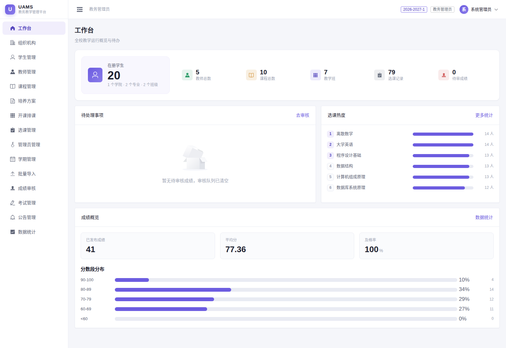

*图 2-2 教务管理员工作台。左侧为教务菜单，右侧为全校概览、待审成绩与选课热度。*

### 2.3 业务主链路

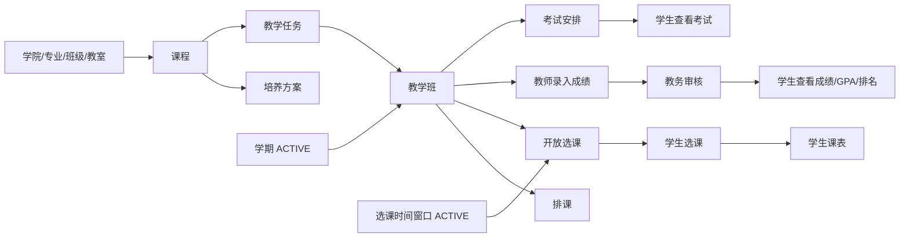

> 关键理解：**“开放选课”不是全校一个总开关**。它至少涉及三层：课程必须是选修课、教学班必须开放选课、学期与选课时间窗口必须处于有效状态。任何一层不满足，学生端都可能看不到或选不了。

---

## 3. 登录、退出与账号安全

### 3.1 登录

**入口**：浏览器打开系统地址，默认进入 `/login`。

**操作步骤**：

1. 在“学号 / 工号 / 用户名”输入框输入账号：
   - 学生：学号（或管理员单独设置的登录名）；
   - 教师：工号（或管理员单独设置的登录名）；
   - 管理员：管理员登录名。
2. 在“密码”输入框输入密码。
3. 点击「登 录」。
4. 登录成功后，系统按角色跳转：
   - 学生 → `/student/dashboard`；
   - 教师 → `/teacher/dashboard`；
   - 教务管理员 → `/admin/dashboard`；
   - 教师兼任管理员 → 默认进入其中一个工作台，可通过顶部按钮切换。

**初始密码规则（【已实现】）**：

- 通过“学生管理”新增学生时，如果“初始密码”留空，默认密码为**学号**；
- 通过“教师管理”新增教师时，如果“初始密码”留空，默认密码为**工号**；
- 通过 Excel 批量导入学生，登录名为学号，初始密码为学号；
- 通过 Excel 批量导入教师，登录名为工号，初始密码为工号；
- 管理员账号没有默认密码，创建时必须由管理员设置至少 6 位密码。

> 安全提示：首次登录后请立即使用右上角用户菜单 →「修改密码」修改初始密码。

### 3.2 退出登录

1. 点击右上角用户名（如“系统管理员”）；
2. 在下拉菜单中选择「退出登录」；
3. 在确认框点击「确定」。

退出后系统清除浏览器中的登录令牌，返回登录页。服务端 JWT 为无状态令牌，不维护服务端会话；退出接口为预留接口，前端清理令牌后即视为退出。

### 3.3 修改密码

1. 点击右上角用户名 →「修改密码」；
2. 输入「原密码」「新密码」「确认密码」；
3. 新密码至少 6 位，两次输入必须一致；
4. 点击「确定」。

修改成功后系统提示“密码已修改，请重新登录”，并自动退出，需用新密码重新登录。

### 3.4 登录失败、锁定与 401/403

| 现象 | 原因 | 处理 |
|---|---|---|
| 提示“用户名或密码错误” | 账号或密码不正确 | 核对账号/密码；注意初始密码可能是学号/工号 |
| 连续输错密码 | 默认连续失败 **5 次**后锁定 **15 分钟** | 等待 15 分钟，或联系管理员重置密码（重置后自动解锁） |
| 提示“账号已被锁定” | 登录失败次数达到上限 | 等待锁定到期，或管理员重置密码 |
| 提示“账号已被停用” | 管理员停用了账号 | 联系教务管理员启用账号 |
| 页面突然回到登录页（401） | 令牌过期、无效、账号被停用/删除 | 重新登录；若仍失败联系管理员 |
| 页面提示“没有权限执行该操作”（403） | 当前角色没有该权限，或管理员权限刚被撤销 | 查看提示；若管理员权限被撤销，系统会自动切换回教师/学生工作台或登录页 |

> 401 与 403 的区别：401 表示“登录状态无效”，需要重新登录；403 表示“已登录，但当前身份没有这个权限”。

### 3.5 多标签页与身份变化

系统会监听同一浏览器的登录令牌变化：

- 在另一个标签页退出登录 → 当前标签页会自动清理登录态并回到登录页；
- 在另一个标签页切换为其他账号 → 当前标签页会回到入口，按新身份重新进入对应工作台。

这样可以避免“界面还是旧角色、令牌已经是新账号”的不一致状态。

---
## 4. 管理员端操作手册

> 管理员菜单共 15 项：工作台、组织机构、学生管理、教师管理、课程管理、培养方案、开课排课、选课管理、管理员管理、学期管理、批量导入、成绩审核、考试管理、公告管理、数据统计。

> **关于“用户管理”**：当前系统**没有独立的“用户管理”菜单**。学生账号随“学生管理”建档创建，教师账号随“教师管理”建档创建，管理员账号在“管理员管理”中创建；后端虽有 `/users` 接口，但前端没有提供通用用户列表页面。请分别到对应菜单操作。

### 4.1 工作台

**入口**：`/admin/dashboard`，左侧菜单「工作台」。

**页面内容**：

- **在册学生**大卡片：学生总数，并显示学院数、专业数、班级数；
- 指标条：教师总数、课程总数、教学班、选课记录、待审成绩；
- **待处理事项**：待审核成绩列表，显示课程、学生、成绩、提交时间；点击「去审核」进入成绩审核；
- **选课热度**：本学期选课人数最多的课程排行（默认前 8 条），点击「更多统计」进入数据统计；
- **成绩概览**：已发布成绩条数、平均分、及格率、分数段分布。

**操作**：卡片和“更多/去审核”链接可直接跳转到对应页面。工作台数据在进入页面时加载；若刚完成其他操作，可切换到目标页面或刷新浏览器查看最新数据。

### 4.2 组织机构

**入口**：`/admin/colleges`，左侧菜单「组织机构」。

页面顶部有四个 Tab：**学院、专业、班级、教室**。四个 Tab 的操作方式相同：上方筛选 + 右侧「新增」按钮，列表支持编辑、删除和分页。

#### 4.2.1 学院

**新增学院字段**：

| 字段 | 是否必填 | 说明 |
|---|---|---|
| 学院代码 | 是 | 唯一，最长 20 字符，例如 `CS` |
| 学院名称 | 是 | 例如“计算机科学与技术学院” |
| 说明 | 否 | 多行文本 |
| 状态 | 是 | 启用 / 停用，默认启用 |

**限制**：学院下还有专业或教师时，不能删除。需先处理专业/教师。

#### 4.2.2 专业

**新增专业字段**：

| 字段 | 是否必填 | 说明 |
|---|---|---|
| 专业代码 | 是 | 唯一，最长 20 字符 |
| 专业名称 | 是 | 例如“软件工程” |
| 所属学院 | 是 | 从已存在的学院中选择 |
| 学位类型 | 是 | 本科 / 硕士 / 博士 |
| 学制（年） | 是 | 默认 4 年 |

**限制**：专业下还有班级时不能删除。

#### 4.2.3 班级

**新增班级字段**：

| 字段 | 是否必填 | 说明 |
|---|---|---|
| 班级代码 | 是 | 唯一，最长 30 字符 |
| 班级名称 | 是 | 例如“软件工程2026-1班” |
| 所属专业 | 是 | 从已存在的专业中选择 |
| 年级 | 是 | 入学年份，例如 2026 |
| 辅导员 | 否 | 从教师中选择 |

**限制**：班级下还有学生时不能删除。

#### 4.2.4 教室

**新增教室字段**：

| 字段 | 是否必填 | 说明 |
|---|---|---|
| 教室号 | 是 | 唯一，例如 `A-301` |
| 楼栋 | 是 | 例如“A楼” |
| 容量 | 是 | 大于 0，最大 2000 |
| 类型 | 是 | 普通教室 / 实验室 / 多媒体教室 |
| 状态 | 是 | 可用 / 维护中 / 停用 |

**限制**：教室已被排课占用时不能删除；排课时教室容量必须不小于教学班容量（见 4.8）。

### 4.3 学生管理

**入口**：`/admin/students`，左侧菜单「学生管理」。

**筛选条件**：关键字（学号或姓名）、学院、专业、班级；点击「查询」。

**列表字段**：学号、姓名、性别、班级、专业/学院、入学年份、学籍状态、已修学分、绩点、操作。

**新增学生字段**：

| 字段 | 是否必填 | 说明 |
|---|---|---|
| 学号 | 是 | 唯一，同时作为默认登录名 |
| 姓名 | 是 | |
| 班级 | 是 | 选择已存在的行政班；专业和学院由班级自动带出 |
| 性别 | 否 | 男 / 女 / 未填写 |
| 出生日期 | 否 | |
| 入学年份 | 是 | 例如 2026 |
| 邮箱 | 否 | 系统要求邮箱唯一（数据库唯一约束） |
| 手机 | 否 | 手机号不要求唯一 |
| 初始密码 | 否 | 留空则默认密码为学号；长度至少 6 位 |

**编辑学生**：

- 学号不可修改；
- 可修改姓名、班级、性别、出生日期、学籍状态、邮箱、手机；
- 修改班级时，专业和学院自动随新班级更新；
- 学籍状态可选：在读、休学、毕业、退学。

**删除学生**：该学生已有选课记录时不能删除（提示“该学生有 N 条选课记录，无法删除”）。

**常见提示**：

- “学号已存在”：学号重复；
- “登录名已被占用”：登录名与已有账号重复；
- 邮箱重复时数据库会拒绝保存；当前可能返回 500 内部错误，而不是友好的“邮箱已存在”提示（见 12.11）；
- 班级不存在：先维护班级。

> **重要提示（邮箱留空/重复）**：前端会把“邮箱留空”提交为空字符串 `""`。由于邮箱有唯一约束，连续新增两个邮箱都为空的档案时，第二个可能返回 500 内部错误；填写重复邮箱也会出现同样问题。建议为每个档案填写唯一邮箱；如确实没有邮箱，请联系技术人员处理。该问题见 12.11。

### 4.4 教师管理

**入口**：`/admin/teachers`，左侧菜单「教师管理」。

**筛选条件**：学院、关键字（工号或姓名）。

**列表字段**：工号、姓名、性别、所属学院、职称、入职日期、状态、操作。

**新增教师字段**：

| 字段 | 是否必填 | 说明 |
|---|---|---|
| 工号 | 是 | 唯一，同时作为默认登录名 |
| 姓名 | 是 | |
| 所属学院 | 是 | |
| 职称 | 否 | 助教 / 讲师 / 副教授 / 教授 |
| 性别 | 否 | |
| 入职日期 | 否 | |
| 邮箱 | 否 | 唯一 |
| 手机 | 否 | |
| 初始密码 | 否 | 留空则默认密码为工号；至少 6 位 |

**编辑教师**：工号不可修改；可修改姓名、学院、职称、性别、入职日期、状态、邮箱、手机。状态可选：在职、离岗、退休。

**删除教师**：教师已担任教学班授课教师时不能删除（提示“该教师有 N 个教学班，无法删除”）；需先调整/删除相关教学班。

> **邮箱提示**：与新增学生相同，邮箱留空或重复时，第二个档案可能返回 500 内部错误。建议填写唯一邮箱或联系技术人员（见 12.11）。

### 4.5 课程管理

**入口**：`/admin/courses`，左侧菜单「课程管理」。

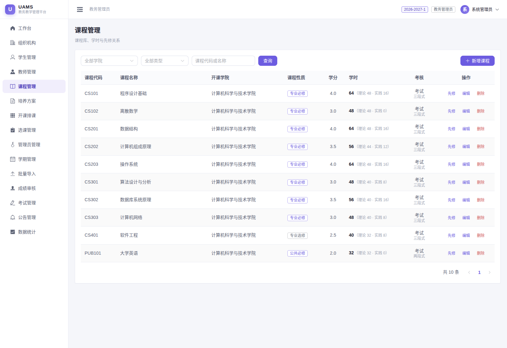

*图 4-1 课程管理列表。列表显示课程代码、名称、开课学院、课程性质、学分、学时、考核方式。*

**筛选条件**：开课学院、课程类型、关键字（课程代码或名称）。

**新增 / 编辑课程字段**：

| 字段 | 是否必填 | 说明 |
|---|---|---|
| 课程代码 | 是 | 唯一，最长 30 字符 |
| 课程名称 | 是 | 最长 100 字符 |
| 开课学院 | 是 | |
| 课程类型 | 是 | 专业必修 / 专业选修 / 公共必修 / 公共选修 / 实践 |
| 学分 | 是 | 大于 0，最多 30，支持 0.5 步长 |
| 总学时 | 是 | 0~500 |
| 理论学时 | 是 | 0~500 |
| 实践学时 | 是 | 0~500 |
| 考核方式 | 是 | 考试 / 考查 |
| 课程简介 | 否 | 多行文本 |

**关键规则（【已实现】）**：

1. **理论学时 + 实践学时必须等于总学时**。不满足时页面直接提示，无法提交。
2. **成绩考核结构由总学时自动决定，不能手动选择**：
   - 总学时 ≤ 32：两段式，平时 20% + 期末 80%，**没有期中**；
   - 总学时 > 32：三段式，平时 20% + 期中 30% + 期末 50%。
3. **实践学时 > 0** 表示课程含实践考试/实践成绩；教师录入时会出现理论/实践拆分列。
4. **课程类型决定选课方式**：
   - 专业选修（`ELECTIVE`）、公共选修（`PUBLIC_ELECTIVE`）：学生可以自主选择；
   - 专业必修（`REQUIRED`）、公共必修（`PUBLIC_REQUIRED`）、实践（`PRACTICE`）：**不进入学生自主选课列表**，由教务预安排。
5. 课程已有教学任务时不能删除。
6. 课程已有“已提交/已审核”成绩时，不能修改总学时、理论学时、实践学时（避免改变历史成绩的考核结构）。

**先修课程**：

1. 在课程列表点击某门课的「先修」；
2. 在弹窗中选择“先修课程”，填写“最低成绩”（默认 60）；
3. 点击「添加」；
4. 已添加的先修关系显示课程代码、名称、最低成绩，可点击「移除」；
5. 系统会自动检测环路（例如 A→B→A），形成环路时拒绝添加。

> 先修课程会在学生选课时校验：学生必须已有该先修课程的**已审核通过**成绩，且成绩不低于最低分，否则不能选课。

### 4.6 培养方案

**入口**：`/admin/curriculum`，左侧菜单「培养方案」。

**新增方案字段**：

| 字段 | 是否必填 | 说明 |
|---|---|---|
| 方案代码 | 是 | 唯一；编辑时不可修改 |
| 方案名称 | 是 | |
| 适用专业 | 是 | 编辑时不可修改 |
| 适用年级 | 是 | 编辑时不可修改 |
| 毕业总学分 | 是 | 大于 0 |
| 必修学分 | 是 | |
| 选修学分 | 是 | |
| 状态 | 是 | 草稿 / 已发布 / 已归档 |

**为方案添加课程**：

1. 在方案列表点击「课程」；
2. 弹窗顶部显示毕业总学分、必修学分、选修学分；
3. 选择课程、建议学期（第 1~8 学期）、是否必修，点击「添加」；
4. 已添加课程显示课程代码、名称、学分、建议学期、性质（必修/选修），可「移除」；
5. 同一方案不能重复添加同一门课程。

**限制**：同一专业 + 同一适用年级只能有一个培养方案。

> 说明：培养方案用于教学规划与展示；当前学生选课/毕业审核并不以培养方案作为强制过滤条件。学生可选课程由课程性质、教学班、学期与时间窗口决定（见第 8 章）。

---
### 4.7 学期管理

**入口**：`/admin/terms`，左侧菜单「学期管理」。

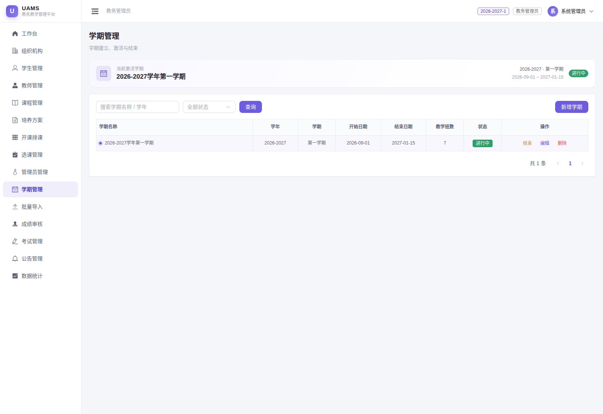

*图 4-2 学期管理。页面顶部显示“当前激活学期”，列表中按状态显示「激活」「结束」等操作。*

#### 4.7.1 查看当前激活学期

页面顶部“当前激活学期”区域会显示：

- 学期名称（如“2026-2027学年第一学期”）；
- 学年与学期序号（第一学期/第二学期）；
- 开始日期 ~ 结束日期；
- 状态标签“进行中”。

如果没有任何进行中的学期，会提示“暂无进行中的学期”，并说明可在下方列表激活一个“未开始”的学期。

#### 4.7.2 新增学期

1. 点击右上角「新增学期」；
2. 填写：

| 字段 | 是否必填 | 说明 |
|---|---|---|
| 学期名称 | 是 | 例如“2026-2027学年第一学期” |
| 学年 | 是 | 例如“2026-2027”，最长 9 字符 |
| 学期序号 | 是 | 第一学期 / 第二学期 |
| 开始日期 | 是 | |
| 结束日期 | 是 | 必须晚于开始日期 |

3. 点击「确定」。

**新建学期的状态**：默认是“未开始（PLANNED）”。新建后还**不能**用于学生选课，必须执行“激活”。

**唯一性**：同一“学年 + 学期序号”只能存在一个学期。例如 `2026-2027` 的第一学期不能重复创建。

#### 4.7.3 激活学期（设置为 ACTIVE）

**前置条件**：学期状态为“未开始”；系统中当前没有其他“进行中”的学期。

**操作**：

1. 在学期列表找到状态为“未开始”的学期；
2. 点击操作列的「激活」；
3. 在确认框点击「激活」。

**结果**：该学期状态变为“进行中”，页面顶部“当前激活学期”更新。

**常见失败原因**：

| 提示 | 原因 | 解决 |
|---|---|---|
| 已存在进行中的学期，不能同时激活多个学期 | 系统中已有一个 ACTIVE 学期 | 先结束旧学期，或直接使用当前进行中的学期 |
| 已结束的学期不能激活 | 该学期已经是 ENDED | 不能再激活；需要新学期的请新建 |
| 结束日期必须晚于开始日期 | 日期填写错误 | 修改日期 |

> **关键规则**：全系统最多只能有一个“进行中”的学期。学生选课、成绩录入等业务依赖学期状态。

#### 4.7.4 结束学期

**前置条件**：该学期状态为“进行中”。

1. 在列表点击「结束」；
2. 确认框点击「结束」。

**结果**：状态变为“已结束”。结束后：

- 不能再次激活；
- 不能修改状态；
- 不能新增/修改/删除该学期的教学班与排课；
- 学生不能在该学期继续选课或退课。

> 结束学期前请确认：成绩录入、审核、退课等业务已经完成。该操作不可逆（不能重新激活）。

#### 4.7.5 编辑与删除学期

- **编辑**：可修改名称、学年、学期序号、起止日期；不能通过编辑直接改状态，状态必须走「激活」「结束」。
- **删除**：该学期下已有教学班时不能删除（提示“该学期下存在 N 个教学班，无法删除”）。需先处理教学班。

### 4.8 开课排课

**入口**：`/admin/teaching`，左侧菜单「开课排课」。

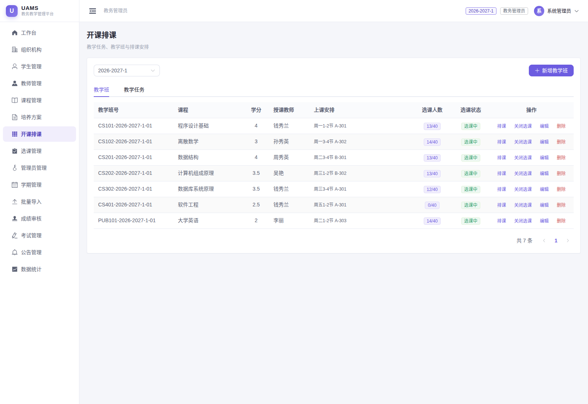

*图 4-3 开课排课。页面有两个 Tab：教学班、教学任务；上方可切换学期。*

#### 4.8.1 学期选择

页面顶部有学期下拉框（如 `2026-2027-1`）。教学任务和教学班都按该学期过滤。

> **注意**：下拉框中的学期来自“浏览器日期推断”，不是从“学期管理”的 ACTIVE 学期读取。如果下拉框中没有你想操作的学期，请先确认学期管理中存在该学年学期；若日期推断与学校实际学期不一致，请手动切换下拉框（详见第 12 章限制）。

#### 4.8.2 教学任务

**Tab**：点击「教学任务」。

**列表字段**：学期、课程代码、课程名称、承担学院、计划/实际开班、状态、操作（删除）。

**新增教学任务**：

1. 确保当前 Tab 是「教学任务」；
2. 点击「新增教学任务」；
3. 填写：

| 字段 | 是否必填 | 说明 |
|---|---|---|
| 学期 | 是 | 默认当前选择学期 |
| 课程 | 是 | 从课程库选择，支持搜索 |
| 承担学院 | 是 | 默认第一个学院，可修改 |
| 计划开班数 | 否 | 默认 1，最大 50 |

4. 点击「确定」。

**结果**：提示“教学任务已创建”，列表出现该任务，状态为“已确认”。

**限制**：

- 同一学期 + 同一课程 + 同一承担学院只能有一个教学任务；
- 任务下已有教学班时不能删除；
- 当前界面**没有“编辑教学任务”按钮**，只能删除后重新创建（后端有修改接口，但前端未提供入口）。

#### 4.8.3 教学班

**Tab**：点击「教学班」。

**列表字段**：教学班号、课程、学分、授课教师、上课安排、选课人数、选课状态、操作（排课、安排学生、开放/关闭选课、编辑、删除）。

**新增教学班前置条件**：

1. 当前选择的学期在“学期管理”中存在；
2. 该学期状态不是“已结束”；
3. 该课程已有**教学任务**；
4. 已有可选的授课教师（教师档案存在且账号类别为教师）。

**新增教学班步骤**：

1. 确保当前 Tab 是「教学班」；
2. 点击「新增教学班」；
3. 填写：

| 字段 | 是否必填 | 说明 |
|---|---|---|
| 教学班号 | 是 | 例如 `CS401-2026-2027-1-01`；同一学期内唯一，跨学期可重复 |
| 教学任务 | 是 | 选择当前学期的教学任务；课程、学期由任务带入 |
| 所属学期 | 自动 | 显示当前选择学期对应的学期实体；若不存在会提示先创建 |
| 授课教师 | **是（后端必填）** | 从教师列表选择；界面未标红色星号，但不选会提交失败 |
| 容量 | 是 | 大于 0，最大 1000；默认 40 |

4. 点击「确定」。

**结果**：提示“教学班已创建”，列表出现教学班，选课状态默认“未开放”。

**关键规则**：

- 教学班所属学期、所属课程创建后**不可修改**；
- 授课教师必须具有教师账号身份；纯管理员账号不能作为授课教师；
- 教学班号在同一学期内唯一；
- 已结束学期不能新增教学班；
- 容量不能小于已选人数；
- 删除教学班：已有学生选课或已有成绩记录时不能删除；
- 更换授课教师：若该教学班已有“待审核/已通过”成绩，不能更换；若该教师已有时间冲突的排课，也不能更换。

**安排学生 / 教学班名单（FIX-002）**：

- 入口：教学班列表 → 操作列「安排学生」；
- 弹窗包含「批量安排」与「当前名单」两个 Tab；
- 批量安排支持按行政班/专业/学院选择范围，先「预览安排」，再二次确认提交；
- 当前名单显示学号、姓名、行政班、专业、安排来源、安排时间、状态，并支持手动添加/移除；
- 已有成绩记录的学生不能被移除；
- 详细操作见 4.10。

#### 4.8.4 排课

**入口**：教学班列表 → 操作列「排课」。

**排课弹窗字段**：

| 分组 | 字段 | 说明 |
|---|---|---|
| 教室 | 教室 | 从教室列表选择；显示教室号和容量 |
| 时间 | 星期 | 周一 ~ 周日 |
| 时间 | 开始节次 / 结束节次 | 1~14 节，结束不能早于开始 |
| 周次 | 开始周 / 结束周 | 1~30 周，结束不能早于开始 |
| 周次 | 周类型 | 每周 / 单周 / 双周 |

**操作**：

1. 选择教室、星期、节次、周次、周类型；
2. 点击「添加」；
3. 成功后弹窗下方“已排课列表”出现该安排；
4. 可对已排课点击「编辑」修改，或「删除」；
5. 关闭弹窗。

**系统自动检测的冲突（【已实现】）**：

1. **教学班自身冲突**：同一教学班在同一时间已有其他安排；
2. **教室冲突**：同一教室在同一学期、同一星期、节次重叠、周次重叠（且单双周相容）已被占用；
3. **教师冲突**：同一教师在同一时间已有其他教学班安排。

**其他限制**：

- 教室必须是“可用”状态；
- **教室容量不能小于教学班容量**（这是“排课失败”的常见原因）；
- 已结束学期不能新增/修改/删除排课；
- 单双周课程在同一时段可以共用教室，但“每周”与任何类型都冲突。

> **开放选课的前置条件**：教学班必须已分配授课教师，且**至少有一条排课记录**；否则点击「开放选课」会失败。

#### 4.8.5 开放 / 关闭选课

**入口**：教学班列表 → 操作列「开放选课 / 关闭选课」。

**操作**：

1. 找到目标教学班；
2. 点击「开放选课」；
3. 成功后提示“已开放选课”，状态变为“选课中”。

**重要说明**：

- 这里的“开放选课”只控制**该教学班**的选课状态；
- 学生最终能否看到课程，还取决于：课程必须是选修课、所属学期必须是进行中、选课时间窗口必须开放（见 4.9）；
- 如果对**必修/实践课**点击「开放选课」，系统仍会开放教学班，但会提示：“已开放，但该课程为必修/实践课，学生端不会出现在自主选课列表中；必修课请使用预安排。”这是既有规则，不是故障；
- 关闭选课后，状态变为“未开放”，学生不能再选该班；已选学生退课也会被拒绝（提示“当前不在选课时间内，无法退课”）。

### 4.9 选课管理

**入口**：`/admin/selection`，左侧菜单「选课管理」。

页面分为两部分：**选课时间窗口**、**教学班选课情况**。

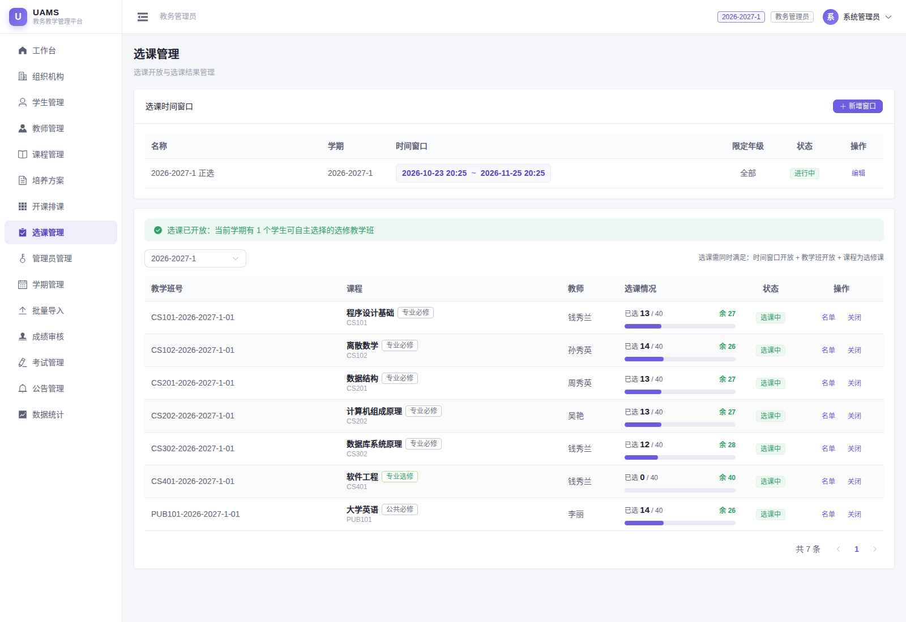

*图 4-4 选课管理。顶部为选课时间窗口；下方为教学班选课情况。绿色提示表示当前有学生可自主选择的选修教学班。*

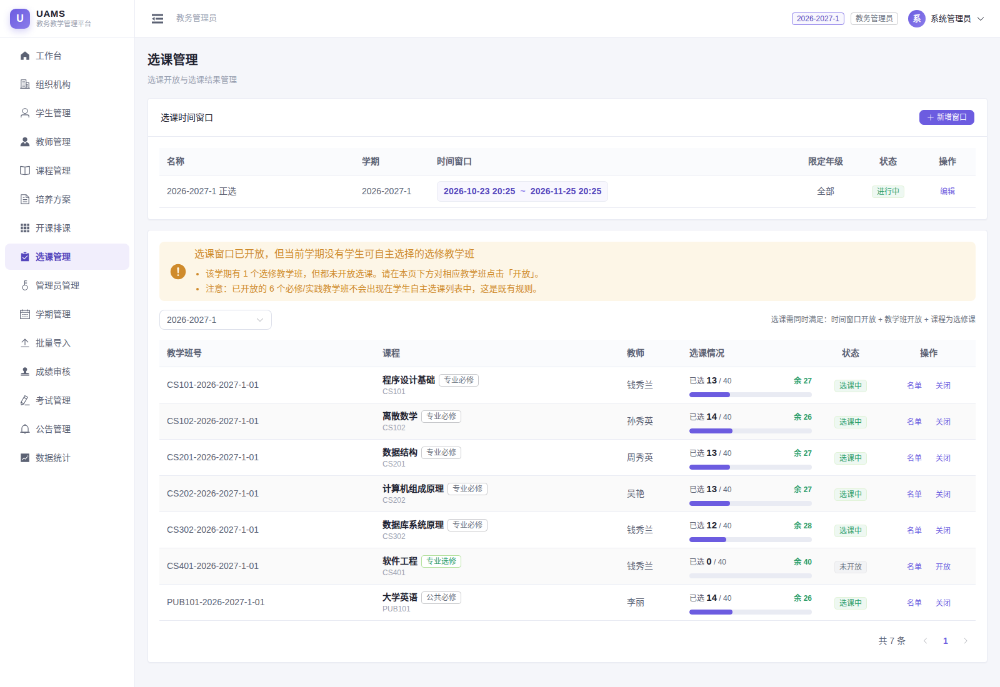

*图 4-5 选课窗口已开放，但所有选修教学班都未开放时的诊断提示。系统会指出缺少的具体配置。*

#### 4.9.1 选课时间窗口

**列表字段**：名称、学期、时间窗口、限定年级、状态、**实际状态**、操作（编辑）。

> “状态”是管理员维护的窗口状态（未开始/进行中/已结束）；“实际状态”由后端按“时间 + 学期”计算：**生效中 / 未开始 / 已过期 / 未激活 / 学期不存在 / 学期未进行（显示学期状态）**。学生端能否选课、退课以后端实际判断为准。

**新增窗口**：

1. 点击「新增窗口」；
2. 填写：

| 字段 | 是否必填 | 说明 |
|---|---|---|
| 学期 | 是 | 例如 `2026-2027-1` |
| 名称 | 是 | 例如“2026-2027-1 正选” |
| 开始时间 | 是 | 精确到分钟 |
| 结束时间 | 是 | 必须晚于开始时间 |
| 限定年级 | 否 | 留空表示全部年级；填写如 2026 表示只允许该年级学生 |
| 状态 | 是 | 未开始 / 进行中 / 已结束 |

3. 点击「确定」。

**学生实际可选/可退的条件**（必须同时满足）：

1. 学期状态 = **进行中（ACTIVE）**；
2. 窗口状态 = **进行中（ACTIVE）**；
3. 当前时间 ≥ 开始时间，且 ≤ 结束时间（边界包含开始/结束时刻）；
4. 如果设置了“限定年级”，学生的入学年份必须等于该年级；
5. 教学班状态为“正常”，且选课状态为“开放中”；
6. 退课还要求：选修课、没有非草稿成绩；必修课由教务安排，学生不能自主退课。

**多窗口重叠规则**：同一学期若存在多个 ACTIVE 窗口，后端按**并集**判断——任一“时间在范围内且年级适用”的窗口开放即可选/退课。学生端展示其中开始时间最晚的一个；管理员端会提示“检测到 N 组 ACTIVE 窗口时间重叠”，建议合并窗口，避免规则难以解释。

> **重要**：状态不会随时间自动变化。例如窗口时间已经到了，但状态仍是“未开始”，学生仍然不能选课；反之，状态是“进行中”但时间已过，后端会按“已过期”拒绝。请同时核对状态与时间。

#### 4.9.2 教学班选课情况

**列表字段**：教学班号、课程（带课程性质标签）、教师、选课情况（已选/容量、余/已满、进度条）、状态（选课中/未开放）、操作（名单、开放/关闭）。

**操作**：

- **名单**：查看该教学班已选学生（学号、姓名、班级）；安排来源、安排时间、手动添加/移除与批量预安排在「开课排课 → 教学班 → 安排学生」中完成（见 4.10）；
- **开放 / 关闭**：切换教学班选课状态；
- 顶部学期下拉框可切换学期；
- 提示文字：“选课需同时满足：时间窗口开放 + 教学班开放 + 课程为选修课”；退课同样校验学期 ACTIVE、窗口实际开放、限定年级和教学班开放；
- “实际状态”列由后端计算；若显示“已过期/未激活/学期不存在/学期未进行”，即使“状态”列写着“进行中”，学生也不能选/退课。

#### 4.9.3 选课配置诊断（【已实现】）

页面会根据后端诊断结果显示三种提示：

| 提示颜色 | 含义 | 管理员应做什么 |
|---|---|---|
| 绿色 | 当前学期有 N 个学生可自主选择的选修教学班 | 无需处理；学生端可见 |
| 黄色 | 选课窗口已开放，但没有学生可自主选择的选修教学班 | 按提示逐条处理：激活学期、创建教学班、把课程设为选修、开放选修班 |
| 蓝色 | 当前学期没有进行中的选课时间窗口 | 在“选课时间窗口”新增/编辑窗口，并把状态设为“进行中” |

黄色提示的常见内容：

- “该学期没有任何教学班” → 先去开课排课创建教学任务与教学班；
- “该学期 N 个教学班中均无可自主选择的选修教学班” → 课程可能全是必修/实践，或教学班已取消；需要创建选修课程的教学班；
- “该学期有 N 个选修教学班，但都未开放选课” → 在本页下方对相应教学班点击「开放」；
- “已开放的 N 个必修/实践教学班不会出现在学生自主选课列表中” → 这是正常规则，不是故障。

> **核心结论**：学生端“可选课程”列表只显示**选修课**。如果管理员只开放了必修课教学班，学生端一定为空。必须存在“选修课程 + 已排课 + 已开放选课 + 学期进行中 + 选课窗口进行中”的教学班。

### 4.10 必修课预安排与教学班名单管理（FIX-002）

**业务规则**：

- 专业必修（`REQUIRED`）、公共必修（`PUBLIC_REQUIRED`）、实践（`PRACTICE`）由教务安排，不进入学生自主选课列表；
- 专业选修、公共选修由学生自主选择；
- 学生端不能自主选择必修课；
- 只有必修/实践课程教学班可以使用「批量安排」；选修课调用会返回 409；
- 同一学生不能在同一教学班重复安排；重复执行批量安排是幂等的；
- 批量安排不会绕过容量、时间冲突、学籍、同课程等业务校验。

**入口**：`/admin/teaching`（开课排课）→「教学班」Tab → 操作列「安排学生」。

弹窗包含两个 Tab：

1. **批量安排**：按行政班/专业/学院批量安排必修课学生；
2. **当前名单**：查看、手动添加、手动移除教学班学生。

#### 4.10.1 批量安排步骤

1. 找到目标必修课教学班，点击「安排学生」；
2. 在「批量安排」Tab 选择范围：
   - 行政班：选择具体行政班；
   - 专业：选择具体专业；
   - 学院：选择具体学院；
3. 点击「预览安排」。系统返回：
   - 匹配学生人数；
   - 已安排人数；
   - 将新增人数；
   - 跳过人数及逐条原因；
   - 当前已选/容量、剩余容量；
   - 时间冲突人数、不符合条件人数；
   - 逐学生预览表（学号、姓名、行政班、专业、结果、原因）；
4. 核对预览结果；预览**不会写库**；
5. 点击「确认安排（新增 N 人）」，在二次确认框中确认；
6. 系统在一个数据库事务中写入所有可新增记录，并刷新名单与教学班人数。

**批量安排结果说明**：

| 预览结果 | 含义 |
|---|---|
| 新增 | 学生将被加入该教学班 |
| 已安排 | 学生已在该教学班，本次不重复添加 |
| 曾移除 | 学生曾从该教学班移除；批量预排不会自动恢复，需在「当前名单」手动添加 |
| 同课程其他班 | 学生已选同一课程的其他教学班，跳过 |
| 时间冲突 | 学生已有课程与该教学班排课时间冲突，跳过 |
| 容量不足 | 教学班剩余容量已用完，后续学生跳过 |
| 学籍无效 | 学生学籍状态不是“在读”，跳过 |

**原子性策略**：

- 预览阶段不写库；
- 正式提交时，所有“新增”记录在**同一个事务**中提交；
- 不符合条件的学生按业务规则跳过，并在结果中逐条报告，不属于“系统失败”；
- 如果数据库提交失败，整批回滚，不会出现“前端提示全部成功但只有部分学生落库”。

#### 4.10.2 当前名单管理

「当前名单」Tab 显示：

| 列 | 说明 |
|---|---|
| 学号、姓名 | 学生基本信息 |
| 行政班、专业 | 学生归属 |
| 安排来源 | 学生自主选课 / 教务批量预安排 / 教务手动添加 / 历史记录（未标记来源） |
| 安排时间 | 该选课/安排记录的 `selected_at`；历史无记录时显示“—” |
| 状态 | 当前有效安排显示“已安排” |
| 操作 | 移除 |

**手动添加**：

1. 在搜索框输入学号或姓名，选择学生；
2. 点击「添加学生」；
3. 后端会校验：教学班有效、学期进行中、学生存在且在读、容量、同课程其他班、时间冲突；
4. 成功后来源记为“教务手动添加”，并写入操作日志。

**手动移除**：

1. 在名单中点击「移除」；
2. 二次确认后执行；
3. 若学生已有成绩记录（含草稿），系统拒绝移除并提示“该学生已有成绩记录，无法移除”；
4. 移除为软删除（状态改为 `DROPPED`），不会删除成绩或历史记录；来源和时间保留。

> 旧数据没有 `source` 字段时显示“历史记录（未标记来源）”；系统不会自动推断或回填历史来源。

#### 4.10.3 安排后的联动

- 教师端「我的课程 → 名单」立即能看到被安排的学生；
- 学生端「我的课表」立即能看到被安排必修课的上课时间/教室（需教学班已排课）；
- 教务端教学班列表的“已选人数/剩余容量”刷新后更新；
- 学生端不需要再次自主选课；
- 关键安排/移除操作写入 `operation_logs`，可在日志中追溯操作人、时间、教学班、学生与结果。

#### 4.10.4 前置条件与限制

- 教学班必须存在、状态为“正常”，所属学期必须为“进行中”；
- 教学班必须已分配授课教师且至少有一条排课，否则安排/手动添加会提示“尚未分配授课教师/尚未安排上课时间”；
- 课程必须是专业必修/公共必修/实践；
- 学生必须存在且学籍状态为“在读”；
- 批量安排不要求学生选课时间窗口开放；它由教务在选课窗口之外执行；
- 教学班容量不会被突破：容量不足时，按学生顺序能安排多少安排多少，其余逐条报告“容量不足”；
- 已结束学期的教学班不能安排/移除；
- 已被移除的学生不会被后续批量预排自动恢复，需手动添加；
- 不允许通过普通界面删除已有成绩记录；需先按成绩管理流程处理成绩。

---
### 4.11 成绩审核

**入口**：`/admin/grades`，左侧菜单「成绩审核」。

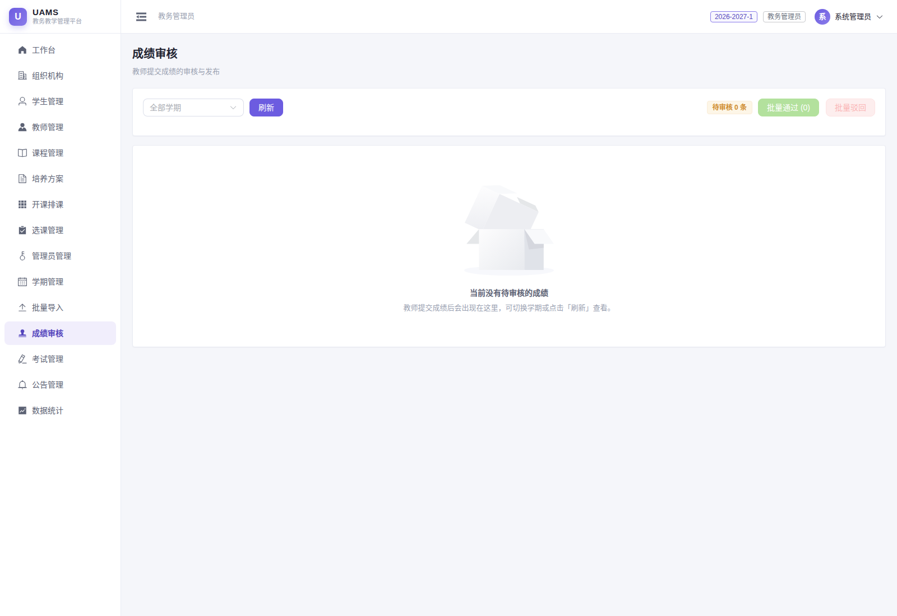

*图 4-6 成绩审核。默认展示待审核列表；可按学期筛选，支持整班审核。*

**页面内容**：

- 学期筛选（默认“全部学期”，可切换）；
- 「刷新」按钮；
- “待审核 N 条”标签；
- 「批量通过」「批量驳回」按钮（需先勾选成绩）；
- 按教学班分组的成绩卡片/表格。

**整班通过 / 整班驳回**：

1. 找到目标教学班分组；
2. 点击「整班通过」或「整班驳回」；
3. 通过：确认后该班所有待审核成绩变为“已通过”；
4. 驳回：必须输入驳回原因（不能为空，最多 500 字），确认后该班成绩变为“已驳回”。

**单条通过 / 驳回**：

1. 在表格中勾选一条或多条成绩；
2. 点击「批量通过」/「批量驳回」，或直接点击行尾「通过」/「驳回」；
3. 驳回时输入原因。

**审核结果**：

- **通过**：成绩状态变为“已通过（APPROVED）”；学生可在“我的成绩”中看到；教师不能直接修改；
- **驳回**：成绩状态变为“已驳回（REJECTED）”；教师可在成绩录入页看到驳回原因，修改后重新提交。

**限制与失败原因**：

| 提示 | 原因 | 解决 |
|---|---|---|
| 只有已提交的成绩可以审核 | 选了草稿/已通过/已驳回的成绩 | 只选择“待审核”成绩；刷新后重试 |
| 驳回原因不能为空 | 未填写原因 | 输入具体原因，如“平时成绩偏高，请复核” |
| 待审核列表为空 | 没有教师提交，或学期筛选不对 | 切换为“全部学期”或刷新；确认教师已提交 |
| 审核后学生仍看不到 | 学生成绩页只显示 APPROVED；或学期筛选不对 | 确认状态为“已通过”；让学生清空/切换学期筛选 |
| 已通过成绩要修改 | 当前界面没有“撤销通过”或“修改已通过成绩”的入口 | 属于限制，见第 12 章；需联系系统管理员/技术人员处理 |

> 说明：审核页表格显示“平时、期末、总评、绩点、学分”，不逐列显示期中/实践拆分；这些数据在教师成绩单和学生成绩页中可见。

### 4.12 考试管理

**入口**：`/admin/exams`，左侧菜单「考试管理」。

**筛选**：顶部学期下拉框。

**创建考试**：

1. 点击「创建考试」；
2. 填写：

| 字段 | 是否必填 | 说明 |
|---|---|---|
| 教学班 | 是 | 选择该学期教学班 |
| 考试类型 | 是 | 期末 / 补考 / 重修 |
| 考试日期 | 是 | |
| 开始时间 | 是 | |
| 结束时间 | 是 | 必须晚于开始时间 |
| 时长（分钟） | 是 | 10~480，默认 120 |

3. 点击「确定」。

**规则**：同一教学班 + 同一考试类型只能有一场考试（例如同一教学班不能创建两场“期末”考试）。

**设置考场**：

1. 在考试行点击「考场」；
2. 选择教室，填写考场容量（不能超过教室容量），点击「添加考场」；
3. 同一教室不能重复添加为同一场考试的考场；
4. 弹窗下方显示已设置考场及“已排/容量”。

**自动排座**：

1. 先设置至少一个考场；
2. 点击「排座」；
3. 系统按该教学班已选学生顺序分配座位；
4. 若考场总容量小于考生人数，会提示容量不足；
5. 排座会清除旧分配并重新分配。

**发布**：

1. 点击「发布」；
2. 确认后学生可在“考试安排”中看到该考试；
3. 已发布状态不能再点击“发布”；学生只看到已发布考试。

**删除**：删除考试会移除该考试及其考场/座位数据；请谨慎操作。

### 4.13 批量导入

**入口**：`/admin/imports`，左侧菜单「批量导入」。

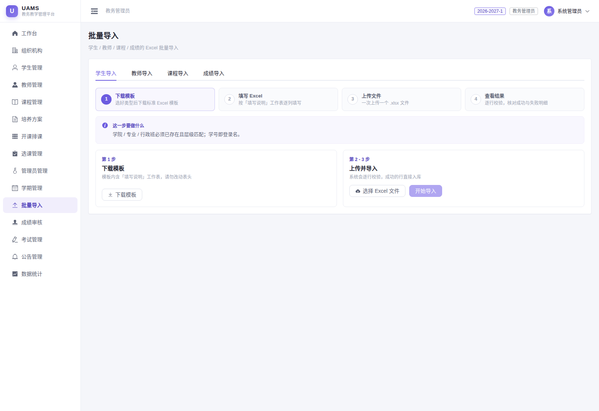

*图 4-7 批量导入。四个 Tab：学生导入、教师导入、课程导入、成绩导入；按“下载模板 → 填写 → 上传 → 查看结果”操作。*

#### 4.13.1 通用流程

1. 选择导入类型 Tab；
2. 点击「下载模板」；
3. 在 Excel 的“导入模板”工作表填写数据，不要修改首行表头；
4. 点击「选择 Excel 文件」，选择 `.xlsx` 文件；
5. 点击「开始导入」；
6. 查看“导入结果”：总行数、成功、失败、错误明细（Excel 行号、出错列、原因）。

**文件限制**：

- 仅支持 `.xlsx`；
- 单个文件不超过 10 MB；
- 系统读取**第一个工作表**作为数据区；模板中的“填写说明”是第二个工作表，不会被当作数据。

**部分成功**：系统逐行校验，成功的行直接入库，失败的行在结果中列出；修正失败行后可重新上传。

> **重新上传注意**：已经成功的行如果再次上传，会被识别为“学号/工号已存在”等重复错误。建议从修正文件中删除已成功的行，只上传失败行。

#### 4.13.2 学生导入

**模板列**：学号、姓名、登录名、学院、专业、行政班。

| 列 | 是否必填 | 说明 |
|---|---|---|
| 学号 | 是 | 唯一；默认作为登录名 |
| 姓名 | 是 | |
| 登录名 | 否 | 留空时使用学号 |
| 学院 | 是 | 必须与系统中已存在的学院名称完全一致 |
| 专业 | 是 | 必须与系统中已存在且属于该学院的专业名称一致 |
| 行政班 | 是 | 必须与系统中已存在且属于该专业的班级名称一致 |

- 入学年份由行政班的年级自动带入，无需填写；
- 系统不会自动创建学院/专业/班级；
- 初始密码为学号。

#### 4.13.3 教师导入

**模板列**：工号、姓名、学院、职称、性别、联系电话。

| 列 | 是否必填 | 说明 |
|---|---|---|
| 工号 | 是 | 唯一；同时作为登录名；初始密码为工号 |
| 姓名 | 是 | |
| 学院 | 是 | 必须已存在 |
| 职称 | 否 | 教授 / 副教授 / 讲师 / 助教 |
| 性别 | 否 | 男 / 女 / 未知 |
| 联系电话 | 否 | |

#### 4.13.4 课程导入

**模板列**：课程代码、课程名称、学院、学分、总学时、理论学时、实践学时、课程性质。

| 列 | 是否必填 | 说明 |
|---|---|---|
| 课程代码 | 是 | 唯一 |
| 课程名称 | 是 | |
| 学院 | 是 | 必须已存在 |
| 学分 | 是 | 大于 0；系统不自动按学时换算学分 |
| 总学时 | 是 | |
| 理论学时 | 是 | |
| 实践学时 | 是 | 理论 + 实践必须等于总学时 |
| 课程性质 | 是 | 专业必修 / 专业选修 / 公共必修 / 公共选修 / 实践 |

- 考核方式由总学时自动决定，模板不填写；
- 实践学时 > 0 的课程才有实践成绩。

#### 4.13.5 成绩导入

**前置条件**：先选择教学班。模板会根据该教学班带出学生名单和课程考核结构。

**模板固定列**（系统生成，请勿修改）：学号、姓名、班级、课程代码、课程名称、教学班。

**成绩列**（由课程结构决定）：

- 所有课程：平时成绩、期末成绩（或期末理论/期末实践）、补考成绩；
- 总学时 > 32：增加期中成绩（或期中理论/期中实践）；
- 实践学时 > 0：期中/期末必须理论、实践成对填写；补考分理论补考/实践补考。

**规则**：

- 每格 0~100 分，留空表示暂不录入；
- 总评、绩点、是否及格由系统统一计算；
- 导入成绩一律保存为**草稿**，不会直接提交审核；
- 已提交/已审核的成绩不能被导入覆盖；
- 教师只能导入本人授课教学班的成绩；教务管理员可导入任意教学班；
- 补考成绩只允许在对应期末成绩不及格（<60）时填写。

---
### 4.14 公告管理

**入口**：`/admin/announcements`，左侧菜单「公告管理」。

**新增/发布公告**：

1. 点击「发布公告」；
2. 填写：

| 字段 | 是否必填 | 说明 |
|---|---|---|
| 标题 | 是 | 最多 200 字 |
| 面向对象 | 是 | 全体 / 学生 / 教师，默认全体 |
| 置顶 | 否 | 开关，默认关闭 |
| 内容 | 是 | 多行文本 |

3. 点击「确定」。新建公告默认为“草稿”状态。

**发布/撤回**：

- 草稿或已撤回的公告：操作列显示「发布」；点击后状态变为“已发布”，并记录发布时间；
- 已发布的公告：操作列显示「撤回」；撤回后普通学生/教师不再看到；
- 可编辑、删除公告。

**可见性规则**：

- **账号类别为 ADMIN 的独立管理员**：可以看到全部公告（包括草稿、已撤回）；
- **教师兼任管理员**（账号类别仍是 TEACHER）：公告列表按教师身份过滤，只能看到“已发布”且面向“全体”或“教师”的公告；草稿/面向学生的公告可能不在列表中（见第 12 章）；
- 学生：只看到“已发布”且面向“全体”或“学生”的公告；
- 教师：只看到“已发布”且面向“全体”或“教师”的公告；
- 排序：置顶优先，其次按发布时间倒序。

### 4.15 数据统计

**入口**：`/admin/statistics`，左侧菜单「数据统计」。

**页面内容**：

1. **全校概览**：学院、专业、班级、学生、教师、课程、教学班、选课记录数量；
2. **成绩分布**：按学期统计已审核成绩的条数、平均分、及格率、分数段（90-100、80-89、70-79、60-69、<60）；
3. **选课热度 Top 10**：按学期统计选课人数最多的课程。

**操作**：顶部切换学期，点击「刷新」。

**统计口径**：

- 成绩分布只统计“已通过（APPROVED）”且有总评的成绩；
- 选课热度只统计“已选（SELECTED）”的选课记录；
- 学期切换只影响成绩分布和选课热度；全校概览是全校累计数量。

### 4.16 管理员管理与权限

**入口**：`/admin/admins`，左侧菜单「管理员管理」。

**核心规则（【已实现】）**：

- 管理员身份**以角色 `ACADEMIC_ADMIN` 为准**，不是账号类别 `user_type`；
- 教师被授予管理员后，账号类别仍是“教师”，教学班、课表、成绩归属完全不变；
- 撤销管理员角色只删除角色关联，不删除账号，不动任何教学数据；
- 系统至少保留一个可用的管理员账号；
- 不能撤销/停用当前登录账号自己。

**页面操作**：

#### 新建管理员账号

1. 点击「新建管理员账号」；
2. 填写「登录名」「姓名」「初始密码」；
3. 初始密码至少 6 位，系统不提供默认/通用密码；
4. 点击「确定」。

新建的账号是“独立管理员”（不关联教师档案），拥有教务端全部权限。

#### 从教师中授权

1. 点击「从教师中授权」；
2. 选择教师（已被授权的教师不会出现在候选列表）；
3. 点击「确定授权」。

结果：该教师同时拥有教师和管理员身份；顶部会出现工作台切换按钮；教学数据不变。

#### 撤销管理员权限

1. 在管理员列表找到目标账号；
2. 点击「撤销权限」；
3. 确认框说明“撤销后立即失去管理员权限，但账号与全部教学数据保留”；
4. 点击「撤销」。

限制：不能撤销自己；不能撤销唯一可用的管理员；对方已是管理员才能撤销。

#### 重置密码

1. 点击「重置密码」；
2. 输入新密码（6~128 位）；
3. 点击「确定」。

重置后会清除登录失败锁定，可用新密码登录；如果账号本身是“已停用”状态，仍需单独点击「启用」。系统不会显示或生成默认密码。

#### 停用 / 启用账号

- 点击「停用」后账号无法登录；点击「启用」恢复；
- 不能停用当前登录账号自己；
- 不能停用唯一可用的管理员。

#### 变更记录

1. 点击某管理员的「变更记录」；
2. 弹窗显示：时间、操作（授予管理员/撤销管理员/启用账号/停用账号）、操作人、说明；
3. 该记录用于追溯管理员权限变化。

> **限制**：系统后端有通用操作日志接口 `/audit-logs`（支持按动作、操作人、资源类型/ID 过滤），但当前前端**没有独立的“操作日志”菜单或通用查询页面**；界面只提供管理员权限变更记录。其他业务操作日志的查询能力属于“后端已实现、前端未提供入口”，见第 12 章。

---

## 5. 教师端操作手册

### 5.1 教师登录与工作台

**入口**：`/teacher/dashboard`，左侧菜单「工作台」。

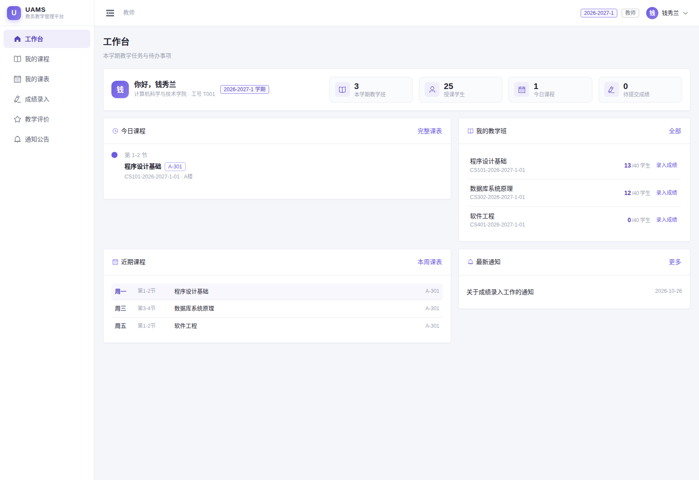

*图 5-1 教师工作台。显示本学期教学班、授课学生、今日课程、待提交成绩，以及今日课程/我的教学班/近期课程/最新通知。*

**页面内容**：

- 顶部问候：姓名、所属学院、工号、当前学期；
- 指标：本学期教学班、授课学生、今日课程、待提交成绩；
- **今日课程**：按节次显示今天的课程、教室、教学班号；
- **我的教学班**：课程名称、教学班号、已选/容量、学生数；点击「录入成绩」进入成绩录入；
- **近期课程**：本学期已排课程（最多 8 条）；
- **最新通知**：面向教师/全体的已发布公告。

> “待提交成绩”统计口径：该教师的教学班中，存在草稿或已驳回成绩的教学班数量。

### 5.2 我的课程与学生名单

**入口**：`/teacher/courses`，左侧菜单「我的课程」。

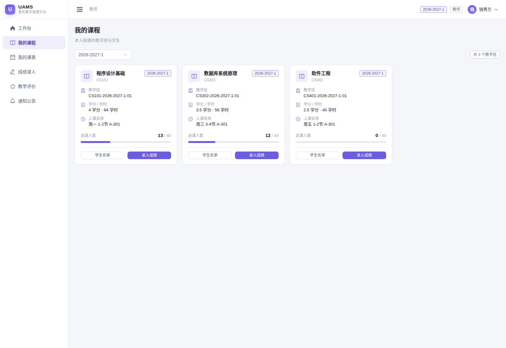

*图 5-2 我的课程。可选择学期，查看本人教学班的课程、学分/学时、上课安排、选课人数。*

**操作**：

1. 顶部选择学期；
2. 页面显示本人授课教学班卡片；
3. 点击「学生名单」查看该班已选学生（学号、姓名、班级）；
4. 点击「录入成绩」进入该班成绩录入。

**限制**：

- 只显示当前登录教师本人授课的教学班（后端按 token 身份校验）；
- 若本学期没有教学班，显示“本学期暂无授课安排，可切换其他学期查看”；
- 教学班必须已分配给你（`teacher_id` 指向你的教师档案），否则不会出现。

### 5.3 我的课表

**入口**：`/teacher/schedule`，左侧菜单「我的课表」。

**操作**：

1. 选择学期；
2. 可选择“全部周次”或具体第 1~20 周；
3. 页面以周课表网格显示本人授课安排；
4. 顶部显示“共 N 门次安排”。

**说明**：

- 课表由“教学班 + 排课”实时推导；
- 单双周课程按周次类型显示；
- 若该学期没有排课，显示“本学期暂无授课安排”。

### 5.4 成绩录入

**入口**：`/teacher/grades`，左侧菜单「成绩录入」。

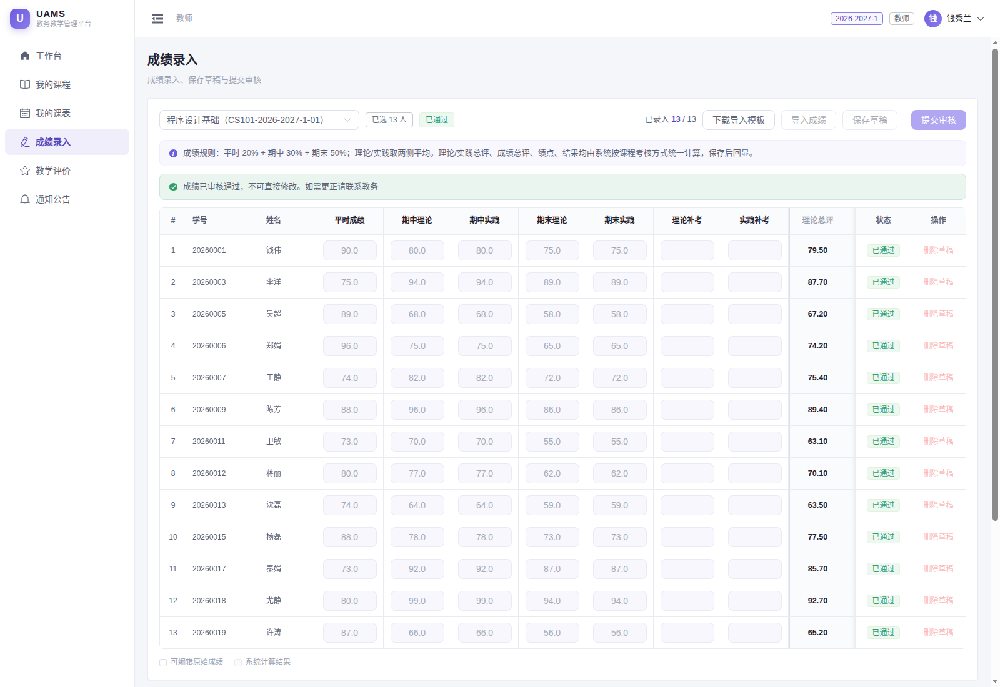

*图 5-3 成绩录入。选择教学班后，可生成成绩单、导入成绩、保存草稿、提交审核。*

#### 5.4.1 选择教学班与生成成绩单

1. 在顶部下拉框选择教学班（显示“课程名称（教学班号）”）；
2. 若该班尚未生成成绩单，工具栏显示「生成成绩单」；
3. 点击「生成成绩单」，系统按该班“已选学生”生成成绩草稿行（幂等，不会重复生成）；
4. 生成后显示学生名单、录入状态、成绩输入框。

> 没有学生选课的教学班，生成后仍为空，无法录入。

#### 5.4.2 考核结构与录入列

成绩录入列由课程属性自动决定，教师不能更改：

| 条件 | 录入列 | 计算列 |
|---|---|---|
| 总学时 ≤ 32，无实践 | 平时成绩、期末成绩、补考成绩 | 理论总评、成绩总评、绩点、结果 |
| 总学时 > 32，无实践 | 平时成绩、期中成绩、期末成绩、补考成绩 | 理论总评、成绩总评、绩点、结果 |
| 实践学时 > 0，总学时 ≤ 32 | 平时、期末理论、期末实践、理论补考、实践补考 | 理论总评、实践总评、成绩总评、绩点、结果 |
| 实践学时 > 0，总学时 > 32 | 平时、期中理论、期中实践、期末理论、期末实践、理论补考、实践补考 | 理论总评、实践总评、成绩总评、绩点、结果 |

**规则**：

- 每格 0~100 分，保留 1 位小数；
- 理论/实践成绩必须成对填写（实践课）；
- 32 学时课程没有期中，页面不显示期中列，也不能录入期中；
- 总评、绩点、是否及格由系统计算，教师不能直接修改；
- 补考只允许在对应期末成绩 < 60 时填写；补考通过（≥60）的一侧总评按 60 封顶。

#### 5.4.3 保存草稿

1. 填写成绩；
2. 点击「保存草稿」；
3. 系统计算并回显总评/绩点（成绩不完整时总评可能为空）；
4. 提示“已保存草稿”。

草稿状态下可反复修改、保存；也可对单条草稿点击「删除草稿」，删除后该学生回到“未录入”。

#### 5.4.4 导入成绩

1. 点击「下载导入模板」；
2. 模板会自动带出本教学班学生名单、课程/教学班固定列，以及按考核结构裁剪的成绩列；
3. 填写成绩列后，点击「导入成绩」选择 `.xlsx` 文件；
4. 系统逐行校验，成功行保存为草稿，失败行显示行号/列/原因；
5. 导入后请核对，再点击「提交审核」。

#### 5.4.5 提交审核

**前置条件**：所有学生成绩均已录入完整（每名学生都有总评）。

1. 点击「提交审核」；
2. 确认“提交后成绩进入教务审核，期间不可修改”；
3. 点击「确定」。

**结果**：提示“已提交 N 条成绩，等待教务审核”；整班状态变为“待审核（SUBMITTED）”；所有输入框和保存/提交按钮变为不可编辑。

#### 5.4.6 成绩状态说明

| 状态 | 含义 | 教师能否修改 |
|---|---|---|
| 草稿（DRAFT） | 已保存但未提交 | 可以 |
| 待审核（SUBMITTED） | 已提交，等待教务审核 | 不可以 |
| 已驳回（REJECTED） | 教务驳回，附驳回原因 | 可以；修改后重新提交 |
| 已通过（APPROVED） | 教务审核通过，学生可见 | 不可以 |

**驳回后修改**：

1. 页面顶部显示“成绩被教务驳回：原因”；
2. 修改成绩；
3. 点击「保存草稿」；
4. 再次点击「提交审核」。

**限制**：

- 已提交/已通过的成绩不能直接修改；已通过成绩当前没有“撤销通过”入口（见第 12 章）；
- 只有本人授课教学班的成绩可操作；其他教师/学生无法查看整班成绩；
- 教师账号类别必须是教师；纯管理员账号不能使用教师成绩录入接口。

#### 5.4.7 成绩分布

页面下方显示该班成绩分布：已录入、平均分、最高分、最低分、及格率、分数段。只统计已有总评的成绩。

### 5.5 教学评价

**入口**：`/teacher/evaluation`，左侧菜单「教学评价」。

**页面内容**：

- 提示“学生评价匿名提交，此处仅展示聚合结果，无法查看具体评价人”；
- 评教总览：评价份数、教学班数；
- 各教学班评分分布：平均分、评价人数、等级（优秀/良好/合格/待改进）；
- 学生评语列表（只有文字，不含学生身份）；
- 无评价时显示“暂无评价数据”。

**限制**：教师只能看到本人授课教学班的评价统计；不能查看具体评价人。

### 5.6 通知公告

**入口**：`/teacher/announcements`，左侧菜单「通知公告」。

**操作**：

1. 列表显示面向“全体”或“教师”的已发布公告；
2. 点击公告标题查看详情（发布人、发布时间、内容）；
3. 支持分页和每页条数切换。

> 教师不能发布公告；公告由教务管理员在“公告管理”中发布。

---
## 6. 学生端操作手册

### 6.1 学生登录与首页

**入口**：`/student/dashboard`，左侧菜单「首页」。

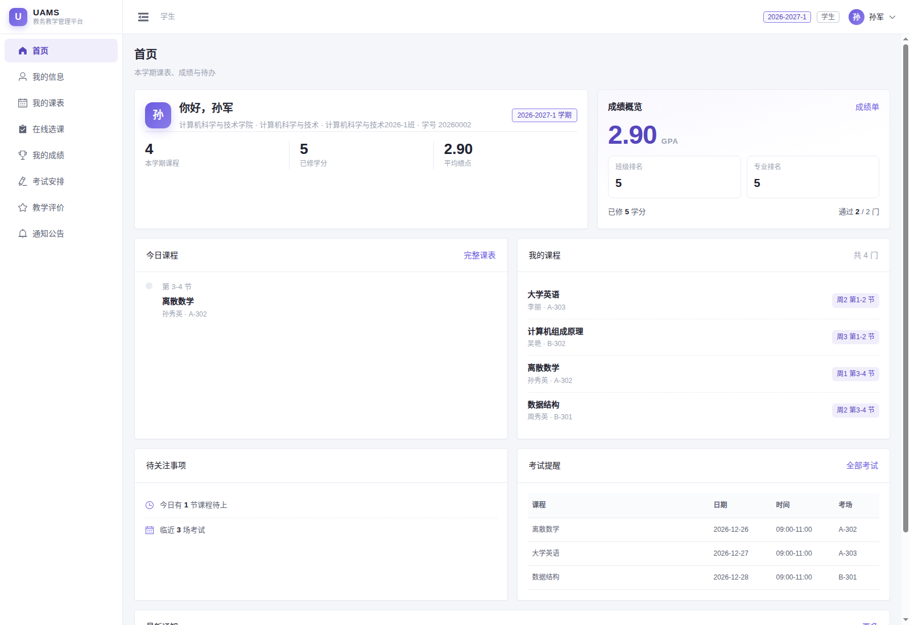

*图 6-1 学生首页。显示本学期课程、已修学分、平均绩点、班级/专业排名、今日课程、我的课程、考试提醒等。*

**页面内容**：

- 顶部问候：姓名、学院、专业、班级、学号、当前学期；
- 指标：本学期课程数（按已排课教学班去重）、已修学分、平均绩点；
- **成绩概览**：GPA、班级排名、专业排名、已修学分、通过课程数/总课程数；
- **今日课程**：按节次显示今天的课程、教师、教室；
- **我的课程**：本学期已选且已排课的课程及上课时间；
- **待关注事项**：今日课程、临近考试、未通过课程；
- **考试提醒**：最近 5 场考试（日期、时间、考场）；
- **最新通知**：面向学生/全体的已发布公告。

> 首页的班级/专业排名来自后端实时计算，只有已审核成绩的学生参与排名；没有有效成绩时显示“—”。

### 6.2 我的信息

**入口**：`/student/profile`，左侧菜单「我的信息」。

**页面内容**（只读）：

- 身份条：姓名、学号、学院、专业、班级、学籍状态；
- **学籍信息**：学号、姓名、性别、入学年份、出生日期、学籍状态；
- **联系方式**：邮箱、手机；
- **学业情况**：已修学分、平均绩点、已修课程数、不及格课程数。

> 学生不能在本页修改个人信息；如需更正，请联系教务管理员。

### 6.3 在线选课

**入口**：`/student/selection`，左侧菜单「在线选课」。

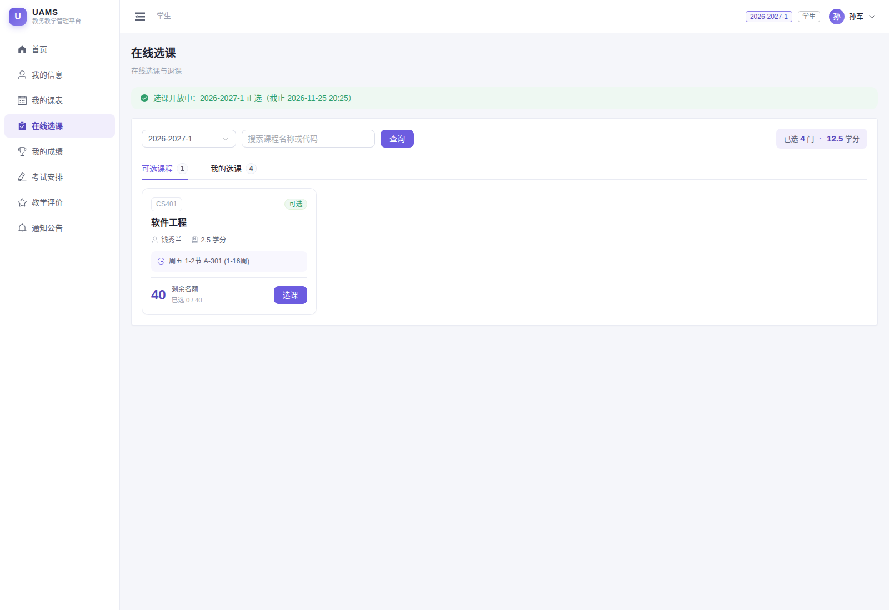

*图 6-2 在线选课页面。顶部显示选课窗口状态；“可选课程”Tab 显示可自主选择的选修教学班。*

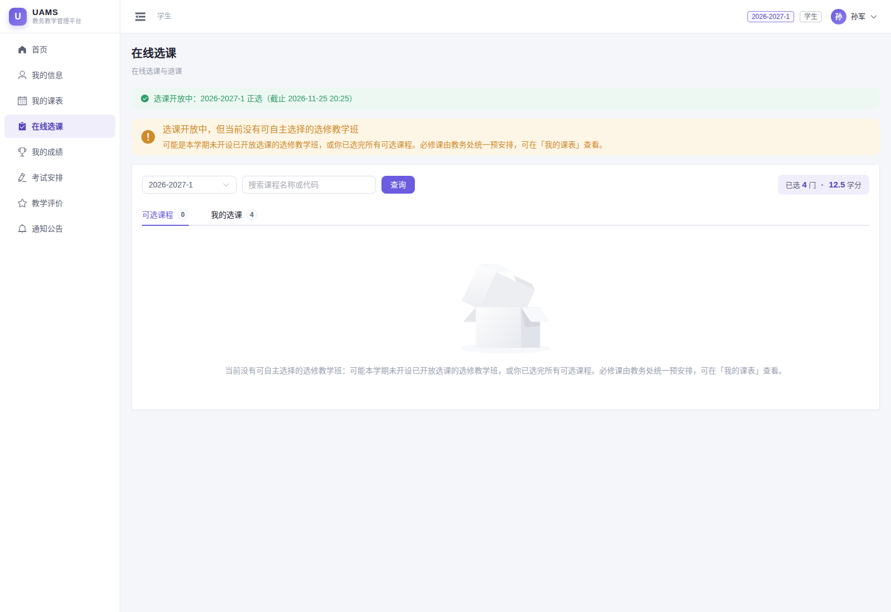

*图 6-3 选课窗口已开放，但当前没有可自主选择的选修教学班时的空状态提示。*

#### 6.3.1 页面结构

- 顶部状态提示：
  - 绿色：“选课开放中：窗口名称（截止时间）”；
  - 黄色：“当前不在选课时间内，仅可查看”；
  - 黄色附加提示：“选课开放中，但当前没有可自主选择的选修教学班”（可能是没有选修班，或你已选完所有可选课程）。
- 学期下拉框：默认按浏览器日期推断的当前学期；可手动切换。
- 搜索框：按课程名称或课程代码搜索。
- 右侧汇总：已选门数、合计学分。
- 两个 Tab：
  - **可选课程**：显示当前可自主选择的选修教学班；
  - **我的选课**：显示本人已选课程及退课按钮。

#### 6.3.2 可选课程卡片字段

| 字段 | 说明 |
|---|---|
| 课程代码 | 如 CS401 |
| 课程名称 | 如“软件工程” |
| 教师 | 授课教师姓名，未分配显示“待定” |
| 学分 | 课程学分 |
| 上课安排 | 星期、节次、教室、周次；未排课显示“未排课” |
| 剩余名额 | 剩余数量；0 显示“已满” |
| 已选/容量 | 如“已选 0 / 40” |
| 状态标签 | 可选 / 余位紧张（≤5）/ 已满 |
| 选课按钮 | 剩余名额为 0 时禁用 |

#### 6.3.3 学生看到选修课程的条件

一个教学班要出现在“可选课程”中，必须同时满足：

1. 你已登录为学生账号，并且存在学生档案；
2. 页面选择的学期与该教学班的学期一致；
3. 教学班所属学期状态为“进行中（ACTIVE）”；
4. 教学班状态为“有效（ACTIVE）”，未取消；
5. 教学班选课状态为“开放（OPEN）”；
6. 课程性质为**专业选修**或**公共选修**；
7. 你本学期没有选过该教学班；
8. 你本学期没有选过同一门课程的其他教学班；
9. 如果填写了搜索关键字，课程名称/代码要匹配。

> **注意**：选课列表的显示**不以选课时间窗口是否开放为前提**。窗口关闭时你仍可能看到课程（页面会提示“仅可查看”），但点击选课会被后端拒绝。能否选课以提交时的校验为准。

#### 6.3.4 选课操作

1. 在“可选课程”中找到目标课程；
2. 点击卡片右下角「选课」；
3. 确认框显示课程名称、教学班号、上课安排；
4. 点击「确定」；
5. 成功提示“选课成功”；
6. 该课程从“可选课程”消失，出现在“我的选课”中。

#### 6.3.5 退课操作

1. 切换到“我的选课”Tab；
2. 找到目标课程；
3. 点击「退课」；
4. 确认框点击「确定」；
5. 成功提示“已退课”；
6. 该课程从“我的选课”消失；如果仍符合可选条件，会重新出现在“可选课程”中。

#### 6.3.6 选课成功的后端校验

提交选课时，后端会按顺序检查：

1. 教学班存在；
2. 教学班状态有效，未取消；
3. 教学班已开放选课；
4. 所属学期为“进行中”；
5. 课程为选修课（必修/实践课拒绝）；
6. 当前时间在某个选课窗口内（状态 ACTIVE 且时间覆盖；如窗口限定年级，入学年份必须匹配）；
7. 没有重复选同一教学班；
8. 本学期没有选同一课程的其他教学班；
9. 教学班未满（按已选记录动态统计，并发时行锁防超卖）；
10. 与已选课程无时间冲突；
11. 先修课程满足（已审核成绩且达到最低分）。

任何一项不满足，都会返回明确错误提示。

#### 6.3.7 常见选课失败提示

| 提示 | 原因 | 处理 |
|---|---|---|
| 当前不在选课时间内 | 窗口状态不是进行中、或当前时间不在起止时间 | 联系教务确认窗口状态和时间 |
| 本学期尚未设置选课时间，无法选课 | 该学期没有任何选课窗口 | 联系教务在“选课管理”新增窗口 |
| 该教学班未开放选课 | 教学班选课状态不是 OPEN | 联系教务开放该教学班 |
| 当前学期未在进行中，无法选课 | 学期不是 ACTIVE | 联系教务激活学期 |
| 该课程为必修课，不能自主选择 | 课程是必修/实践 | 必修课由教务预安排，不能自主选 |
| 已选过该教学班，不能重复选课 | 已选同一教学班 | 到“我的选课”查看 |
| 本学期已选过该课程的其他教学班 | 同一课程只能选一个教学班 | 先退掉原教学班再选 |
| 该教学班已满（x/y） | 容量已满 | 选择其他教学班或等待退课 |
| 时间冲突：与 xxx（周x 第x-x节）冲突 | 与已选课程时间重叠 | 退掉冲突课程或选择其他时间 |
| 未修读先修课程，无法选课 | 先修课未通过 | 先修课通过后再选 |
| 先修课程成绩 x 未达到要求 y | 先修课成绩不足 | 达到要求后再选 |
| 当前账号不是学生 / 学生档案不存在 | 账号类型或档案异常 | 联系教务检查学籍与账号 |

#### 6.3.8 看不到课程时先做什么

1. 看页面顶部状态：
   - 如果是“当前不在选课时间内”，联系教务确认窗口是否“进行中”且时间覆盖当前；
   - 如果是“选课开放中，但没有可选课程”，继续下一步；
2. 确认学期下拉框选择的是**正确学期**（默认值是按浏览器日期推断的，可能与你实际学期不一致）；
3. 询问教务：该课程是否是“专业选修/公共选修”；
4. 询问教务：该选修教学班是否已排课并“开放选课”；
5. 询问教务：所选学期的教学班是否属于“进行中”的学期；
6. 检查搜索框是否有关键字，点击「查询」清空后重试；
7. 检查自己是否已经选过该课程/该教学班（“我的选课”Tab）；
8. 管理员可在“选课管理”页面查看系统诊断提示，按提示补齐配置。

### 6.4 我的课表

**入口**：`/student/schedule`，左侧菜单「我的课表」。

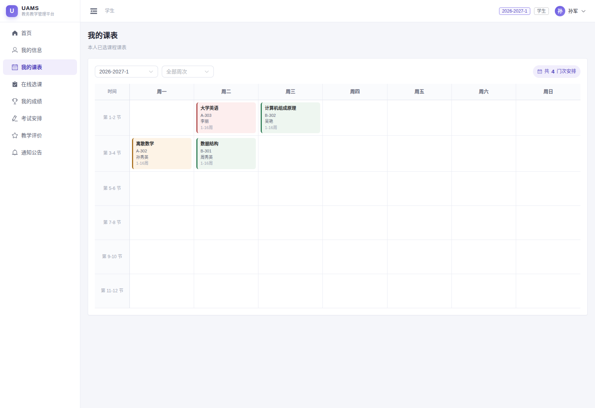

*图 6-4 学生课表。可按学期、周次筛选，课表由已选课程与排课实时生成。*

**操作**：

1. 选择学期；
2. 可选择“全部周次”或第 1~20 周；
3. 页面以周课表网格显示已选课程的排课；
4. 顶部显示“共 N 门次安排”。

**说明**：

- 课表由“选课记录 + 排课”实时推导，不单独保存；
- 未选课或所选教学班未排课时，对应课程不会出现在课表中；
- 退课后，该课程从课表消失；
- 单双周课程按周次类型显示。

### 6.5 我的成绩、学分、绩点与排名

**入口**：`/student/grades`，左侧菜单「我的成绩」。

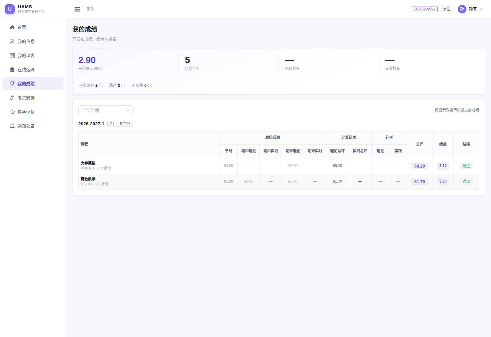

*图 6-5 我的成绩。只显示教务审核通过的成绩；可按学期筛选，按学期分组。*

**页面内容**：

- 概览：平均绩点 GPA、已修学分、班级排名、专业排名；
- 已修课程/通过/不及格门数；
- 学期筛选（默认“全部学期”）；
- 成绩明细，按学期分组，显示：
  - 课程、课程代码、学分；
  - 原始成绩：平时、期中理论、期中实践、期末理论、期末实践；
  - 计算结果：理论总评、实践总评；
  - 补考：理论、实践；
  - 总评、绩点、结果（通过/不及格）。

**规则**：

- 只显示**已审核通过（APPROVED）**的成绩；草稿、待审核、已驳回不显示；
- 已修学分只统计及格课程；
- GPA 与排名按已审核成绩实时计算，不保存历史快照；
- 成绩为空时显示“暂无已发布的成绩”。

> **已知限制**：当前“我的成绩”页面的“班级排名/专业排名”固定显示“—”（前端未接入排名数据）；**首页“成绩概览”卡片可以显示排名**。如需查看排名，请以首页为准。该问题已列入第 12 章。

### 6.6 考试安排

**入口**：`/student/exams`，左侧菜单「考试安排」。

**操作**：

1. 选择学期；
2. 只显示**已发布（PUBLISHED）**且属于本人已选教学班的考试；
3. 按考试日期分组，显示课程、类型（期末/补考/重修）、时间、时长、考场、座位号；
4. 距考试 7 天内显示提醒标签；已过期显示“已结束”。

**说明**：

- 未选课程不会显示考试；
- 考试未发布时学生看不到；
- 考场/座位号由教务在“考试管理”中设置并排座后显示；未排座时考场可能显示“待定”、座位号为“—”。

### 6.7 教学评价

**入口**：`/student/evaluation`，左侧菜单「教学评价」。

**操作**：

1. 顶部选择评价任务（下拉框显示任务名称；进行中的任务带“进行中”标签）；
2. 页面显示本人已选课程中属于该任务的待评价课程；
3. 点击「去评价」；
4. 在弹窗中：
   - 拖动滑块或输入评分（0~100 分）；
   - 可填写评语（选填，最多 1000 字）；
5. 点击「提交」；
6. 成功后该课程显示“已评价”，按钮变为“已完成”。

**规则**：

- 评价内容匿名提交，教师无法看到评价人；
- 只能评价本人所选课程；
- 同一任务、同一课程只能提交一次；
- 评价任务必须在开放时间内（状态 ACTIVE 且当前时间在起止时间）；
- 教学班未分配教师时不能评价；
- 已评价课程不能重复提交。

### 6.8 通知公告

**入口**：`/student/announcements`，左侧菜单「通知公告」。

**操作**：

1. 列表显示面向“全体”或“学生”的已发布公告；
2. 置顶公告带“置顶”标签；
3. 点击公告查看详情（发布人、发布时间、内容）；
4. 支持分页和每页条数切换。

> 学生不能发布公告；公告由教务管理员发布。

---
## 7. 从零开始：管理员创建课程到学生成功选课的完整操作实例

> **本章数据全部为虚构示例**，用于说明操作顺序，不代表正式数据库已有这些数据。示例中的账号、课程代码、教学班号、教室、时间均可替换为学校实际数据。

### 7.1 示例数据与前置条件

**示例目标**：在 `2026-2027-1` 学期开设一门**专业选修**课，开放选课后，学生能在“在线选课”中看到并成功选择。

| 项目 | 示例值 | 说明 |
|---|---|---|
| 学期 | `2026-2027-1`（2026-2027学年第一学期） | 必须处于“进行中” |
| 学院 | 计算机科学与技术学院（示例） | 必须已存在 |
| 专业 | 软件工程（示例） | 必须已存在 |
| 行政班 | 软件工程2026-1班（示例） | 必须已存在 |
| 教室 | `A-301`，容量 60（示例） | 容量 ≥ 教学班容量 |
| 课程 | `CS900` 人工智能导论（示例） | 课程性质必须为“专业选修”或“公共选修” |
| 学分/学时 | 3 学分；总 48；理论 40；实践 8 | 理论+实践=总学时 |
| 教学任务 | `2026-2027-1` + `CS900` + 计算机学院 | 同一学期/课程/学院唯一 |
| 教学班 | `CS900-2026-2027-1-01`；教师 T100；容量 40 | 同一学期内编号唯一 |
| 排课 | 周五 5-6 节；A-301；1-16 周；每周 | 至少一条排课才能开放选课 |
| 选课窗口 | `2026-2027-1 正选（示例）`；当前时间在窗口内；状态“进行中” | 状态不会随时间自动变化 |
| 学生 | `20269999` / 密码 `20269999`（示例） | 已存在学生档案，且未选过该课程 |

**前置条件检查**：

1. 管理员账号可以登录；
2. 学生账号可以登录，且学生档案存在；
3. 授课教师账号可以登录，且教师档案存在；
4. 当前学期在“学期管理”中存在并已激活；
5. 学院、专业、班级、教室已存在。

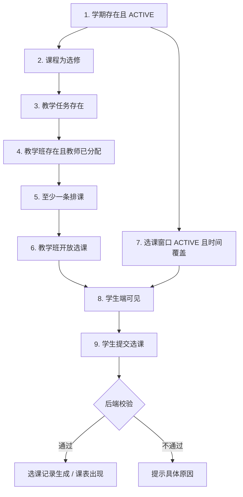

### 7.2 第一步：建立并激活学期

**页面**：`/admin/terms`（左侧菜单「学期管理」）。

**操作**：

1. 查看页面顶部“当前激活学期”；
2. 如果 `2026-2027-1` 不存在：
   - 点击「新增学期」；
   - 填写：
     - 学期名称：`2026-2027学年第一学期`
     - 学年：`2026-2027`
     - 学期序号：第一学期
     - 开始日期：`2026-09-01`
     - 结束日期：`2027-01-15`
   - 点击「确定」；
3. 如果该学期状态是“未开始”，在列表点击「激活」并确认；
4. 如果该学期已经是“进行中”，跳过。

**预期结果**：

- 页面顶部显示“当前激活学期：2026-2027学年第一学期”，状态“进行中”；
- 列表中该学期状态为“进行中”。

**检查方法**：刷新页面，顶部仍然显示该学期为进行中。

**常见失败**：

- “已存在进行中的学期”：先结束旧学期，或使用当前进行中的学期；
- “结束日期必须晚于开始日期”：修正日期；
- 学期已结束：不能重新激活，只能新建学期。

### 7.3 第二步：准备组织机构与教室

**页面**：`/admin/colleges`（左侧菜单「组织机构」）。

**检查项**：

1. **学院** Tab：存在“计算机科学与技术学院”；
2. **专业** Tab：存在“软件工程”，且所属学院正确；
3. **班级** Tab：存在“软件工程2026-1班”，且所属专业正确、年级为 2026；
4. **教室** Tab：存在 `A-301`，容量 ≥ 40（示例教学班容量为 40），状态“可用”。

如果缺少，按 4.2 的步骤新增。**不要跳过这一步**：创建教学班时，教师、班级、教室都必须已存在。

### 7.4 第三步：创建选修课程

**页面**：`/admin/courses`（左侧菜单「课程管理」）。

**操作**：

1. 点击「新增课程」；
2. 填写示例值：

| 字段 | 示例值 | 注意 |
|---|---|---|
| 课程代码 | `CS900` | 唯一；示例代码，请勿与正式课程冲突 |
| 课程名称 | `人工智能导论（示例）` | |
| 开课学院 | 计算机科学与技术学院 | |
| 课程类型 | **专业选修** | 必须是选修，否则学生端不会显示 |
| 学分 | 3 | |
| 总学时 | 48 | |
| 理论学时 | 40 | |
| 实践学时 | 8 | 40 + 8 = 48 |
| 考核方式 | 考试 | |
| 课程简介 | 示例课程 | 可留空 |

3. 点击「确定」。

**预期结果**：

- 提示“课程已创建”；
- 课程列表出现 `CS900`，课程性质显示“专业选修”；
- 考核结构显示“三段式”（因为 48 学时 > 32）。

**检查方法**：

- 在课程列表搜索 `CS900`；
- 点击「编辑」确认课程类型是“专业选修”；
- 若课程类型误选为“专业必修”，学生端一定看不到，请改回“专业选修”。

### 7.5 第四步：创建教学任务

**页面**：`/admin/teaching`（左侧菜单「开课排课」）→「教学任务」Tab。

**操作**：

1. 顶部学期选择 `2026-2027-1`；
2. 切换到「教学任务」Tab；
3. 点击「新增教学任务」；
4. 填写：

| 字段 | 示例值 |
|---|---|
| 学期 | `2026-2027-1` |
| 课程 | `CS900 人工智能导论（示例）` |
| 承担学院 | 计算机科学与技术学院 |
| 计划开班数 | 1 |

5. 点击「确定」。

**预期结果**：

- 提示“教学任务已创建”；
- 教学任务列表出现该课程，状态“已确认”，计划/实际开班为 `0 / 1`（创建教学班后变为 `1 / 1`）。

**常见失败**：

- “该学期该课程的教学任务已存在”：不要重复创建，直接使用已有任务；
- 课程下拉框找不到 `CS900`：先确认课程是否创建成功、课程状态是否为“启用”。

### 7.6 第五步：创建教学班

**页面**：`/admin/teaching` →「教学班」Tab。

**操作**：

1. 切换回「教学班」Tab；
2. 点击「新增教学班」；
3. 填写：

| 字段 | 示例值 | 注意 |
|---|---|---|
| 教学班号 | `CS900-2026-2027-1-01` | 同一学期内唯一 |
| 教学任务 | `人工智能导论（示例）（2026-2027-1）` | 必须选择上一步创建的任务 |
| 所属学期 | 自动显示 `2026-2027学年第一学期` | 若显示“学期管理中不存在”，先回学期管理创建 |
| 授课教师 | `T100（示例教师）` | **必须选择**；不选会提交失败 |
| 容量 | 40 | 大于 0；后续不能小于已选人数 |

4. 点击「确定」。

**预期结果**：

- 提示“教学班已创建”；
- 教学班列表出现 `CS900-2026-2027-1-01`；
- 选课状态为“未开放”；
- 上课安排显示“未排课”。

**检查方法**：在教学班列表找到该行，确认课程、教师、容量正确。

**常见失败**：

- “当前学期在学期管理中不存在”：先在学期管理创建/激活对应学期；
- “请填写教学班号并选择教学任务”：漏填；
- “授课教师必须具有教师身份”：选择的账号不是教师，或教师档案异常；
- “该学期下教学班编号已存在”：换一个教学班号；
- 后端返回 `teacher_id: Field required`：没有选择授课教师（界面未标红星，但后端必填）。

### 7.7 第六步：配置排课

**页面**：`/admin/teaching` →「教学班」Tab → 目标教学班行「排课」。

**操作**：

1. 点击「排课」；
2. 选择：

| 分组 | 示例值 |
|---|---|
| 教室 | `A-301(60人)` |
| 星期 | 周五 |
| 开始节次 | 5 |
| 结束节次 | 6 |
| 开始周 | 1 |
| 结束周 | 16 |
| 周类型 | 每周 |

3. 点击「添加」；
4. 弹窗下方“已排课列表”出现该安排；
5. 关闭弹窗。

**预期结果**：

- 提示“排课成功”；
- 教学班列表的“上课安排”显示“周五5-6节 A-301”。

**检查方法**：关闭弹窗后，确认该教学班行“上课安排”不再是“未排课”。

**常见失败**：

| 提示 | 原因 | 解决 |
|---|---|---|
| 教室容量小于教学班容量 | 教室容量 < 40 | 选择更大教室，或降低教学班容量 |
| 教室在该时段已被其他教学班占用 | 教室冲突 | 换教室或换时间 |
| 该教师在该时段已有其他教学安排 | 教师冲突 | 换时间或换教师 |
| 该教学班在周x 第x-x节 已有其他安排 | 教学班自身冲突 | 换时间 |
| 该学期已结束，不能操作教学安排 | 学期 ENDED | 不能在该学期排课；使用进行中/未开始学期 |
| 教室当前不可用 | 教室状态非“可用” | 在组织机构中把教室状态改为“可用” |

> **开放选课的前提**：教学班必须已分配教师且至少有一条排课。没有排课就点“开放选课”会失败。

---
### 7.8 第七步：设置选课时间窗口

**页面**：`/admin/selection`（左侧菜单「选课管理」）→“选课时间窗口”。

**操作**：

1. 点击「新增窗口」；
2. 填写示例值：

| 字段 | 示例值 | 注意 |
|---|---|---|
| 学期 | `2026-2027-1` | 必须与教学班学期一致 |
| 名称 | `2026-2027-1 正选（示例）` | |
| 开始时间 | `2026-10-20 08:00:00` | 示例 |
| 结束时间 | `2026-11-10 23:59:59` | 必须晚于开始 |
| 限定年级 | 留空 | 留空表示全部年级；填写则只允许该入学年份学生 |
| 状态 | **进行中** | 关键：状态不会自动变化 |

3. 点击「确定」。

**预期结果**：窗口列表出现该窗口，状态“进行中”。

**检查方法**：

- 确认当前时间确实在开始/结束时间之间；
- 确认状态是“进行中”，不是“未开始”；
- 如果限定了年级，确认学生入学年份匹配。

> **常见误解**：只设置了起止时间，但状态还是“未开始”，学生仍然不能选课。必须把状态改为“进行中”。

### 7.9 第八步：开放教学班选课

**入口二选一**：

- `/admin/teaching` →「教学班」Tab → 目标教学班行「开放选课」；
- `/admin/selection` →“教学班选课情况” → 目标教学班行「开放」。

**操作**：

1. 找到 `CS900-2026-2027-1-01`；
2. 点击「开放选课」或「开放」；
3. 等待成功提示。

**预期结果**：

- 教学班选课状态从“未开放”变为“选课中”；
- 选课管理页面顶部出现**绿色**提示：“选课已开放：当前学期有 N 个学生可自主选择的选修教学班”。

**检查方法**：

- 在“选课管理”页面确认绿色提示；
- 确认 `CS900` 行的课程性质是“专业选修”；
- 确认“选课时间窗口”状态是“进行中”。

**如果出现黄色/蓝色提示**：

- 黄色“选课窗口已开放，但没有学生可自主选择的选修教学班”：按提示检查是“没有教学班”“全是必修”“选修班未开放”中的哪一种；
- 蓝色“当前学期没有进行中的选课时间窗口”：回到“选课时间窗口”新增/编辑并设为进行中。

> **重要**：对必修/实践课点击「开放选课」会成功，但系统会提示“学生端不会出现在自主选课列表中”。这不是故障，是既有规则。

### 7.10 第九步：学生查询并选课

**前置条件**：学生账号可登录；学生档案存在；学生在 `2026-2027-1` 学期没有选过 `CS900`。

**操作**：

1. 学生打开登录页，输入示例账号 `20269999` / 密码 `20269999`，点击「登 录」；
2. 进入 `/student/dashboard` 后，点击左侧菜单「在线选课」；
3. 顶部应显示绿色“选课开放中：2026-2027-1 正选（示例）（截止 ...）”；
4. 确认学期下拉框是 `2026-2027-1`；如果不是，手动切换；
5. 在“可选课程”Tab 中找到 `CS900 人工智能导论（示例）`；
6. 检查卡片：教师、学分、上课安排（周五 5-6 节 A-301）、剩余名额；
7. 点击「选课」；
8. 在确认框核对课程和上课安排，点击「确定」；
9. 等待提示“选课成功”。

**预期结果**：

- “可选课程”中该卡片消失；
- “我的选课”Tab 中出现该课程；
- “已选”门数和学分增加；
- 点击左侧「我的课表」，课表中出现该课程（周五 5-6 节，A-301）。

**检查方法**：

- 学生端“我的选课”能看到记录；
- 学生端“我的课表”能看到排课；
- 教师端“我的课程”中该教学班选课人数 +1；
- 教务端“选课管理”中该教学班“已选”+1，点击「名单」能看到该学生。

### 7.11 第十步：三方核对选课结果

| 角色 | 查看位置 | 应看到 |
|---|---|---|
| 学生 | `/student/selection` →「我的选课」 | 课程 `CS900`、教学班号、学分、教师、选课时间 |
| 学生 | `/student/schedule` | 周五 5-6 节、A-301、1-16 周 |
| 教师 | `/teacher/courses` | 该教学班“选课人数”+1；点击「学生名单」能看到该学生 |
| 教师 | `/teacher/grades` | 选择该教学班，“已选 N 人”包含该学生；生成成绩单后名单包含该学生 |
| 教务 | `/admin/selection` | 该教学班“已选”+1；点击「名单」能看到该学生 |
| 教务 | `/admin/teaching` | 该教学班“选课人数”+1 |

如果以上任一处不一致，请先刷新页面；仍不一致时按第 9 章排查。

### 7.12 学生看不到课程时的检查顺序

请严格按以下顺序检查，不要直接让技术人员改数据库：

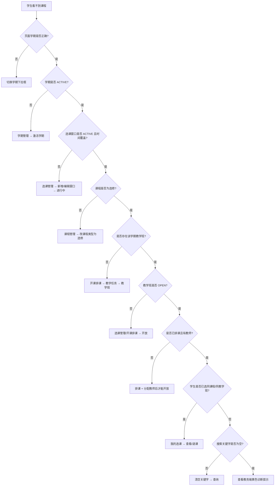

**检查清单（按顺序）**：

1. **页面学期**：学生端默认学期是按浏览器日期推断的，可能不是学校当前学期。先手动切换到正确学期。
2. **学期状态**：学期管理 → 目标学期是否为“进行中”。
3. **选课窗口**：选课管理 → 窗口状态是否为“进行中”，当前时间是否在起止时间内，限定年级是否匹配。
4. **课程性质**：课程管理 → 课程类型是否为“专业选修/公共选修”。必修/实践课不会出现在学生自主选课列表。
5. **教学班**：开课排课 → 目标学期是否存在该课程的教学班；教学班是否被取消。
6. **教学班选课状态**：是否为“选课中/OPEN”。
7. **教师与排课**：教学班是否已分配教师、是否至少有一条排课；没有排课不能开放选课。
8. **容量**：是否已满（已满仍会显示，但按钮禁用）。
9. **学生自身记录**：是否已选过该教学班，或已选同一课程的其他教学班。
10. **搜索条件**：搜索框是否有关键字；点击「查询」或清空。
11. **学生档案**：学生账号是否有学生档案、学籍状态是否正常。
12. **教务诊断**：选课管理页面顶部的绿色/黄色/蓝色提示，按提示处理。

**典型场景对照**：

| 场景 | 学生端表现 | 根因 | 正确处理 |
|---|---|---|---|
| 只开放了必修课教学班 | “可选课程”为空，黄色提示“没有可自主选择的选修教学班” | 必修课不参与自主选课 | 创建选修课程的教学班并开放 |
| 选修教学班未开放 | 为空，黄色提示“有选修班但都未开放” | 教学班 selection_status=CLOSED | 在选课管理点击「开放」 |
| 选课窗口状态“未开始” | 顶部黄色“当前不在选课时间内”，即使时间已到 | 状态不会自动变化 | 编辑窗口，状态改为“进行中” |
| 窗口时间已过 | 顶部黄色“当前不在选课时间内” | 当前时间不在起止时间 | 修改窗口时间或新建窗口 |
| 课程类型是“专业必修” | 为空 | 课程不是选修 | 课程管理改为“专业选修”（注意已有教学任务/成绩的影响） |
| 页面学期选错 | 为空 | 默认学期与学校实际学期不一致 | 手动切换学期 |
| 教学班没有排课 | 无法开放选课；或开放失败 | 开放选课要求至少一条排课 | 先排课，再开放 |
| 学生已选过该课程 | 该课程不显示 | 同课程只能选一个教学班 | 到“我的选课”查看或退掉原教学班 |
| 教学班已满 | 卡片显示“已满”，按钮禁用 | 容量满 | 选择其他教学班或等待退课 |
| 学生年级不符合窗口限定 | 可能看得到课程，但选课提示“当前不在选课时间内” | 列表不校验限定年级，提交时校验 | 联系教务确认窗口限定年级（见第 12 章限制） |

---
## 8. 系统业务规则说明

### 8.1 三类用户的权限边界

系统采用 RBAC（基于角色的权限控制）。权限由角色决定，前端菜单/路由只是体验控制，**真正的权限校验在后端**。

| 能力 | 学生 | 教师 | 教务管理员 |
|---|---|---|---|
| 查看课程/培养方案 | ✅（只读） | ✅（只读） | ✅（可维护） |
| 查看本人信息 | ✅ | ✅ | ✅ |
| 查看学生名单 | ❌ | ✅（教学班名单；无独立学生管理菜单） | ✅ |
| 维护学院/专业/班级/教室 | ❌ | ❌ | ✅ |
| 维护学生/教师档案 | ❌ | ❌ | ✅ |
| 维护课程/培养方案 | ❌ | ❌ | ✅ |
| 维护学期 | ❌ | ❌ | ✅ |
| 维护教学任务/教学班/排课 | ❌ | ❌（只读本人） | ✅ |
| 开放/关闭选课 | ❌ | ❌ | ✅ |
| 学生自主选课/退课 | ✅（本人） | ❌ | ❌（管理员不代替学生选课） |
| 查看整班学生名单 | ❌ | ✅（本人教学班） | ✅ |
| 录入/保存成绩草稿 | ❌ | ✅（本人教学班） | 可导入，但不通过教师录入接口 |
| 提交成绩 | ❌ | ✅（本人教学班） | ❌（仅教师提交） |
| 审核成绩 | ❌ | ❌ | ✅ |
| 查看本人成绩 | ✅ | — | — |
| 查看评价统计 | ❌ | ✅（本人教学班） | ✅ |
| 提交教学评价 | ✅ | ❌ | ❌ |
| 发布公告 | ❌ | ❌ | ✅ |
| 查看统计 | ❌ | ❌ | ✅ |
| 管理员账号/权限管理 | ❌ | ❌ | ✅（角色 `ACADEMIC_ADMIN`） |

**学生角色权限**：`course:read`、`curriculum:read`、`schedule:read`、`term:read`、`selection:read/write`、`grade:read`、`exam:read`、`evaluation:read/write`、`announcement:read`。

**教师角色权限**：`course:read`、`class:read`、`student:read`、`teaching:read`、`schedule:read`、`term:read`、`selection:read`、`grade:read/write/submit`、`exam:read`、`evaluation:read`、`announcement:read`。

**教务管理员**：拥有系统全部权限（42 项）。

> 注意：
> - 教师没有 `selection:manage`、`grade:approve`、`course:write` 等权限，不能开放选课、审核成绩、维护课程；
> - 学生没有 `student:read`，但“我的信息”接口按当前登录用户身份读取本人档案，不需要该权限；
> - 管理员拥有全部权限，但学生选课接口仍要求 `user_type=STUDENT`，管理员不能代替学生选课。

### 8.2 学期状态流转

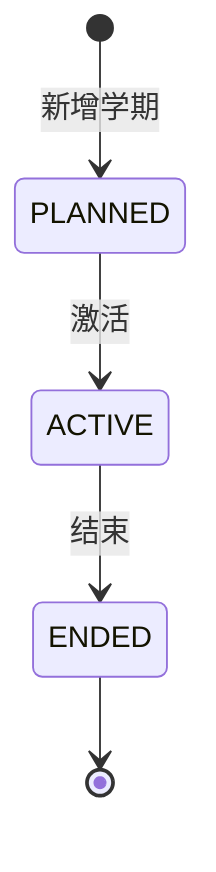

**规则**：

1. 同一“学年 + 学期序号”唯一；
2. 全系统最多一个 `ACTIVE` 学期；
3. 状态只能 `PLANNED → ACTIVE → ENDED` 单向流转；
4. `ENDED` 不能重新激活、不能修改状态；
5. 只有 `ACTIVE` 才能结束；
6. 学期下存在教学班时不能删除学期；
7. 学生选课要求学期 `ACTIVE`；`ENDED` 学期不能退课；
8. `ENDED` 学期不能新增/修改/删除教学班与排课。

> **操作提醒**：新增学期默认 `PLANNED`，必须手动点击「激活」才会变成 `ACTIVE`。系统不会根据日期自动切换学期状态。

### 8.3 课程、教学任务、教学班、排课与选课的关系

```mermaid
erDiagram
    COLLEGE ||--o{ MAJOR : 拥有
    MAJOR ||--o{ CLASS : 拥有
    CLASS ||--o{ STUDENT : 包含
    COLLEGE ||--o{ COURSE : 开设
    COURSE ||--o{ TEACHING_TASK : 生成
    ACADEMIC_TERM ||--o{ TEACHING_CLASS : 归属
    TEACHING_TASK ||--o{ TEACHING_CLASS : 开班
    TEACHER ||--o{ TEACHING_CLASS : 授课
    TEACHING_CLASS ||--o{ SCHEDULE : 排课
    TEACHING_CLASS ||--o{ COURSE_SELECTION : 选课
    STUDENT ||--o{ COURSE_SELECTION : 选择
    TEACHING_CLASS ||--o{ GRADE : 成绩
    TEACHING_CLASS ||--o{ EXAM : 考试
```

- **课程**是定义，不是某学期的具体开班；
- **教学任务**把课程、学期、承担学院关联起来；
- **教学班**是教学任务下的具体开班，绑定 `term_id`、课程、教师、容量；
- **排课**属于教学班，决定上课时间/教室；
- **选课**记录学生与教学班的关系，`semester` 冗余保存；
- **课表**由“选课记录 + 排课”实时推导，不单独建表；
- **成绩**按“学生 + 教学班”唯一，学分是课程学分的快照；
- **考试**属于教学班，学生只看到已发布且本人已选课程的考试。

### 8.4 必修课与选修课的不同处理

课程性质共 5 种：

| 课程性质 | 代码 | 是否进入学生自主选课列表 | 处理方式 |
|---|---|---|---|
| 专业必修 | `REQUIRED` | ❌ | 教务预安排 |
| 公共必修 | `PUBLIC_REQUIRED` | ❌ | 教务预安排 |
| 实践 | `PRACTICE` | ❌ | 教务预安排 |
| 专业选修 | `ELECTIVE` | ✅ | 学生自主选择 |
| 公共选修 | `PUBLIC_ELECTIVE` | ✅ | 学生自主选择 |

> **关键**：教学班本身没有单独的“选课类型”字段，它**继承课程的 `course_type`**。同一门课程在不同学期开教学班，性质仍由课程决定。如果课程类型填错，学生端一定看不到（必修）或会错误出现（选修）。修改课程类型前请确认不会影响已有教学任务/成绩。

即使是选修课，也必须同时满足：学期 `ACTIVE`、教学班 `ACTIVE` 且 `selection_status=OPEN`、至少一条排课、选课窗口 `ACTIVE` 且时间覆盖、学生未选过同课程/同教学班、容量未满、无时间冲突、先修满足。

### 8.5 教学班容量与冲突检测

#### 8.5.1 容量

- 教学班容量 `capacity > 0`，最大 1000；
- 已选人数由 `course_selections` 中 `status='SELECTED'` 的记录动态统计，不保存冗余计数；
- 选课时对教学班行加 `SELECT ... FOR UPDATE` 锁，并在事务内用当前读统计已选人数，防止并发超卖；
- 数据库唯一约束 `(student_id, teaching_class_id)` 作为最后一道防线；
- 容量不能改到小于已选人数；
- 教学班已满时学生仍能看到课程卡片，但按钮禁用；后端返回 `TEACHING_CLASS_FULL`。

#### 8.5.2 冲突检测

排课与选课共用同一套时间重叠判定：

1. 同学期；
2. 同星期；
3. 节次区间重叠（`start_period <= other.end_period` 且 `other.start_period <= end_period`）；
4. 周次区间重叠；
5. 单双周相容：任一方为“每周（ALL）”，或双方周类型相同。

排课时检测三类冲突：

- 教学班自身冲突；
- 教室冲突；
- 教师冲突。

学生选课时额外检测：

- 与本人本学期已选课程的时间冲突；
- 同一课程其他教学班；
- 先修课程要求。

> 教室容量必须 ≥ 教学班容量，这是排课的额外约束。

---
### 8.6 成绩考核结构与计算规则

#### 8.6.1 考核结构由总学时决定

| 总学时 | 考核方式代码 | 结构 | 权重 |
|---|---|---|---|
| ≤ 32 | `32` | 两段式，无期中 | 平时 20% + 期末 80% |
| 33 ~ 48 | `48` | 三段式，有期中 | 平时 20% + 期中 30% + 期末 50% |
| > 48 | `64` | 三段式，有期中 | 平时 20% + 期中 30% + 期末 50% |

- 考核结构由 `Course.total_hours` **自动推导**，教务/教师不能手动选择；
- 课程页面会显示“成绩考核结构由总学时自动决定，不可手动选择”；
- 数据库中的 `assessment_type` 即使有历史值，后端也会按总学时重新计算，不信任旧值。

#### 8.6.2 是否含实践

- `practice_hours == 0`：无实践考试/实践成绩，只录入合并的期中/期末成绩；
- `practice_hours > 0`：含实践，期中/期末必须分别录入**理论**和**实践**成绩，且必须成对；
- 实践成绩只允许出现在含实践学时的课程；无实践课程录入实践成绩会被拒绝。

#### 8.6.3 计算口径

**非实践课**：

```text
理论总评 = 平时 × 20% + 期中 × 30% + 期末 × 50%（32 学时无期中：平时 × 20% + 期末 × 80%）
成绩总评 = 理论总评
```

**实践课**：

```text
理论总评 = 平时 × 20% + 期中理论 × 30% + 期末理论 × 50%
实践总评 = 平时 × 20% + 期中实践 × 30% + 期末实践 × 50%
成绩总评 = (理论总评 + 实践总评) / 2
```

**补考**：

- 只有对应期末分项 < 60 时才允许录入补考；
- 补考成绩替换对应期末分项重新计算；
- 补考通过（≥ 60）的一侧总评按 **60 分封顶**（补考最高记 60）；
- 最终是否通过仍按成绩总评 ≥ 60 判定。

**及格线**：60 分。

**示例 1（非实践，48 学时）**：

- 平时 80，期中 70，期末 90；
- 理论总评 = 80×0.2 + 70×0.3 + 90×0.5 = 16 + 21 + 45 = **82.00**；
- 成绩总评 = 82.00，绩点 = 3.3（80~84 段）。

**示例 2（含实践，48 学时）**：

- 平时 80；期中理论 70、期中实践 75；期末理论 90、期末实践 85；
- 理论总评 = 80×0.2 + 70×0.3 + 90×0.5 = 82.00；
- 实践总评 = 80×0.2 + 75×0.3 + 85×0.5 = 16 + 22.5 + 42.5 = 81.00；
- 成绩总评 = (82 + 81) / 2 = **81.50**，绩点 = 3.3。

> 总评、绩点、是否及格全部由后端统一计算；前端只提交原始成绩，不允许直接提交总评/绩点。

### 8.7 成绩状态流转

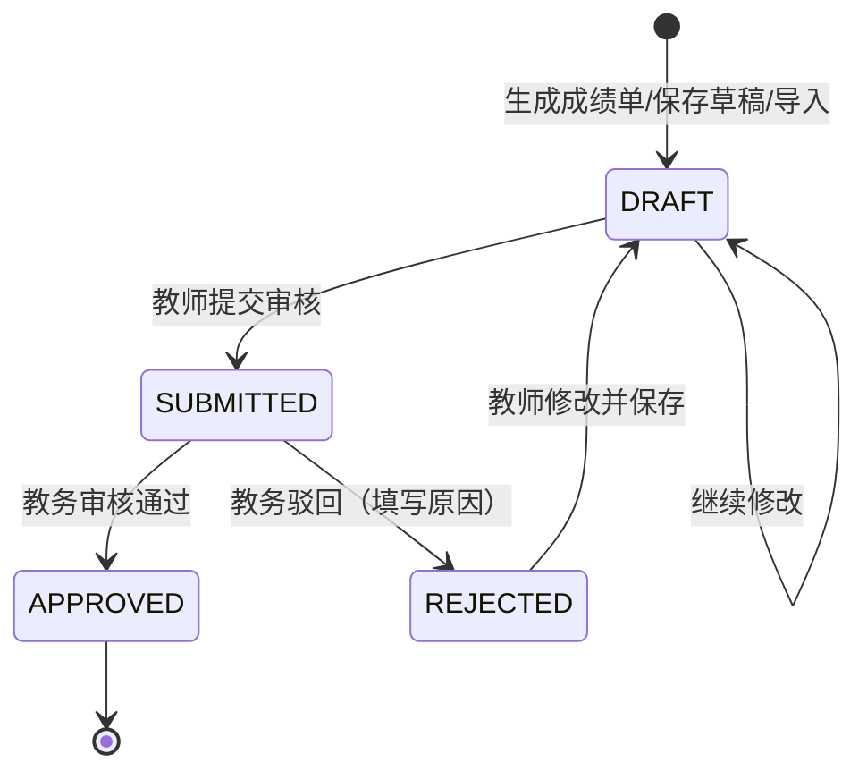

| 状态 | 含义 | 教师 | 教务 | 学生 |
|---|---|---|---|---|
| `DRAFT` | 草稿 | 可修改、可删除 | 可查看/导入？不能审核 | 不可见 |
| `SUBMITTED` | 待审核 | 不可修改 | 可通过/驳回 | 不可见 |
| `APPROVED` | 已通过 | 不可修改 | 不可直接改 | 可见 |
| `REJECTED` | 已驳回 | 可修改后重新提交 | 可查看原因 | 不可见 |

**关键规则**：

1. 生成成绩单：按教学班“已选学生”生成草稿行，幂等；
2. 保存草稿：允许成绩不完整，总评可能为空；
3. 提交审核：必须所有学生都有总评，否则提示“还有 N 名学生成绩未录入完整”；
4. 审核通过/驳回：只允许 `SUBMITTED` 状态；
5. 驳回必须填写原因（最多 500 字）；
6. 删除草稿：只允许 `DRAFT`；`SUBMITTED/APPROVED/REJECTED` 删除会被拒绝；
7. 学生只看到 `APPROVED`；
8. 已通过成绩不能由教师直接修改；当前界面也没有管理员“撤销通过/修改已通过”的入口（见第 12 章）。

### 8.8 GPA 与排名计算

#### 8.8.1 百分制 → 绩点

| 成绩区间 | 绩点 |
|---|---|
| ≥ 90 | 4.0 |
| 85 ~ 89.99 | 3.7 |
| 80 ~ 84.99 | 3.3 |
| 75 ~ 79.99 | 3.0 |
| 70 ~ 74.99 | 2.7 |
| 65 ~ 69.99 | 2.3 |
| 60 ~ 64.99 | 1.0 |
| < 60 | 0.0 |

#### 8.8.2 GPA 公式

```text
GPA = Σ(课程绩点 × 课程学分) / Σ课程学分
```

- 只使用 **已审核通过（APPROVED）且有总评** 的成绩；
- 不及格课程计入 GPA，绩点按 0 计算；
- 没有有效成绩时，GPA 显示“—”，不参与排名；
- GPA 不落库，每次查询实时计算。

**示例**：

- 课程 A：3 学分，成绩 85 → 绩点 3.7，贡献 3.7×3 = 11.1；
- 课程 B：2 学分，成绩 60 → 绩点 1.0，贡献 1.0×2 = 2.0；
- GPA = (11.1 + 2.0) / (3 + 2) = 13.1 / 5 = **2.62**。

#### 8.8.3 已修学分

- 只统计 **已审核通过且及格** 的课程学分；
- 不及格课程不计入已修学分。

#### 8.8.4 班级/专业排名

- 按班级/专业内学生的 GPA 降序排名；
- 只有有有效成绩的学生参与排名；没有成绩的学生排名为“—”；
- 同分并列：例如 1、2、2、4（下一名跳号）；
- 排名实时计算，不保存历史快照。

> 已知限制：学生“我的成绩”页面排名显示“—”，首页“成绩概览”可以显示排名。详见第 12 章。

### 8.9 管理员兼任教师的工作台切换

**身份判定**：

- 管理员身份 = 是否持有 `ACADEMIC_ADMIN` 角色；
- 教师身份 = 账号类别 `user_type=TEACHER`；
- “访问身份集合” = 账号类别（`STUDENT`/`TEACHER`，不含 `ADMIN`）∪ 角色代码；
- 教师被授予管理员后，`user_type` 仍是 `TEACHER`，因此同时拥有教师端和教务端身份。

**切换方式**：

- 教师兼任管理员登录后，顶部会出现按钮：
  - 在教务端：显示「切换到教学工作台」；
  - 在教师端：显示「切换到教务控制台」；
- 点击后跳转到另一个工作台。

**撤销管理员权限后**：

- 该账号立即失去教务端权限；
- 若仍有教师身份 → 自动回到教师工作台；
- 若仍有学生身份 → 回到学生工作台；
- 若没有其他有效身份（纯管理员账号）→ 清理登录态，回到登录页；
- 账号、教学班、课表、成绩数据均保留。

### 8.10 账号登录与权限变化后的处理

| 情况 | 系统行为 | 用户操作 |
|---|---|---|
| 密码错误 | 提示“用户名或密码错误”；累计失败次数 | 重新输入；注意初始密码 |
| 连续失败 5 次 | 账号锁定 15 分钟 | 等待，或管理员重置密码 |
| 账号被停用 | 登录返回 403，提示“账号已被停用” | 联系管理员启用 |
| 令牌过期/无效（401） | 清理本地登录态，跳转登录页 | 重新登录 |
| 普通业务越权（403） | 只提示“没有权限执行该操作”，不清登录态 | 使用有权限的账号/功能 |
| 管理员权限被撤销 | 403 后前端重新拉取 `/auth/me`；确认角色已撤销 → 回到当前真实身份工作台或登录页 | 无需手动退出；界面会自动调整 |
| 多标签页退出 | 其他标签页清理登录态并回登录页 | 重新登录 |
| 多标签页切换账号 | 其他标签页回到入口，按新身份重新分发 | 正常使用 |
| 管理员重置密码 | 密码更新并解锁账号 | 用新密码登录 |

---
## 9. 常见问题与故障排查

> 排查原则：先看页面提示，再按“学期 → 课程性质 → 教学班 → 排课 → 选课窗口 → 学生自身记录”的顺序检查。不要一开始就改数据库。

### 9.1 管理员开启选课后学生端没有课程

这是最常见的选课问题。请按以下顺序排查。

#### 第一步：确认“开启”的是哪一层

“开启选课”不是全校一个开关，至少涉及：

1. 课程是否为**选修**；
2. 教学班是否**已排课**并**开放选课**；
3. 学期是否**进行中**；
4. 选课时间窗口是否**进行中且时间覆盖当前**；
5. 学生页面选择的**学期**是否正确。

#### 第二步：看教务端诊断

打开 `/admin/selection`（选课管理）：

- **绿色**：“选课已开放：当前学期有 N 个学生可自主选择的选修教学班” → 配置基本正确，转第三步；
- **黄色**：“选课窗口已开放，但没有学生可自主选择的选修教学班” → 看下方逐条提示：
  - “该学期没有任何教学班” → 去开课排课建任务/教学班；
  - “均无可自主选择的选修教学班” → 课程可能全是必修/实践，或教学班取消；
  - “有 N 个选修教学班，但都未开放选课” → 在本页对相应教学班点「开放」；
  - “已开放的 N 个必修/实践教学班不会出现在学生自主选课列表中” → 正常规则；
- **蓝色**：“当前学期没有进行中的选课时间窗口” → 去“选课时间窗口”新增/编辑，状态设为“进行中”。

#### 第三步：检查课程性质

`/admin/courses` → 找到课程 → 课程类型是否为“专业选修/公共选修”。

- 如果是“专业必修/公共必修/实践”，学生**永远不会**在自主选课列表看到；
- 如果填错，改为选修前请确认：该课程是否已有教学任务/成绩；修改课程类型本身不会自动补选学生。

#### 第四步：检查教学班

`/admin/teaching` →「教学班」Tab：

- 是否有该学期、该课程的教学班；
- 授课教师是否已分配；
- 上课安排是否“未排课”；
- 选课状态是否“选课中”。

> 没有排课或没有教师，点击「开放选课」会失败；必须先补排课/教师。

#### 第五步：检查选课时间窗口

`/admin/selection` →“选课时间窗口”：

- 状态是否“进行中”；
- 当前时间是否在开始/结束之间；
- 限定年级是否与学生入学年份匹配。

#### 第六步：检查学生页面学期

学生端学期下拉框默认按浏览器日期推断。若学校实际学期与日期推断不一致，学生可能停在错误学期。

处理：让学生在“在线选课”顶部手动切换到正确学期，再查询。

#### 第七步：检查学生自身记录

- 学生是否已选过该教学班；
- 学生是否已选同一课程的其他教学班；
- 学生是否已选完所有可选课程（此时空列表是正常）。

#### 如果以上都正常

收集以下信息，交给技术人员核对后端数据：

1. 学生账号、学号；
2. 页面选择的学期；
3. 课程代码、教学班号；
4. 学生端提示文字（截图）；
5. 教务端“选课管理”诊断提示（截图）；
6. 操作时间。

### 9.2 创建了课程但无法创建教学班

| 现象 | 原因 | 解决 |
|---|---|---|
| 点击「新增教学班」提示“当前学期在学期管理中不存在” | 页面选择的学期字符串与 AcademicTerm 不匹配 | 去“学期管理”创建该学年学期，或切换页面学期 |
| 提示“已结束的学期不能新增教学班” | 学期状态 ENDED | 使用进行中/未开始学期；ENDED 不可再建班 |
| 教学任务下拉框为空 | 该学期没有教学任务 | 先在「教学任务」Tab 新增任务 |
| 提示“请填写教学班号并选择教学任务” | 漏填/漏选 | 填写教学班号，选择任务 |
| 提交后提示 `teacher_id: Field required` | 没有选择授课教师 | 必须选择教师（界面未标红星但后端必填） |
| 提示“授课教师必须具有教师身份” | 选中的账号不是教师，或教师档案异常 | 在教师管理中检查该教师档案与账号 |
| 提示“该学期下教学班编号已存在” | 同一学期内教学班号重复 | 换一个教学班号 |
| 提示“学期不存在” | 后端没有对应 term_id | 先在学期管理创建学期 |
| 容量无法提交 | 容量 ≤ 0 或 > 1000 | 设置为 1~1000 |

### 9.3 学生无法选课

先看学生端的具体错误提示，再对照：

| 提示 | 原因 | 解决 |
|---|---|---|
| 当前不在选课时间内 | 没有窗口/状态非进行中/时间不在范围/限定年级不匹配 | 教务检查窗口状态、时间、限定年级 |
| 该教学班未开放选课 | 教学班 OPEN 状态未开启 | 教务在选课管理/开课排课点「开放」 |
| 当前学期未在进行中 | 学期非 ACTIVE | 学期管理激活 |
| 该课程为必修课，不能自主选择 | 课程是必修/实践 | 必修课走预安排；学生不能自主选 |
| 已选过该教学班 | 重复选同一班 | 我的选课查看 |
| 本学期已选过该课程的其他教学班 | 同课程只能选一个班 | 先退原班再选 |
| 该教学班已满 | 容量满 | 换班或等待退课 |
| 时间冲突：与 xxx 冲突 | 与已选课程时间重叠 | 退冲突课程或换时间 |
| 未修读先修课程 / 先修成绩未达到要求 | 先修课未通过/分数不够 | 先修课通过后再选 |
| 当前账号不是学生 / 学生档案不存在 | 账号类型或档案异常 | 教务检查学籍与账号 |
| 页面为空但顶部显示“选课开放中” | 没有选修班/已选完/学期选错/关键字 | 按 9.1 检查 |

**排查顺序**：

1. 页面顶部学期是否正确；
2. 顶部窗口状态；
3. 课程性质；
4. 教学班状态；
5. 已选记录；
6. 容量/冲突/先修；
7. 教务端诊断。

### 9.4 学生无法退课

| 提示 | 原因 | 解决 |
|---|---|---|
| 该记录已退课 | 已退过 | 刷新“我的选课” |
| 必修课不能由学生自主退选 | 课程是必修/实践 | 联系教务调整；学生不能自主退 |
| 当前不在选课时间内，无法退课 | 教学班选课状态不是 OPEN | 教务开放教学班后重试 |
| 该学期已结束，无法退课 | 学期 ENDED | 学期结束后不能退课 |
| 该课程已有成绩记录，无法退课 | 已有非草稿成绩（待审核/已通过/已驳回） | 联系教务处理成绩后再退；不要直接删成绩 |
| 只能退选本人的课程 | 记录不属于当前学生 | 正常界面不会出现；如出现请提供证据给技术人员 |

> **已知限制**：退课只校验“教学班是否 OPEN”和“学期是否结束”，**不校验选课时间窗口的起止时间**。如果管理员关闭了选课窗口但忘记关闭教学班，学生仍可能退课。详见第 12 章。

### 9.5 教师看不到教学班

| 原因 | 检查方法 | 解决 |
|---|---|---|
| 教学班没有分配给你 | 教务端开课排课 → 教学班 → 授课教师 | 让教务把授课教师改为你 |
| 页面学期选错 | 我的课程顶部学期下拉框 | 切换到正确学期 |
| 教师档案不存在 | 登录后提示“教师档案不存在” | 教务检查教师档案/账号关联 |
| 教学班属于其他学期 | 教学班学期与页面学期不一致 | 切换学期 |
| 成绩录入页看不到 | 成绩录入页没有学期下拉框，只加载浏览器日期推断的当前学期 | 确认当前学期与教学班学期一致；若不一致，属于限制（见第 12 章），请联系技术人员处理，不建议修改服务器日期 |
| 教学班已取消 | 教学班状态 CANCELLED | 教务检查教学班状态 |

**补充**：教师端“我的课程”只显示本人授课教学班；如果教学班没有排课，仍会出现在“我的课程”，但不会出现在“我的课表”。

---
### 9.6 教师无法录入成绩

| 现象 | 原因 | 解决 |
|---|---|---|
| 选择教学班后没有学生 | 该教学班没有已选学生 | 先让学生选课，或由教务检查选课记录；没有学生无法录入 |
| 显示“尚未生成成绩单” | 还没点「生成成绩单」 | 点击「生成成绩单」 |
| 提示“只能操作本人授课教学班的成绩” | 该教学班不属于当前教师 | 只能操作本人教学班；请教务调整授课教师 |
| 所有输入框灰色、按钮不可用 | 成绩状态为待审核/已通过 | 待审核需教务驳回；已通过不能直接改（见 9.7） |
| 保存时提示缺少必要成绩 | 平时/期中/期末等必填项为空 | 补齐对应成绩；草稿允许不完整，但提交前必须完整 |
| 提示“课程含实践学时，期中必须分别录入理论/实践成绩” | 实践课只填了合并成绩或只填一侧 | 理论、实践必须成对填写 |
| 提示“课程无实践学时，不能录入实践成绩” | 非实践课填了实践列 | 只填合并的期中/期末成绩 |
| 提示“32 学时课程无期中考试，不能录入期中成绩” | 32 学时课程填了期中 | 32 学时课程没有期中，清空期中 |
| 提示“理论补考只允许在期末理论成绩不及格时录入” | 期末 ≥ 60 还填了补考 | 只有期末 < 60 才能填补考 |
| 提示“结束节次不能早于开始节次”等 | 排课问题，不是成绩 | 检查排课 |
| 纯管理员账号无法保存/提交 | 成绩录入接口要求教师身份 | 使用教师账号；管理员只负责审核/导入 |
| 成绩录入页没有想要的学期 | 成绩录入页没有学期选择器，只加载浏览器日期推断的当前学期 | 属于限制（见第 12 章）；请确认当前学期，或联系技术人员 |

**录入前检查**：

1. 教学班是否已分配给你；
2. 是否已选学生；
3. 是否已生成成绩单；
4. 课程总学时/实践学时对应的列是否正确；
5. 成绩状态是否可编辑（DRAFT/REJECTED）。

### 9.7 成绩提交后无法修改

| 当前状态 | 能否修改 | 正确处理 |
|---|---|---|
| 草稿 DRAFT | 可以 | 直接修改、保存草稿、重新提交 |
| 待审核 SUBMITTED | 不可以 | 联系教务在“成绩审核”中**驳回**并填写原因；教师收到驳回后修改 |
| 已驳回 REJECTED | 可以 | 修改后保存草稿，再提交审核 |
| 已通过 APPROVED | 不可以 | 当前界面没有“撤销通过/修改已通过”入口；属于限制（见第 12 章），需联系系统管理员/技术人员处理 |

> 常见误解：教师以为“已提交”还能改。提交后成绩进入教务审核，必须由教务驳回才能回到可编辑状态。

### 9.8 成绩审批失败

| 提示 | 原因 | 解决 |
|---|---|---|
| 只有已提交的成绩可以审核 | 勾选了草稿/已通过/已驳回 | 只勾选待审核；刷新后重试 |
| 未找到成绩记录 | 记录被删除/ID 不存在 | 刷新列表 |
| 驳回原因不能为空 | 驳回未填原因 | 填写原因（≤500 字） |
| 待审核列表为空 | 没有提交或学期筛选不对 | 切换“全部学期”/刷新；确认教师已提交 |
| 批量审核失败并列出问题记录 ID | 勾选的数据中混有非待审核状态 | 只勾选待审核记录，或使用整班审核 |
| 审核通过后学生仍看不到 | 学生成绩页只显示 APPROVED；或学生选了别的学期 | 确认状态；让学生清空学期筛选 |
| 已通过成绩需要更正 | 当前界面无撤销/修改已通过入口 | 属于限制（见第 12 章） |

### 9.9 Excel 导入失败

**通用检查**：

1. 文件是否为 `.xlsx`（不是 `.xls`、`.csv`）；
2. 文件是否 ≤ 10 MB；
3. 是否使用系统下载的模板，首行表头是否被修改；
4. 数据是否从第 2 行开始；
5. 引用的学院/专业/班级/课程/教学班是否已存在且层级匹配；
6. 学号/工号/登录名是否重复；
7. 是否一次上传了多个文件（一次只能 1 个）。

**按类型**：

| 类型 | 常见错误 | 解决 |
|---|---|---|
| 学生 | “学院/专业/行政班不存在” | 先在组织机构创建，名称必须完全一致 |
| 学生 | “专业与学院不匹配”“行政班与专业不匹配” | 检查层级关系 |
| 学生 | “学号已存在”“登录名已存在” | 换学号/登录名，或删除已存在记录（谨慎） |
| 教师 | “工号已存在”“登录名已被占用” | 换工号；工号同时是登录名 |
| 教师 | “职称非法”“性别非法” | 使用模板允许的中文/英文值 |
| 课程 | “理论+实践必须等于总学时” | 修正学时 |
| 课程 | “课程性质非法” | 使用专业必修/专业选修/公共必修/公共选修/实践 |
| 成绩 | “请先选择教学班” | 在成绩导入 Tab 先选教学班 |
| 成绩 | “学生不属于该教学班” | 模板固定列不要改；确认学生已选该班 |
| 成绩 | “成绩已提交/已审核，不能覆盖” | 先由教务驳回，再导入 |
| 成绩 | “期中理论/实践必须同时填写” | 实践课成对填写 |
| 成绩 | “补考只允许期末不及格时填写” | 检查期末分项 |
| 成绩 | “只能导入本人授课教学班的成绩” | 教师只能导入自己的班；管理员可导入任意班 |

**部分成功处理**：

1. 查看“错误明细”的 Excel 行号、出错列、原因；
2. 修正这些行；
3. 删除已成功的行，避免重复；
4. 重新上传；
5. 导入成绩后仍是草稿，需教师核对后提交审核。

### 9.10 用户名、邮箱或手机号重复

| 字段 | 唯一性规则 | 重复时的处理 |
|---|---|---|
| 登录名 `username` | **唯一** | 系统提示“登录名已存在/已被占用”；换登录名 |
| 学号 `student_no` | **唯一** | 提示“学号已存在”；换学号或核对是否重复建档 |
| 工号 `teacher_no` | **唯一** | 提示“工号已存在”；换工号 |
| 邮箱 `email` | **唯一（数据库约束）** | 数据库拒绝保存；当前可能返回 500 内部错误（见 12.11）；换唯一邮箱 |
| 邮箱留空后连续新增 | 前端提交空字符串 `""`，第二个空邮箱可能触发唯一约束并返回 500 | 填写唯一邮箱；或联系技术人员处理（见 12.11） |
| 手机 `phone` | **不要求唯一** | 可以重复；系统不会因手机号重复拒绝 |
| 用户与档案关联 | 一个账号只能关联一个学生/教师档案 | 不要重复创建同一人的账号 |

**提示**：

- 学生/教师的“登录名”默认是学号/工号；如果学号/工号已被其他账号占用，新增会失败；
- 邮箱虽然是选填，但一旦填写就必须全库唯一；
- 如果确实需要复用邮箱/手机号，请先与教务/技术人员确认业务要求，不要直接改数据库。

### 9.11 登录失败或出现 401、403

| 现象 | 含义 | 处理 |
|---|---|---|
| 登录页提示“用户名或密码错误” | 账号/密码错误 | 核对；初始密码可能是学号/工号 |
| 提示“账号已被锁定” | 连续失败 5 次，锁定 15 分钟 | 等待，或管理员重置密码 |
| 提示“账号已被停用” | 管理员停用 | 联系管理员启用 |
| 页面提示“登录已过期，请重新登录”并跳登录页（401） | 令牌过期/无效/账号状态变化 | 重新登录 |
| 页面提示“没有权限执行该操作”（403） | 当前角色无权限 | 使用有权限的账号；不要反复重试 |
| 管理员操作时突然回到教师/学生工作台 | 管理员角色被撤销，前端自动切换身份 | 正常行为；如需继续管理，请让其他管理员重新授权 |
| 清除浏览器数据后仍无法登录 | 账号被停用/锁定/密码错误 | 联系管理员 |

> 默认令牌有效期为 480 分钟（8 小时），由后端环境变量 `ACCESS_TOKEN_EXPIRE_MINUTES` 控制；实际以部署配置为准。

### 9.12 多标签页切换账号导致身份变化

**系统行为**：

- 同一浏览器中，登录令牌保存在 `localStorage`，多个标签页共享；
- 在一个标签页退出登录，其他标签页会收到通知并清理登录态、回到登录页；
- 在一个标签页切换为其他账号，其他标签页会回到入口，按新身份重新进入工作台。

**建议**：

- 不要在同一浏览器的多个标签页同时登录不同角色；
- 需要同时使用管理员/教师/学生账号时，使用不同浏览器、不同浏览器配置文件或无痕窗口；
- 如果发现界面身份与当前账号不一致，刷新页面或重新登录。

### 9.13 页面数据没有及时刷新

**先做**：

1. 点击页面上的「查询」「刷新」按钮；
2. 切换 Tab（如教学班/教学任务）触发重新加载；
3. 切换学期下拉框再切回；
4. 刷新浏览器（`F5`；必要时 `Ctrl+F5` 强制刷新）；
5. 确认当前学期与目标数据所属学期一致。

**常见原因**：

- 页面使用 `keep-alive` 缓存，返回页面时不会自动重新请求；
- 某些下拉选项在进入页面时加载一次（如导入中心的教学班、管理员管理的教师列表），新增后需要刷新页面；
- 另一个标签页/另一个管理员刚修改了数据；
- 后端服务异常，接口失败但页面保留了旧数据。

**如果仍不一致**：

收集页面路径、操作时间、账号、数据 ID、错误提示/截图，交给技术人员查看后端日志与数据库。

---
## 10. 首次使用系统的推荐操作顺序

新系统或新学期开始前，建议严格按以下顺序配置。前一步未完成时，后一步通常无法进行。

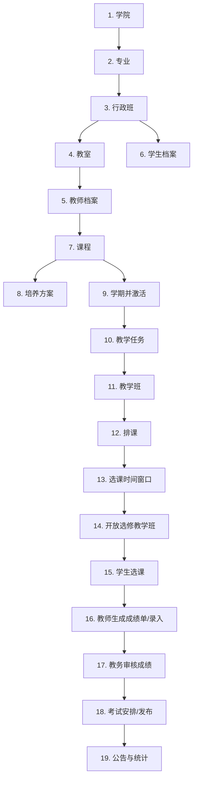

| 顺序 | 操作 | 页面 | 完成标志 |
|---|---|---|---|
| 1 | 创建学院 | 组织机构 → 学院 | 学院列表有数据 |
| 2 | 创建专业 | 组织机构 → 专业 | 专业归属学院正确 |
| 3 | 创建行政班 | 组织机构 → 班级 | 班级归属专业正确、年级正确 |
| 4 | 创建教室 | 组织机构 → 教室 | 教室状态“可用”、容量足够 |
| 5 | 创建教师 | 教师管理 | 教师账号可登录 |
| 6 | 创建学生 | 学生管理 / 批量导入 | 学生账号可登录、班级正确 |
| 7 | 创建课程 | 课程管理 | 课程性质、学时、学分正确 |
| 8 | 创建培养方案（可选） | 培养方案 | 方案课程已添加 |
| 9 | 创建并激活学期 | 学期管理 | 顶部显示“当前激活学期” |
| 10 | 创建教学任务 | 开课排课 → 教学任务 | 任务状态“已确认” |
| 11 | 创建教学班 | 开课排课 → 教学班 | 教师、容量正确 |
| 12 | 排课 | 教学班 → 排课 | 上课安排不再是“未排课” |
| 13 | 设置选课时间窗口 | 选课管理 | 窗口状态“进行中”，时间覆盖当前 |
| 14 | 开放选修教学班 | 选课管理/开课排课 | 选课管理顶部绿色提示 |
| 15 | 学生选课 | 学生 → 在线选课 | 我的选课/课表出现课程 |
| 16 | 教师录入成绩 | 教师 → 成绩录入 | 生成成绩单并保存草稿 |
| 17 | 教务审核成绩 | 成绩审核 | 状态“已通过”，学生可见 |
| 18 | 考试安排 | 考试管理 | 设置考场、排座、发布 |
| 19 | 公告与统计 | 公告管理/数据统计 | 公告已发布、统计有数据 |

**开学前重点检查**：

- 学期是否 ACTIVE；
- 选修课程是否已创建教学班并排课；
- 选课窗口是否“进行中”且时间正确；
- 必修课是否已通过「教学班 → 安排学生」完成预安排（见 4.10）；
- 教室容量是否足够；
- 教师/学生账号是否能登录。

---

## 11. 常见问题快速排查表

| 现象 | 最先检查 | 页面/操作 | 责任角色 |
|---|---|---|---|
| 学生端可选课程为空 | 页面学期是否正确 | 学生在线选课 → 切换学期 | 学生 |
| 学生端可选课程为空，窗口已开 | 是否有选修教学班且已开放 | 选课管理 → 看黄色诊断 | 教务 |
| 学生端提示“不在选课时间” | 窗口状态是否“进行中”、时间是否覆盖 | 选课管理 → 编辑窗口 | 教务 |
| 学生端看不到某门课 | 课程性质是否选修 | 课程管理 → 课程类型 | 教务 |
| 学生选课提示“未开放” | 教学班选课状态 | 开课排课/选课管理 → 开放 | 教务 |
| 学生选课提示“已满” | 教学班已选/容量 | 选课管理 → 名单/容量 | 教务 |
| 学生选课提示“时间冲突” | 与已选课程排课 | 学生我的课表 | 学生/教务 |
| 学生选课提示“先修不满足” | 先修课程成绩 | 课程管理 → 先修；学生成绩 | 教务/学生 |
| 学生不能退课 | 教学班是否 OPEN、学期是否结束、是否有成绩 | 选课管理/成绩 | 教务 |
| 创建教学班失败 | 学期、教学任务、教师、编号 | 开课排课 | 教务 |
| 排课失败 | 教室容量/教室冲突/教师冲突/学期结束 | 排课弹窗 | 教务 |
| 开放选课失败 | 是否有教师、是否有排课 | 开课排课 → 排课 | 教务 |
| 教师看不到教学班 | 授课教师是否本人、学期是否正确 | 开课排课 → 教学班 | 教务/教师 |
| 教师无法生成成绩单 | 是否有已选学生 | 学生选课/选课管理名单 | 教务/教师 |
| 教师无法提交成绩 | 是否有学生未录完整 | 成绩录入 → 已录入 x/y | 教师 |
| 教师提交后不能改 | 状态是否 SUBMITTED/APPROVED | 成绩录入顶部状态 | 教师/教务 |
| 教务审核失败 | 是否只选了 SUBMITTED | 成绩审核 | 教务 |
| 学生看不到成绩 | 是否 APPROVED、学期筛选 | 成绩审核/学生成绩 | 教务/学生 |
| Excel 导入失败 | 格式/表头/引用/重复/学时 | 批量导入 → 错误明细 | 教务 |
| 登录失败 | 账号密码/锁定/停用 | 登录页提示 | 用户/管理员 |
| 页面 401 | 令牌过期 | 重新登录 | 用户 |
| 页面 403 | 角色无权限/权限被撤销 | 查看提示 | 用户/管理员 |
| 多标签页身份错乱 | 同浏览器登录了不同账号 | 刷新/重新登录/分浏览器 | 用户 |
| 页面数据不更新 | 缓存/未查询 | 查询/刷新/切 Tab | 用户 |

---

## 12. 已发现的问题与限制（含证据）

> 本章只记录**当前代码与真实界面核对后发现的问题**，不包含猜测。按照任务要求，本次只编写文档，**未修改任何业务代码、数据库结构或数据**。

### 12.1 学生“我的成绩”页面班级/专业排名固定显示“—”

**现象**：学生首页“成绩概览”能看到班级排名、专业排名（例如 5 / 5），但进入“我的成绩”页面后，概览中的“班级排名”“专业排名”固定显示“—”，即使后端已返回排名。

**证据**：

- 前端 `uams/frontend/src/views/student/Grades.vue` 的概览区直接写死：
  - `<span class="ov__value">—</span>`（班级排名）
  - `<span class="ov__value">—</span>`（专业排名）
  - 该页只调用了 `/grades/mine` 与 `/grades/mine/summary`，没有调用返回排名的 `/grades/my`。
- 后端 `GET /api/v1/grades/my` 实际返回 `class_rank`、`major_rank`；学生首页 `Dashboard.vue` 使用了该接口，所以首页能显示排名。
- 截图对照：
  - `docs/images/manual/12-student-dashboard.png`：首页显示班级排名 5、专业排名 5；
  - `docs/images/manual/15-student-grades.png`：我的成绩页显示“—”。

**影响**：学生无法在“我的成绩”页查看排名，只能回首页查看。

**临时办法**：以首页“成绩概览”为准。

### 12.2 必修课预安排前端入口（已修复 FIX-002）

**原问题**：FIX-002 之前，教务端没有“必修课预安排”入口，教学班列表只有“名单”（查看），没有“添加学生/移除学生/预安排”按钮；普通教务人员无法通过界面完成必修课名单维护。

**修复后**：

- 开课排课 →「教学班」操作列新增「安排学生」；
- 弹窗包含「批量安排」和「当前名单」两个 Tab；
- 批量安排支持按行政班/专业/学院选择范围，先预览、再二次确认提交；
- 预览展示匹配/已安排/将新增/跳过人数、剩余容量、冲突/不符合条件人数及逐条原因；
- 当前名单展示学号、姓名、行政班、专业、安排来源、安排时间、状态，并支持手动添加/移除；
- 已有成绩记录的学生禁止移除；
- 新增 `course_selections.source` 字段区分“学生自主选课 / 教务批量预安排 / 教务手动添加”；历史记录保持 NULL，显示“历史记录（未标记来源）”，不自动回填；
- 批量安排和手动添加/移除写入操作日志。

**验证**：FIX-002 已在隔离库完成 35 项后端/API 测试；浏览器三角色端到端验收需在部署后按 FIX-002 报告执行。正式库应用 `course_selections.source` 迁移前需按变更流程确认。

### 12.3 退课不校验选课时间窗口（已修复 FIX-003）

**原问题**：FIX-003 之前，学生退课只校验教学班是否 `OPEN`、学期是否 `ENDED`、是否有非草稿成绩，没有校验选课时间窗口（`SelectionPeriod`）；窗口关闭但教学班仍开放时，学生仍可退课。

**修复后**：

- 选课和退课统一调用后端的窗口判断：学期 ACTIVE、窗口 ACTIVE、当前时间在起止时间内、限定年级匹配；
- 退课还校验教学班 ACTIVE/OPEN、选修课、非草稿成绩；必修课仍禁止学生自主退课；
- 时间边界包含开始/结束时刻；同一学期多个 ACTIVE 窗口按并集判断；
- 学生端显示统一原因（如“选课尚未开始/已结束/窗口未开放/不适用于你的年级”），并禁用不可操作的选课/退课按钮；
- 管理员端“实际状态”列与后端判断一致，并对重叠窗口给出提示；
- 直接调用 API 同样被后端拒绝，不能绕过前端。

**验证**：FIX-003 在隔离库 `uams_test` 完成 42 项窗口测试；FIX-001（25 项）、FIX-002（36 项）回归通过；浏览器学生端/管理员端验证完成（见 `docs/archive/UAMS_V3.1_FIX-003_REPORT.md`）。

### 12.4 前端默认学期按浏览器日期推断，可能与学校实际学期不一致

**现象**：多个页面使用 `currentSemester()` 按浏览器当前日期推断学期（9 月~次年 1 月为第一学期，2 月~8 月为第二学期），而不是读取后端“当前激活学期”。

**证据**：

- `uams/frontend/src/composables/useSemester.ts` 的 `currentSemester()` 按 `new Date()` 计算；
- 使用该默认值的页面包括：
  - 学生“在线选课”“我的课表”“考试安排”“首页”“教学评价”；
  - 教务“开课排课”“选课管理”“数据统计”“考试管理”“工作台”；
  - 教师“工作台”“成绩录入”。
- **教师“成绩录入”页没有学期下拉框**，只加载 `currentSemester()` 对应的教学班。

**影响**：如果学校实际激活学期与浏览器日期推断不一致（例如提前开学、补录、跨年学期），相关页面默认显示错误学期，可能表现为“学生看不到课程”“教师看不到教学班”“成绩录入没有班级”。

**临时办法**：

- 有学期下拉框的页面：手动切换到正确学期；
- 教师成绩录入页：没有学期选择器，属于限制；请联系技术人员确认当前学期配置，不建议修改服务器日期。

### 12.5 学生可选列表不校验“限定年级”窗口，可能出现“看得到但选不了”

**现象**：选课时间窗口可以设置“限定年级”。学生可选课程列表只校验课程性质、教学班状态、学期状态，不校验窗口的 `target_grade_year`；学生可能看到课程，但提交选课时提示“当前不在选课时间内”。

**证据**：

- `available_classes()` 使用 `_selectable_conditions()`，不涉及 `SelectionPeriod`；
- `select_course()` 调用 `_check_period_open(student, semester)`，其中 `SelectionPeriod.is_open_now(student.enrollment_year)` 会校验限定年级；
- 学生端 `openPeriod` 也只判断窗口状态与起止时间，不判断 `target_grade_year`。

**影响**：年级限定窗口下，不符合年级的学生会看到课程但无法选择，提示可能不够直观。

**临时办法**：尽量使用“限定年级=全部”的窗口；如必须限定年级，提前告知学生，并在窗口中写清适用年级。

### 12.6 已审核通过的成绩没有界面更正入口

**现象**：教师提交成绩后，教务审核通过（APPROVED）。如果发现成绩错误，当前界面没有“撤销通过/修改已通过成绩”的入口。

**证据**：

- 教师成绩录入页提示“成绩已审核通过，不可直接修改。如需更正请联系教务”；
- 教务成绩审核页只查询 `SUBMITTED` 成绩；`approve`/`reject` 都要求 `SUBMITTED`；
- 没有“撤销审核”或“修改已通过成绩”的接口/按钮。

**影响**：已通过成绩的错误只能通过技术人员在数据库层面更正（需保留审计记录），普通界面无法完成。

**建议**：正式使用前建立成绩更正流程；后续版本可考虑增加“撤销审核/更正”功能。

### 12.7 通用操作日志只有后端接口，前端没有独立查询页面

**现象**：管理员管理页只提供“变更记录”（管理员授予/撤销/启停），没有面向全部业务操作的“操作日志”菜单。

**证据**：

- 后端存在 `GET /api/v1/audit-logs`，支持按动作、操作人、资源类型/ID 过滤，权限 `audit:read`；
- 前端只有 `AdminManage.vue` 的“变更记录”弹窗调用 `auditLogs`，按 `resource_type=user`、`resource_id=管理员账号` 查询；
- 没有独立路由/菜单“操作日志”。

**影响**：无法通过界面查询学生、课程、选课、成绩等业务操作的通用日志；只能查管理员权限变更记录。

**临时办法**：需要时由技术人员通过后端接口/日志系统查询。

### 12.8 教学任务没有前端编辑入口

**现象**：开课排课的“教学任务”列表只有「删除」，没有「编辑」；如需修改计划开班数或状态，只能删除后重建。

**证据**：

- 后端存在 `PUT /api/v1/teaching-tasks/{task_id}`；
- 前端 `admin/Teaching.vue` 教学任务表格只渲染「删除」按钮。

**影响**：修改教学任务需要删除重建；任务下已有教学班时不能删除，会进一步限制操作。

**临时办法**：在任务下尚未创建教学班时删除重建；已有教学班时联系技术人员通过接口修改。

### 12.9 考试管理不自动检测考试时间/考场冲突

**现象**：创建考试、添加考场时，系统不检测同一教室在同一时间是否已有其他考试，也不检测与上课排课的冲突；需要教务人工避免。

**证据**：

- `create_exam()` 只校验教学班存在、同教学班同类型考试唯一、结束时间晚于开始时间；
- `add_room()` 只校验教室存在、容量不超过教室容量、同一考试不重复添加同一教室；
- 没有查询其他考试/排课的时间冲突。

**影响**：可能排出同一教室同一时间的多场考试，或考试与上课冲突。

**临时办法**：教务在安排考试前人工核对教室和时间；必要时使用数据统计/课表页面辅助检查。

### 12.10 公告列表按账号类别过滤，教师兼任管理员可能看不到草稿

**现象**：教师被授予管理员角色后，可以进入教务端并发布公告，但在“公告管理”列表中可能看不到自己刚创建的草稿公告，也看不到面向学生的公告。

**证据**：

- 后端 `GET /api/v1/announcements` 的可见性判断使用 `current.user_type != UserType.ADMIN`；
- 教师兼任管理员的 `user_type` 仍是 `TEACHER`，因此会被当作普通教师过滤，只返回“已发布且面向教师/全体”的公告；
- 管理员身份本来以 `ACADEMIC_ADMIN` 角色为准，但公告列表仍按账号类别过滤，两者口径不一致。

**影响**：教师兼任管理员发布/编辑公告时，列表可能缺少草稿或学生公告，容易误以为发布失败。

**临时办法**：使用账号类别为 ADMIN 的独立管理员维护公告；或发布后通过学生/教师端确认可见性。

### 12.11 邮箱留空或重复时，新增档案可能返回 500

**现象**：通过“学生管理/教师管理”新增档案时，如果“邮箱”留空，前端会提交空字符串 `""`。连续新增两个邮箱都为空的档案时，第二个可能返回 **500 Internal Server Error**；填写两个相同的非空邮箱也会返回 500。系统没有给出“邮箱已存在”的友好提示。

**证据**：

- 前端新增学生/教师的表单初始值为 `email: ''`，提交时未把空字符串转成 `null`；
- 数据库 `users.email` 有唯一约束；
- 后端 `StudentService.create_student()` / `TeacherService.create_teacher()` 在 `self.db.flush()` 阶段写用户，唯一约束冲突发生在该 `flush()`，没有被 `BaseCrudService._commit()` 的重复错误处理捕获，因此返回 500；
- 隔离库实测：
  - 第一个邮箱为空的学号 `99000001` 创建成功（201）；
  - 第二个邮箱为空的学号 `99000002` 返回 **500**；
  - 第一个使用 `duplicate@example.com` 的学号 `99000011` 创建成功（201）；
  - 第二个使用同一邮箱的学号 `99000012` 返回 **500**。

**影响**：教务连续录入多个没有邮箱的学生/教师，或误填重复邮箱时，保存失败且错误信息不直观。

**临时办法**：为每个档案填写唯一邮箱；或由技术人员在数据层面将空邮箱规范为 `NULL`。不要重复点击提交。

---

## 13. 附录：字段与状态速查

### 13.1 课程性质

| 代码 | 中文 | 是否自主选课 |
|---|---|---|
| `REQUIRED` | 专业必修 | 否 |
| `PUBLIC_REQUIRED` | 公共必修 | 否 |
| `PRACTICE` | 实践 | 否 |
| `ELECTIVE` | 专业选修 | 是 |
| `PUBLIC_ELECTIVE` | 公共选修 | 是 |

### 13.2 学期状态

| 代码 | 中文 | 能否选课 | 能否新增教学班/排课 |
|---|---|---|---|
| `PLANNED` | 未开始 | 否 | 可以（需先创建学期） |
| `ACTIVE` | 进行中 | 是 | 可以 |
| `ENDED` | 已结束 | 否 | 否 |

### 13.3 教学班选课状态

| 代码 | 中文 | 学生能否选 |
|---|---|---|
| `CLOSED` | 未开放 | 否 |
| `OPEN` | 选课中 | 是（还需满足其他条件） |
| `FINISHED` | 已结束 | 否 |

### 13.4 选课记录状态

| 代码 | 中文 | 含义 |
|---|---|---|
| `SELECTED` | 已选 | 当前有效选课 |
| `DROPPED` | 已退 | 软删除，保留记录；重选同一教学班时复用 |

### 13.5 成绩状态

| 代码 | 中文 | 学生可见 | 教师可改 |
|---|---|---|---|
| `DRAFT` | 草稿 | 否 | 是 |
| `SUBMITTED` | 待审核 | 否 | 否 |
| `APPROVED` | 已通过 | 是 | 否 |
| `REJECTED` | 已驳回 | 否 | 是 |

### 13.6 成绩字段

| 字段 | 中文 | 录入/计算 |
|---|---|---|
| `regular_score` | 平时成绩 | 教师录入 |
| `mid_score` | 期中成绩（合并口径） | 非实践课教师录入 |
| `mid_theory_score` | 期中理论 | 实践课教师录入 |
| `mid_practice_score` | 期中实践 | 实践课教师录入 |
| `final_score` | 期末成绩（合并口径） | 非实践课教师录入 |
| `final_theory_score` | 期末理论 | 实践课教师录入 |
| `final_practice_score` | 期末实践 | 实践课教师录入 |
| `theory_makeup_score` | 理论补考/补考成绩 | 教师录入（期末不及格时） |
| `practice_makeup_score` | 实践补考 | 实践课教师录入 |
| `theory_total_score` | 理论总评 | 系统计算 |
| `practice_total_score` | 实践总评 | 系统计算 |
| `total_score` | 成绩总评 | 系统计算 |
| `grade_point` | 绩点 | 系统计算 |
| `is_passed` | 是否及格 | 系统计算（总评 ≥ 60） |

### 13.7 常用页面路径

| 角色 | 页面 | 路径 |
|---|---|---|
| 公共 | 登录 | `/login` |
| 管理员 | 工作台 | `/admin/dashboard` |
| 管理员 | 组织机构 | `/admin/colleges` |
| 管理员 | 学生管理 | `/admin/students` |
| 管理员 | 教师管理 | `/admin/teachers` |
| 管理员 | 课程管理 | `/admin/courses` |
| 管理员 | 培养方案 | `/admin/curriculum` |
| 管理员 | 开课排课 | `/admin/teaching` |
| 管理员 | 选课管理 | `/admin/selection` |
| 管理员 | 管理员管理 | `/admin/admins` |
| 管理员 | 学期管理 | `/admin/terms` |
| 管理员 | 批量导入 | `/admin/imports` |
| 管理员 | 成绩审核 | `/admin/grades` |
| 管理员 | 考试管理 | `/admin/exams` |
| 管理员 | 公告管理 | `/admin/announcements` |
| 管理员 | 数据统计 | `/admin/statistics` |
| 教师 | 工作台 | `/teacher/dashboard` |
| 教师 | 我的课程 | `/teacher/courses` |
| 教师 | 我的课表 | `/teacher/schedule` |
| 教师 | 成绩录入 | `/teacher/grades` |
| 教师 | 教学评价 | `/teacher/evaluation` |
| 教师 | 通知公告 | `/teacher/announcements` |
| 学生 | 首页 | `/student/dashboard` |
| 学生 | 我的信息 | `/student/profile` |
| 学生 | 我的课表 | `/student/schedule` |
| 学生 | 在线选课 | `/student/selection` |
| 学生 | 我的成绩 | `/student/grades` |
| 学生 | 考试安排 | `/student/exams` |
| 学生 | 教学评价 | `/student/evaluation` |
| 学生 | 通知公告 | `/student/announcements` |

### 13.8 默认账号说明

- 正式环境的账号由学校统一创建和发放；本手册不提供正式账号密码。
- 演示/开发环境可能使用 `admin / admin123`、`T001 / T001`、`20260001 / 20260001` 等演示账号，**仅用于开发演示，不得用于正式环境**。
- 学生/教师首次登录的默认密码规则见 3.1；首次登录后请立即修改。

---

> **文档结束**
> 本手册基于当前代码与隔离测试环境逐项核对。若系统后续版本调整页面、字段或业务规则，请同步更新本手册。
