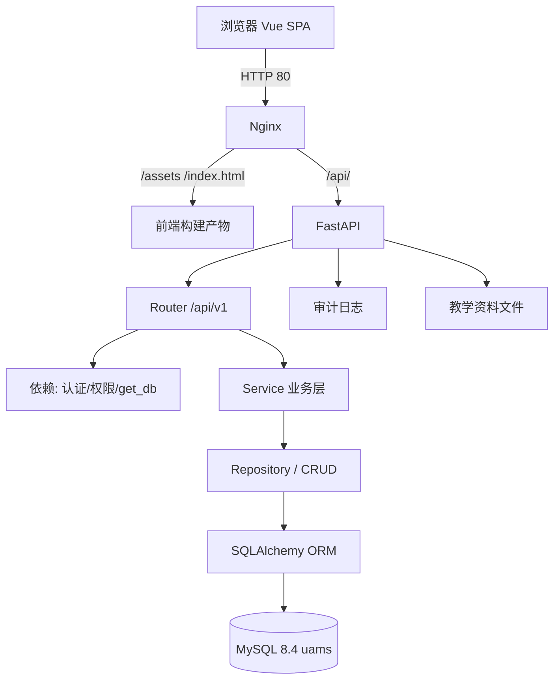
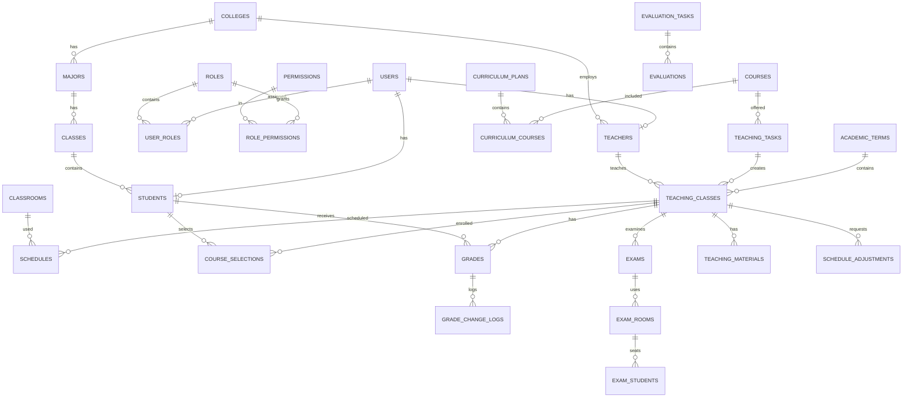

# UAMS 高校教务教学管理系统技术文档

> 文档版本：V3.2
> 更新日期：2026-10-29
> 面向读者：开发人员、维护人员、技术评审、后续项目接手者
> 当前版本：UAMS V3.2
> 正式数据库：MySQL `uams`，Alembic head `e4f5a6b7c8d9`
> 配套文档：[PRD](PRD.md)、[系统白皮书](UAMS_系统白皮书.md)、[API](API.md)、[DATABASE](DATABASE.md)、[DEPLOYMENT](DEPLOYMENT.md)

---

## 1. 系统概述

### 1.1 项目背景

UAMS 面向高校教务教学管理，覆盖基础数据、课程、培养方案、教学任务、教学班、排课、选课、课表、成绩、考试、评价、公告、教学资料、调停课、导入导出与审计统计。

### 1.2 建设目标

- 形成可运行的教学业务闭环；
- 关键规则后端化，防止绕过；
- 三类角色数据隔离；
- 支持正式部署、迁移、备份与回滚；
- 提供可持续维护的分层代码与文档。

### 1.3 技术定位

前后端分离的单体 Web 应用：

- 前端为 Vue 3 SPA；
- 后端为 FastAPI 单体服务，分层组织；
- MySQL 单库持久化；
- Nginx 提供静态站点与 API 反向代理；
- systemd 管理后端进程。

### 1.4 当前版本与边界

| 项目 | 当前状态 |
|---|---|
| 版本 | V3.2 |
| 正式库 | `uams` |
| Alembic head | `e4f5a6b7c8d9` |
| 正式访问 | Nginx 80 |
| 后端 | systemd，127.0.0.1:8000 |
| 开发/测试 | Vite 5173 + uvicorn（按需启动） |
| 已实现 | 教务核心闭环、导入导出、审计、统计、正式部署 |
| 未实现 | 招生/财务/人事、毕业审核、智能排课、SSO、原生移动端、HTTPS |

---

## 2. 技术栈

版本来自 `backend/requirements.txt`、`frontend/package.json` 与实际运行环境。

### 2.1 后端

| 组件 | 版本 | 用途 |
|---|---|---|
| Python | 3.14.4 | 运行时 |
| FastAPI | 0.141.1 | Web API |
| Starlette | 1.6.0 | ASGI 基础 |
| Uvicorn | 0.53.0 | ASGI Server |
| SQLAlchemy | 2.0.52 | ORM / 事务 |
| Alembic | 1.20.0 | 数据库迁移 |
| PyMySQL | 1.2.0 | MySQL 驱动 |
| Pydantic | 2.13.5 | Schema / 校验 |
| pydantic-settings | 2.15.0 | 环境配置 |
| bcrypt | 5.0.0 | 密码哈希 |
| python-jose | 3.5.0 | JWT |
| openpyxl | 3.1.5 | Excel 导入导出 |
| python-multipart | 0.0.32 | 文件上传 |
| pytest | 9.1.1 | 测试 |

### 2.2 前端

| 组件 | 版本 | 用途 |
|---|---|---|
| Node.js | 22.22.1 | 构建环境 |
| npm | 11.19.1 | 包管理 |
| Vue | 3.5.42 | UI 框架 |
| Vue Router | 5.3.1 | 路由与守卫 |
| Pinia | 4.0.3 | 状态管理 |
| Element Plus | 2.14.5 | UI 组件 |
| Axios | 1.20.0 | HTTP |
| Vite | 8.3.0 | 构建/开发服务器 |
| TypeScript | 6.0.3 | 类型 |
| vue-tsc | 3.3.11 | 类型检查 |
| Sass | 1.104.1 | 样式预处理 |

### 2.3 基础设施

| 组件 | 版本/状态 |
|---|---|
| MySQL | 8.4.11（InnoDB / utf8mb4） |
| Nginx | 1.28.3 |
| systemd | 259 |
| 操作系统 | Ubuntu（Linux 7.0 内核环境） |

---

## 3. 总体架构

### 3.1 逻辑架构



### 3.2 分层职责

```text
Router（app/api/v1）
  ↓ 参数校验 / 权限依赖
Schema（app/schemas 或 Router 内 DTO）
  ↓
Service（app/services）
  ↓ 业务规则、事务、状态机
Repository / BaseCrudService（app/repositories、app/services/base.py）
  ↓
Model（app/models）
  ↓
SQLAlchemy → PyMySQL → MySQL
```

- Router 只处理 HTTP、依赖、响应；
- Service 承载业务规则与事务；
- Repository/BaseCrudService 封装通用查询；
- Model 负责表结构；
- Core 提供配置、安全、异常。

### 3.3 认证与权限

- 登录：`AuthService.authenticate()`；
- Token：JWT，`sub` 为用户 ID，附 username/user_type；
- 每次请求 `get_current_user` 重新读取用户并检查 ACTIVE；
- 权限依赖 `RequirePermissions`；
- 对象级校验在 Router/Service 内执行（学生本人、教师本人教学班）；
- 管理员身份以 `ACADEMIC_ADMIN` 角色判定。

### 3.4 部署拓扑

```mermaid
flowchart LR
    U[用户浏览器] -->|80| N[Nginx]
    N -->|静态| R[/var/www/uams/current]
    N -->|/api/| A[FastAPI 127.0.0.1:8000]
    A --> M[(MySQL 127.0.0.1:3306/uams)]
    S[systemd uams-backend] --> A
    A --> F[backend/uploads/materials]
```

---

## 4. 工程目录

```text
uams/
├── README.md
├── CLAUDE.md
├── start.sh
├── backend/
│   ├── app/
│   │   ├── main.py
│   │   ├── api/
│   │   │   ├── deps.py
│   │   │   └── v1/            # auth/person/course/teaching/selection/grade/exam/...
│   │   ├── core/              # config/security/exceptions
│   │   ├── db/                # base/session
│   │   ├── models/            # 14 个模型模块
│   │   ├── repositories/      # 用户等数据访问
│   │   ├── schemas/           # Pydantic Schema
│   │   ├── services/          # 20 个业务服务
│   │   └── utils/
│   ├── alembic/               # 迁移链
│   ├── scripts/               # seed/env_guard/启动辅助
│   ├── tests/                 # pytest
│   ├── uploads/materials/     # 教学资料（Git 忽略）
│   ├── .env                   # 本机配置（Git 忽略）
│   └── requirements.txt
├── frontend/
│   ├── src/
│   │   ├── api/               # Axios 与接口封装
│   │   ├── assets/            # main.css
│   │   ├── components/        # 公共组件
│   │   ├── composables/       # useCrudTable/useSemester
│   │   ├── layouts/           # MainLayout
│   │   ├── router/            # 路由与守卫
│   │   ├── stores/            # Pinia auth
│   │   ├── types/             # TypeScript 类型
│   │   ├── utils/
│   │   └── views/             # 38 个页面，admin/teacher/student/common
│   ├── public/
│   ├── package.json
│   └── vite.config.ts
├── deploy/
│   ├── nginx/uams.conf
│   ├── systemd/uams-backend.service
│   ├── deploy-frontend.sh
│   ├── preflight-nginx.sh
│   ├── preflight-system.sh
│   └── README.md
├── docs/
│   ├── README.md
│   ├── PRD.md / PRD.docx
│   ├── UAMS_系统白皮书.md
│   ├── UAMS_系统技术文档.md
│   ├── UAMS_教务管理系统用户操作手册.md
│   ├── UAMS_启动与环境切换说明.md
│   ├── ARCHITECTURE.md / API.md / DATABASE.md / DEPLOYMENT.md / DEVELOPMENT.md / TESTING.md
│   └── archive/{audits,fixes,reports}
└── scripts/                   # 环境准备脚本
```

运行数据：`logs/`、`.run/`、`backend/uploads/`、`/var/www/uams/` 均不属于源码。

---

## 5. 后端架构

### 5.1 API 层

`backend/app/api/v1/` 模块：

| 模块 | 职责 |
|---|---|
| `auth.py` | 登录/登出/当前用户/改密 |
| `user.py` | 管理员账号、角色授权 |
| `person.py` | 学生/教师档案 |
| `organization.py` | 学院/专业/班级/教室 |
| `course.py` | 课程、培养方案 |
| `terms.py` | 学期 |
| `teaching.py` | 教学任务/教学班/排课 |
| `selection.py` | 选课窗口、选课/退课、必修预安排、名单 |
| `grade.py` | 成绩录入/提交/审核/更正/历史 |
| `exam.py` | 考试/考场/监考/排座 |
| `misc.py` | 公告、评价、审计日志 |
| `materials.py` | 教学资料上传/下载/删除 |
| `adjustments.py` | 调停课申请/审批 |
| `imports.py` / `exports.py` | Excel 导入导出 |
| `schedule.py` | 本人/学生课表 |
| `teaching_schedule.py` | 教学班排课辅助 |

### 5.2 Schema 层

- 请求/响应 DTO 使用 Pydantic v2；
- 主要 Schema 在 `app/schemas/`，部分模块在 Router 内定义；
- 统一分页 `PageParams/PageResult`；
- 业务异常统一 `{code, message}`，校验异常 `{code, message, errors}`。

### 5.3 Service 层

| 服务 | 职责 |
|---|---|
| `auth.py` | 认证、锁定、JWT 签发、改密 |
| `base.py` | 通用 CRUD、分页、唯一性、搜索 |
| `assessment.py` | 课程考核结构与权重 |
| `score_service.py` | 总评/绩点/补考/及格计算 |
| `gpa_service.py` | 实时 GPA |
| `ranking_service.py` | 班级/专业排名 |
| `grade.py` | 成绩状态机、审核、更正、历史 |
| `selection.py` | 窗口、选课/退课、预安排 |
| `exam.py` | 考试冲突与考场校验 |
| `teaching.py` | 教学班/排课/冲突、名单 |
| `term.py` | 学期状态与 ACTIVE |
| `person.py` | 学生/教师建档与账号联动 |
| `course.py` / `organization.py` | 课程/组织 |
| `import_service.py` | Excel 导入 |
| `audit.py` | 操作日志写入 |
| `email.py` / `integrity.py` | 邮箱治理 / 唯一约束翻译 |

### 5.4 Repository / Model

- `repositories/user.py` 提供用户按 ID/用户名查询；
- 多数模块通过 `BaseCrudService` 直接使用 SQLAlchemy Session；
- 模型位于 `app/models/`：user/role/person/organization/course/term/teaching/selection/grade/exam/misc/material/adjustment；
- 关系加载使用 `selectinload` 控制 N+1。

### 5.5 Core / DB

- `core/config.py`：pydantic-settings 读取 `backend/.env`；
- `core/security.py`：bcrypt、JWT 编解码；
- `core/exceptions.py`：业务异常与错误码；
- `db/session.py`：engine、SessionLocal、get_db；
- `db/base.py`：DeclarativeBase、IdMixin、TimestampMixin。

---

## 6. 前端架构

### 6.1 路由

`src/router/index.ts` 定义三端：

| 端 | 路径 | 页面 |
|---|---|---|
| 学生 | `/student/*` | 工作台、信息、课表、培养方案、资料、选课、成绩、考试、评价、公告 |
| 教师 | `/teacher/*` | 工作台、课程、资料、课表、成绩录入、调停课、评价、公告 |
| 教务 | `/admin/*` | 工作台、组织、学生、教师、课程、培养方案、开课、调停课、选课、管理员、学期、审计、导入、成绩审核、评价、考试、公告、统计 |

守卫逻辑：

1. 公共页放行；
2. 未登录跳 `/login`；
3. 刷新后权限为空时调用 `/auth/me`；
4. 根据 `identities`（user_type + 角色）判断能否进入对应端；
5. 后端仍是最终权限裁判。

### 6.2 状态管理

`src/stores/auth.ts`：

- token/user 持久化到 localStorage；
- 登录后拉取 ACTIVE 学期；
- 401 清理并跳登录；
- 403 区分普通越权与管理员权限撤销；
- 登录响应缺少凭证时清理并抛错。

### 6.3 API 请求

`src/api/request.ts`：

- baseURL `/api/v1`，同源；
- 自动注入 Bearer Token；
- 登录请求/登录页不弹全局错误，由登录页内联提示；
- 401 清理登录态；
- 403 通知 auth store；
- 422 展示字段错误；
- 网络/5xx 统一提示。

### 6.4 页面与布局

- `MainLayout.vue`：侧边菜单 + 顶栏；
- 38 个页面，按角色分目录；
- 列表页复用 `useCrudTable`；
- 课表使用 `ScheduleGrid.vue`；
- PC 优先，基础响应式。

---

## 7. 数据库设计

### 7.1 核心实体

实际库共 33 张表（含 `alembic_version`）：

`users`、`roles`、`permissions`、`user_roles`、`role_permissions`、`students`、`teachers`、`colleges`、`majors`、`classes`、`classrooms`、`courses`、`course_prerequisites`、`curriculum_plans`、`curriculum_courses`、`academic_terms`、`teaching_tasks`、`teaching_classes`、`schedules`、`selection_periods`、`course_selections`、`grades`、`grade_change_logs`、`exams`、`exam_rooms`、`exam_students`、`evaluation_tasks`、`evaluations`、`announcements`、`teaching_materials`、`schedule_adjustments`、`operation_logs`。

### 7.2 ER 图（核心）



### 7.3 约束与索引

- 主键：`BIGINT UNSIGNED` 自增；
- 唯一约束：用户名、学号、工号、课程代码、角色/权限代码、学期、教学班编码等；
- 外键：业务关系明确，删除策略 CASCADE/SET NULL；
- CHECK：状态枚举、成绩范围、来源、调停课类型等；
- 索引：登录、状态、时间、课程/班级/教学班等高频字段；
- 字符集：utf8mb4；引擎：InnoDB。

### 7.4 迁移

```bash
cd backend
.venv/bin/alembic current
.venv/bin/alembic history
.venv/bin/alembic upgrade head
```

- 迁移链线性，当前 head `e4f5a6b7c8d9`；
- 版本不一致时 `uams-backend.service` 启动前拒绝；
- 不自动迁移；正式迁移需单独授权与备份。

### 7.5 事务与一致性

- 选课/退课：锁定教学班行，校验容量，写选课记录；
- 成绩审核/更正：成绩状态与学分/GPA 刷新同事务；学生行加锁；
- 调停课审批：申请行 `FOR UPDATE`，排课变更与状态同事务；
- 关键唯一约束防止重复记录。

---

## 8. 核心业务实现

### 8.1 学期状态

- `AcademicTermService.activate()` 保证唯一 ACTIVE；
- `/terms/active` 供全系统统一读取；
- ENDED 学期下教学班/排课只读。

### 8.2 教学班与排课

- 教学班关联学期、课程、教师、任务；
- 开放选课要求教师 + 排课，编辑接口同样校验；
- `ScheduleService` 检测教师/教室/教学班冲突；
- 排课变更受学期状态保护。

### 8.3 选课与容量

- `SelectionService.selection_window_status()` 统一窗口判断；
- 多 ACTIVE 窗口取并集；
- 选课/退课锁教学班行，动态计数；
- 必修预安排支持预览、逐条跳过原因、单事务写入。

### 8.4 成绩考核结构

`assessment.py`：

- 总学时 ≤32：平时 20% + 期末 80%，无期中；
- ≤48：平时 20% + 期中 30% + 期末 50%；
- >48：同 48；
- 实践学时 >0：理论/实践分别计算，总评为两侧平均。

### 8.5 成绩计算与审核

- `ScoreService.compute()` 计算理论/实践总评、总评、绩点、及格；
- 补考替换不及格期末分项，通过侧最高 60；
- 状态机：DRAFT → SUBMITTED → APPROVED/REJECTED；
- 撤销审核：APPROVED → REJECTED，教师可重提；
- 直接更正：APPROVED 保持，写变更历史，重算学分/GPA。

### 8.6 GPA 与排名

- GPA 实时计算，不落库；
- 有效成绩 = APPROVED 且有总评；
- 排名按 GPA 降序，同分并列跳号；
- 学生已修学分在审核/撤销/更正后同事务刷新到 `students`。

### 8.7 考试管理

- `ExamService` 校验时长、教室、监考、学生、排课冲突；
- 新建考试尚未 flush 时同样检测学生冲突；
- 考场容量/已分配人数校验；
- 发布前必须有考场；排座后已分配考场不可删除。

### 8.8 教学评价

- 任务含学期、起止、状态；
- 学生仅评价本人已选课程，且教学班学期与任务一致；
- 每任务每课程一次；
- 统计按教学班聚合，教师仅本人。

### 8.9 文件上传下载

- 目录：`backend/uploads/materials`（绝对解析）；
- 文件名取 basename，落盘 UUID；
- 类型白名单、10MB 限长读取；
- 下载/删除校验班级归属与路径包含；
- 不作为 Nginx 静态文件暴露。

### 8.10 调停课

- 类型 CHANGE/CANCEL/ADD；
- 教师仅本人教学班；区间校验；
- 审批行锁；批准后原子改排课。

### 8.11 审计与业务日志

- 登录成功/失败写 `operation_logs`；
- 已认证 POST/PUT/PATCH/DELETE 由中间件记录；
- 不读取请求体，不记录密码/Token；
- 查询接口需要 `audit:read`。

---

## 9. API 设计

### 9.1 组织

- 前缀 `/api/v1`；
- 资源 REST 风格；
- 特殊动作使用 `POST /resource/{id}/action`；
- 分页 `page/page_size/keyword/order_by/order_desc`。

### 9.2 响应

成功：资源对象或 `PageResult`；错误：

```json
{"code": "AUTH_INVALID_CREDENTIALS", "message": "用户名或密码错误"}
```

校验错误：

```json
{"code": "VALIDATION_ERROR", "message": "请求参数校验失败", "errors": [{"field": "username", "msg": "..."}]}
```

### 9.3 认证与权限

- `Authorization: Bearer <token>`；
- 401 未认证/过期；
- 403 无权限/停用；
- 423 锁定；
- 权限码如 `student:read`、`grade:approve`、`selection:manage`、`audit:read`。

### 9.4 典型调用

```bash
# 登录
curl --noproxy '*' -s -X POST http://127.0.0.1:8000/api/v1/auth/login \
  -H 'Content-Type: application/json' \
  -d '{"username":"admin","password":"..."}'

# 学生可选课程
curl --noproxy '*' -s 'http://127.0.0.1:8000/api/v1/course-selections/available?semester=2026-2027-1' \
  -H "Authorization: Bearer $TOKEN"

# 教务审核成绩
curl --noproxy '*' -s -X POST http://127.0.0.1:8000/api/v1/grades/approve \
  -H "Authorization: Bearer $TOKEN" -H 'Content-Type: application/json' \
  -d '{"grade_ids":[1,2]}'
```

### 9.5 API 文档

- 开发环境 `DEBUG=true`：`/docs`、`/redoc`、`/openapi.json`；
- 正式环境默认关闭；
- 完整清单见 [API.md](API.md)。

---

## 10. 安全设计

| 机制 | 实现 |
|---|---|
| 密码 | bcrypt 哈希，禁止明文 |
| JWT | HS256，有效期默认 480 分钟，密钥来自 `.env` |
| RBAC | 用户→角色→权限；后端依赖校验 |
| 对象级权限 | 学生本人；教师本人教学班；管理员全校 |
| 管理员判定 | `ACADEMIC_ADMIN` 角色，支持教师双身份 |
| 登录失败 | 默认 5 次锁定 15 分钟；返回剩余秒数 |
| 敏感配置 | `.env` Git 忽略，权限 600 |
| 文件 | 类型/大小/路径/归属校验 |
| 数据库 | 应用账号仅授权业务库；正式/测试分离 |
| 日志 | 不记录密码/Token/JWT；审计失败不阻断业务 |
| 代理 | Nginx 传递 Host/X-Real-IP/X-Forwarded-*；后端仅信任 127.0.0.1 |

未实现：HTTPS、HSTS、统一身份认证、WAF、第三方安全测评。

---

## 11. 正式部署

### 11.1 当前真实状态

| 组件 | 状态 |
|---|---|
| Nginx | 1.28.3，active，监听 80 |
| 站点配置 | `/etc/nginx/sites-available/uams` → `sites-enabled/uams` |
| 前端根 | `/var/www/uams/current`（软链到 release） |
| 后端 | `uams-backend.service` active，127.0.0.1:8000 |
| 数据库 | `uams`，head `e4f5a6b7c8d9` |
| 5173 | 已停止，仅开发/测试使用 |
| 日志 | journald + `/var/log/nginx/uams.*.log` |

### 11.2 systemd

```ini
ExecStartPre=.../env_guard.py check production
ExecStart=.../env_guard.py exec production -- .venv/bin/python -m uvicorn app.main:app \
  --host 127.0.0.1 --port 8000 --proxy-headers --forwarded-allow-ips=127.0.0.1
Restart=on-failure
StandardOutput=journal
```

管理：

```bash
sudo systemctl status uams-backend nginx
sudo systemctl restart uams-backend
journalctl -u uams-backend -f
```

### 11.3 Nginx

- `location ^~ /api/` → `proxy_pass http://127.0.0.1:8000;`（无尾斜杠，保留路径）；
- SPA `try_files $uri $uri/ /index.html`；
- `/assets/` 长期缓存；`index.html` no-store；
- 拒绝点文件；上传 20MB；
- 默认站点已停用，UAMS 为 80 唯一站点。

### 11.4 前端发布

```bash
bash deploy/deploy-frontend.sh
```

- 构建 → release → `nginx -t` → 原子切换 → reload → 首页/API 校验；
- 本机检查使用 `curl --noproxy '*'`，避免代理误判；
- 记录 `previous`；失败回滚；首次失败保留 current；
- 旧 release 只保留最近 3 个且不删 current/previous。

### 11.5 数据库版本检查

`env_guard.py`：

- 从 `.env` 解析 URL，只替换库名；
- `SELECT DATABASE()` 必须为目标库；
- `alembic_version` 必须等于项目 head；
- 不自动迁移。

### 11.6 备份与回滚

- 备份：`mysqldump --single-transaction --no-tablespaces` + gzip + SHA256；
- 前端回滚：`ln -sfn /var/www/uams/previous /var/www/uams/current`；
- Nginx/ systemd 配置备份见 `deploy/README.md`；
- 数据库回滚依赖备份恢复，不依赖 `downgrade`。

---

## 12. 测试与验收

### 12.1 自动化

```bash
cd backend && .venv/bin/pytest -q
cd frontend && npm run build
bash -n start.sh deploy/*.sh
```

当前结果：

| 项目 | 结果 |
|---|---|
| pytest | 44 通过 |
| 前端构建 | 通过 |
| Shell 语法 | 通过 |
| systemd unit 校验 | 通过 |
| Nginx 配置 | 正式站点运行；`nginx -t` 需 root，未在普通用户下完成 |

### 12.2 覆盖范围

- 邮箱治理、成绩快照、考试时长、隔离库、选课窗口；
- 成绩更正/撤销/历史；
- 考试冲突、考场、调停课；
- 审计、双身份、数据隔离、导出、资料、评价；
- 登录错误码/锁定；
- 环境守卫 URL/身份/版本。

### 12.3 未覆盖

- 全页面/全权限组合；
- 高并发与性能；
- 长时间稳定性；
- 跨浏览器矩阵；
- 生产数据库故障注入；
- 第三方安全测评。

> 44 项测试通过不代表所有功能已完整覆盖。

---

## 13. 故障处理

| 现象 | 排查 |
|---|---|
| 后端无法启动 | `journalctl -u uams-backend -n 100`；检查 `.env`、Alembic head、8000 占用 |
| 数据库连接失败 | `systemctl status mysql`；`curl 127.0.0.1:8000/health`；检查 `.env` |
| 版本不一致 | `alembic current` vs head；先备份并单独迁移；服务不会自动迁移 |
| Nginx 502 | 后端未启动/端口错误；`journalctl -u uams-backend`；`curl 127.0.0.1:8000/health` |
| Nginx 404（子路由） | 检查 `try_files ... /index.html`；确认站点配置已加载 |
| 首页是欢迎页 | 默认站点仍启用；移出 `sites-enabled` 后 reload |
| 静态资源 404 | `current` 指向/权限；`ls -l /var/www/uams/current`；重新发布 |
| 发布误判 | 确认 `curl --noproxy '*'`；检查 80 实际响应；查看 `previous` |
| 前端页面空白 | 浏览器控制台；`/api` 网络；`index.html` 缓存；静态资源 200 |
| systemd 频繁重启 | `journalctl`；`StartLimitBurst`；检查启动前校验 |
| 文件上传失败 | 类型/大小；目录权限；Nginx `client_max_body_size` |
| 登录锁定 | 等待 `retry_after_seconds`；不要反复尝试 |
| 代理环境导致本机检查失败 | 使用 `--noproxy '*'`；发布脚本已处理 |

---

## 14. 维护与扩展

### 14.1 日常运维

```bash
sudo systemctl status uams-backend nginx mysql
sudo systemctl restart uams-backend
sudo systemctl reload nginx
journalctl -u uams-backend -f
tail -f /var/log/nginx/uams.access.log /var/log/nginx/uams.error.log
./start.sh status
```

### 14.2 日志

- 后端：journald；
- Nginx：access/error；
- 开发/测试：`logs/backend.log`、`logs/frontend.log`；
- 不在日志中输出密码/JWT。

### 14.3 数据库备份

```bash
mysqldump --single-transaction --no-tablespaces --routines --triggers \
  -u <user> -p uams | gzip > uams_$(date +%Y%m%d_%H%M%S).sql.gz
sha256sum uams_*.sql.gz
```

建议异机保存并定期恢复演练。

### 14.4 升级流程

1. 备份数据库与 Nginx/systemd 配置；
2. 拉取代码，安装依赖；
3. 检查 Alembic head；
4. 单独授权并执行迁移；
5. `npm run build`；
6. `deploy-frontend.sh`（原子发布）；
7. `systemctl restart uams-backend`；
8. 健康检查与三角色验收；
9. 失败时回滚 release/配置/数据库备份。

### 14.5 扩展方向

- HTTPS/HSTS；
- 对象存储；
- 通知中心；
- 学籍/毕业审核/学分预警；
- 统一身份认证；
- 监控告警与自动备份；
- 智能排课/学业分析（需规则与数据成熟）。

---

## 附录 A：错误码示例

| code | HTTP | 说明 |
|---|---:|---|
| `AUTH_INVALID_CREDENTIALS` | 401 | 用户名或密码错误（含不存在） |
| `AUTH_ACCOUNT_DISABLED` | 403 | 账号停用 |
| `AUTH_ACCOUNT_LOCKED` | 423 | 账号锁定（含 `retry_after_seconds`） |
| `AUTH_INVALID_TOKEN` | 401 | Token 无效/过期 |
| `PERM_DENIED` | 403 | 无权限 |
| `RESOURCE_NOT_FOUND` | 404 | 资源不存在 |
| `RESOURCE_CONFLICT` | 409 | 业务冲突 |
| `VALIDATION_ERROR` | 422 | 参数校验失败 |

## 附录 B：关键环境变量

| 变量 | 说明 |
|---|---|
| `DATABASE_URL` | MySQL 连接串（不提交） |
| `JWT_SECRET` | 签名密钥（不提交） |
| `APP_ENV` | production/testing/restore |
| `DEBUG` | 是否开放 `/docs` |
| `DB_POOL_SIZE` / `DB_MAX_OVERFLOW` / `DB_POOL_RECYCLE` | 连接池 |
| `MAX_LOGIN_FAILURES` / `LOGIN_LOCK_MINUTES` | 登录锁定 |
| `CORS_ORIGINS` | 跨域来源（正式同源代理通常不需要） |
