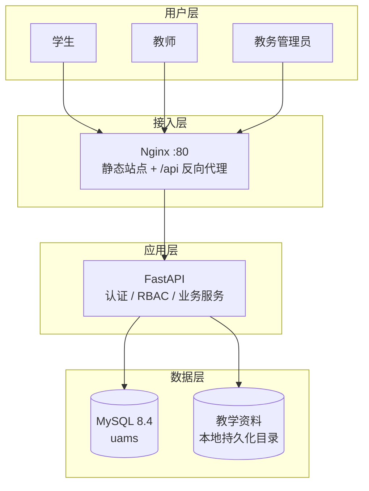
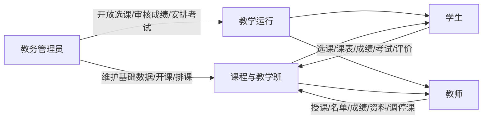
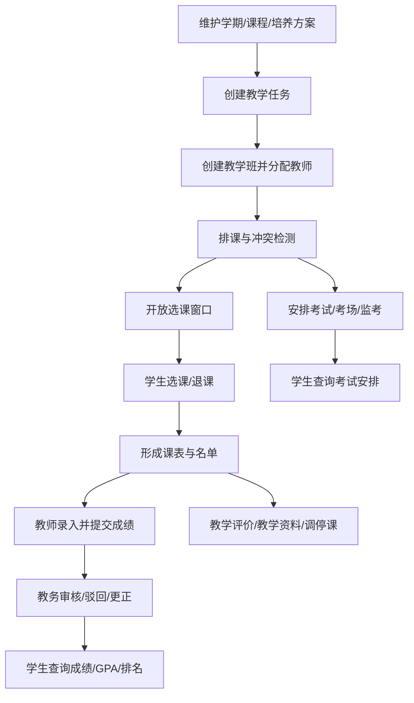
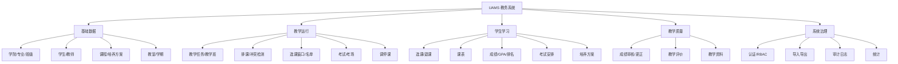

# UAMS 高校教务教学管理系统白皮书

## 高校教学管理数字化解决方案

> 文档版本：V3.2
> 发布日期：2026-10-29
> 适用对象：高校管理人员、教务管理部门、项目评审人员、潜在使用单位、非技术读者
> 系统状态：核心教务业务已实现，正式环境以 Nginx + systemd 运行，数据库 `uams`
> 说明：本文所述功能以当前代码与实际部署为准；未经验证的大规模并发、商业运营或安全认证能力不作宣称。

---

## 1. 执行摘要

UAMS（University Academic Affairs & Teaching Management System）是一套面向高校教学运行场景的多角色 Web 教务系统。系统围绕“课程如何开出来、学生如何选、教师如何教、成绩如何产生、考试如何安排、教务如何管理”建立完整业务链路，服务学生、教师和教务管理员三类核心用户。

系统采用浏览器访问、前后端分离架构：Nginx 提供前端静态站点并反向代理 API，FastAPI 提供业务接口，MySQL 保存教务数据。通过统一认证、基于角色的权限控制（RBAC）和对象级数据隔离，系统在同一平台上实现三类角色的业务协同。

当前版本已完成课程、培养方案、教学任务、教学班、排课、选课、课表、成绩、考试、评价、公告、教学资料、调停课、导入导出、审计与统计等核心模块，并完成正式数据库迁移与 Nginx + systemd 部署。系统适用于高校教务处的教学运行管理、课程设计与教学演示，以及后续扩展的试点环境。

UAMS 的定位不是通用低代码平台，也不是覆盖招生、财务、人事、科研等全部校务的“大平台”，而是**聚焦教学运行闭环的教务业务系统**。

---

## 2. 建设背景与行业需求

### 2.1 教务管理的复杂性

高校教学运行同时涉及组织、人员、课程、时间、空间与过程数据：

- 学院、专业、行政班、教师、学生构成组织结构；
- 培养方案规定专业课程与学分要求；
- 教学任务把课程落实到学期、学院与教师；
- 教学班承载授课、容量、名单与排课；
- 选课连接学生与教学班，并受时间、容量、年级与冲突约束；
- 成绩经历录入、提交、审核、发布与更正；
- 考试需要协调时间、教室、监考与学生冲突；
- 评价、公告、资料与调停课支撑日常教学运行。

这些数据彼此关联，任何单点错误都可能影响课表、成绩或毕业审核。

### 2.2 常见痛点

| 痛点 | 典型表现 | UAMS 的应对 |
|---|---|---|
| 数据分散 | 学生、课程、成绩分散在表格 | 统一数据模型与账号体系 |
| 排课冲突 | 教师/教室/班级时间撞车 | 后端冲突检测与拒绝写入 |
| 选课不可控 | 超容、重复选、窗口外选课 | 窗口、容量、年级、冲突统一校验 |
| 成绩流程不透明 | 谁改了什么无法追溯 | 提交/审核/更正状态机与变更历史 |
| 权限越界 | 教师看到非本人课程，学生看到他人成绩 | RBAC + 对象级访问控制 |
| 考试安排靠人工 | 教室、监考、学生冲突漏检 | 考试冲突检测与考场管理 |
| 资料散落 | 课件通过聊天工具传递 | 教学资料按教学班授权管理 |
| 审计缺失 | 关键操作无记录 | 登录与写操作审计日志 |

### 2.3 建设必要性

教务系统的价值不仅是“把表格搬到网页”，而是把业务规则固化到系统边界中：窗口是否开放、容量是否足够、成绩是否已审核、教师是否有权操作，这些判断必须由后端统一执行，避免“前端看起来可以、实际数据已错误”的情况。

---

## 3. 产品定位与建设目标

### 3.1 产品定位

UAMS 面向**单所高校的教学运行管理**，以教务处和二级学院为主要管理方，以学生和教师为直接使用者。系统强调业务闭环、数据一致性、权限边界和可运维性，适合作为：

- 高校教务处的教学运行支撑系统；
- 二级学院教学秘书的日常业务工具；
- 软件工程/课程设计项目的完整案例；
- 后续扩展学籍、毕业审核、教学分析的基础平台。

### 3.2 建设目标

1. 建立统一的账号、角色、权限与数据边界；
2. 打通课程、教学任务、教学班、排课、选课、成绩、考试的业务链路；
3. 将关键规则放入后端，防止绕过；
4. 让三类角色在各自工作台完成核心任务；
5. 提供可正式部署、可审计、可回滚的运行方案；
6. 为后续教学分析与扩展模块保留接口与数据结构。

### 3.3 非目标

- 不覆盖招生、财务、宿舍、图书馆、人事、科研、OA 等非教务业务；
- 不提供原生移动 App；
- 不替代在线直播教学平台；
- 不以商业 SaaS 多租户运营为目标；
- 不在当前阶段实现全自动智能排课。

---

## 4. 目标用户与使用场景

### 4.1 目标用户

| 用户 | 关注点 | 使用频率 |
|---|---|---|
| 教务管理员 | 基础数据、开课、排课、选课、成绩审核、考试、评价、审计 | 每日/每学期 |
| 教师 | 本人课程、名单、课表、成绩、资料、调停课 | 每周/学期节点 |
| 学生 | 选课、课表、成绩、考试、评价、资料 | 每周/学期节点 |
| 教学管理者 | 教学运行概览、统计、质量反馈 | 阶段性 |
| 评审/接手人员 | 架构、部署、测试、文档完整性 | 项目节点 |

### 4.2 典型场景

**场景 A：新学期开课**

教务维护学期与课程 → 创建教学任务 → 建教学班 → 分配教师 → 排课 → 开放选课 → 学生选课 → 课表形成。

**场景 B：成绩发布**

教师查看名单 → 录入成绩 → 保存草稿 → 提交 → 教务审核/驳回 → 学生查询成绩、GPA 与排名。

**场景 C：考试组织**

教务创建考试 → 设置时间/考场/监考 → 系统检测冲突 → 发布 → 学生查询考场与座位。

**场景 D：教学运行调整**

教师提交调课/停课/补课申请 → 教务审核 → 批准后系统原子更新排课 → 学生课表同步变化。

**场景 E：教学资料共享**

教师上传课件 → 仅本人教学班学生可下载 → 管理员可监管 → 资料不暴露为公共静态文件。

---

## 5. 系统整体解决方案

### 5.1 解决方案框架



### 5.2 三种角色的业务关系



### 5.3 典型教务业务流程



---

## 6. 产品功能架构

### 6.1 功能框架



### 6.2 核心功能矩阵

| 能力域 | 学生 | 教师 | 教务管理员 |
|---|:---:|:---:|:---:|
| 登录/改密 | ✔ | ✔ | ✔ |
| 个人/档案查看 | 本人 | 本人 | 全校 |
| 课程/培养方案 | 查看本专业 | 查看授课课程 | 维护 |
| 教学任务/教学班 | — | 查看本人 | 维护 |
| 排课 | 查看本人课表 | 查看本人课表 | 维护 + 冲突检测 |
| 选课/退课 | ✔（受窗口/容量等约束） | — | 窗口/名单/预安排 |
| 成绩 | 查看已发布 | 录入/提交 | 审核/驳回/更正 |
| GPA/排名 | 查看本人 | — | 统计 |
| 考试 | 查看本人 | 查看本人课程 | 维护/考场/发布 |
| 教学评价 | 提交 | 查看本人统计 | 任务/统计 |
| 教学资料 | 下载已选课程 | 上传本人课程 | 监管 |
| 公告 | 查看 | 查看 | 维护 |
| 调停课 | 课表同步 | 申请 | 审批 |
| 导入导出 | — | — | ✔ |
| 审计/统计 | — | 本人统计 | ✔ |

---

## 7. 核心业务流程

### 7.1 开课与选课

1. 教务建立学期并激活；
2. 维护课程与培养方案；
3. 创建教学任务，落实到学院与学期；
4. 创建教学班，分配教师、容量；
5. 安排教室、星期、节次、周次；
6. 开放选课，系统校验教师与排课前置条件；
7. 设置选课窗口与限定年级；
8. 学生查看可选课程并提交选课；
9. 后端校验窗口、容量、重复、同课程、时间冲突、先修；
10. 写入选课记录并形成课表。

### 7.2 成绩闭环

```text
教师生成名单 → 录入成绩 → 保存草稿 → 提交
        → 教务审核（通过/驳回）
        → 通过后学生可见
        → 如需修正：撤销审核或教务直接更正
        → 记录变更历史，重算学分/GPA
```

成绩总评由后端按课程考核结构统一计算，教师与前端不能直接决定总评。实践课必须分别录入理论/实践成绩，避免合并分被静默覆盖。

### 7.3 考试组织

考试创建时校验日期、时长、教室、监考、学生与排课冲突；考场容量不能超过教室容量，已分配考生的考场不能删除；发布前必须设置考场。

### 7.4 调停课

教师提交申请 → 教务审批 → 系统在单事务内修改/新增/删除排课 → 更新申请状态；并发审批通过行锁避免重复应用。

---

## 8. 系统技术特点

### 8.1 前后端分离

- 前端：Vue 3 + TypeScript + Vite + Element Plus；
- 后端：FastAPI + SQLAlchemy 2 + Pydantic v2；
- 数据库：MySQL 8.4（InnoDB / utf8mb4）；
- 部署：Nginx 静态站点 + `/api` 反向代理 + systemd 后端。

### 8.2 业务规则后端化

选课窗口、容量、成绩状态、权限归属等关键判断全部在后端执行。前端只负责展示与交互，不能通过修改请求绕过业务规则。

### 8.3 统一计算与状态机

成绩计算集中在统一服务，课程学时决定考核结构；成绩状态遵循 DRAFT → SUBMITTED → APPROVED/REJECTED 的流转，审核后教师不可直接修改。

### 8.4 数据一致性

选课、退课、成绩审核、调停课等关键操作使用事务；必要的行锁与唯一约束防止超容、重复与并发覆盖。

### 8.5 可运维性

后端由 systemd 管理，启动前校验实际数据库与 Alembic 版本；前端采用 release + current 软链原子发布，支持回滚；Nginx 与 systemd 日志可通过标准工具查询。

### 8.6 安全设计

- bcrypt 密码哈希；
- JWT 认证与有效期；
- RBAC 权限码；
- 对象级数据隔离；
- 登录失败锁定；
- 审计日志不记录密码/Token；
- 教学资料鉴权下载，不作为静态文件暴露。

---

## 9. 权限管理与数据安全

### 9.1 角色与权限

系统采用 `用户 → 角色 → 权限` 模型。权限码覆盖学生、教师、课程、教学、选课、成绩、考试、评价、公告、审计、统计等业务。教师可被授予教务管理员角色，形成双身份；管理员身份以角色为准，而不是仅看账号类型。

### 9.2 数据边界

| 角色 | 可见范围 |
|---|---|
| 学生 | 本人档案、课表、选课、成绩、考试、评价、公告、资料 |
| 教师 | 本人教学班、对应学生、成绩、课表、资料、调停课 |
| 教务管理员 | 全校教学业务数据 |

### 9.3 关键保护

- 后端对每个敏感接口执行权限校验；
- 教师查看学生/课表需属于本人教学班；
- 学生只能操作本人选课与成绩；
- 登录失败计数与临时锁定；
- 审计记录用户、动作、资源、结果、IP/UA，不记录敏感正文；
- 数据库账号只授权业务库，测试库与正式库分离。

---

## 10. 部署模式及运行环境

### 10.1 正式部署拓扑

```mermaid
flowchart LR
    B[浏览器] -->|HTTP :80| N[Nginx]
    N -->|静态文件| W[/var/www/uams/current]
    N -->|/api/| F[FastAPI 127.0.0.1:8000]
    F -->|SQLAlchemy/PyMySQL| M[(MySQL uams)]
    F --> U[教学资料目录]
```

### 10.2 运行环境

| 组件 | 当前版本/方式 |
|---|---|
| 操作系统 | Ubuntu（Linux 7.0 内核环境） |
| Python | 3.14.4 |
| FastAPI | 0.141.1 |
| SQLAlchemy | 2.0.52 |
| MySQL | 8.4.11 |
| Node.js | 22.22.1 |
| Nginx | 1.28.3 |
| 后端进程 | systemd `uams-backend.service` |
| 前端 | 构建产物 + Nginx |
| 数据库 | `uams`，Alembic head `e4f5a6b7c8d9` |

### 10.3 环境隔离

| 环境 | 数据库 | 启动方式 |
|---|---|---|
| 正式 | `uams` | Nginx + systemd |
| 测试 | `uams_test` | Vite + uvicorn（`start.sh --env testing`） |
| 恢复验证 | `uams_restore_20261027` | 版本匹配时允许，否则拒绝 |

测试脚本强制连接 `uams_test`，不允许误连正式库。

---

## 11. 应用价值

### 11.1 对教务管理部门

- 将基础数据、开课、排课、选课、成绩、考试集中管理；
- 关键规则由系统校验，减少人工核对；
- 成绩审核与变更留痕，便于追溯；
- 提供名单、成绩、选课结果导出。

### 11.2 对教师

- 在统一工作台查看本人课程、名单、课表；
- 成绩录入与提交流程清晰；
- 教学资料按课程共享；
- 调停课在线申请，减少线下沟通。

### 11.3 对学生

- 选课、课表、成绩、GPA、排名、考试集中查询；
- 选课失败有明确原因；
- 成绩与考试信息及时可见；
- 教学资料按已选课程获取。

### 11.4 对项目管理与评审

- 分层架构与统一文档便于评审；
- 测试、迁移、部署、回滚有据可查；
- 历史报告归档，当前文档聚焦使用；
- 可作为课程设计、软件工程实践与内部试点的完整案例。

> 本文不宣称具体高校客户、用户规模、经济收益或行业排名。

---

## 12. 实际实现成果

### 12.1 已实现

| 领域 | 成果 |
|---|---|
| 认证与权限 | 登录、改密、JWT、RBAC、对象级隔离、登录锁定 |
| 基础数据 | 学院、专业、班级、教室、学生、教师 |
| 课程与培养方案 | 课程、先修、方案、方案课程 |
| 教学运行 | 学期、教学任务、教学班、排课、冲突检测 |
| 选课 | 窗口、容量、年级、必修预安排、名单维护、退课 |
| 成绩 | 草稿、提交、审核、驳回、撤销、更正、历史、GPA/排名 |
| 考试 | 考试、考场、监考、冲突、排座、发布 |
| 质量与资源 | 评价任务/提交/统计、教学资料、公告、调停课 |
| 批量处理 | 学生/成绩导入，名单/课程/成绩/选课导出 |
| 治理 | 操作日志、统计、管理员与权限管理 |
| 部署 | Nginx 80、systemd 后端、MySQL、Alembic 版本校验 |
| 测试 | pytest 隔离库测试、前端构建、部署预检 |

### 12.2 交付形态

- 源码：FastAPI 后端 + Vue 前端；
- 数据库：MySQL 迁移链与正式库；
- 部署：Nginx 站点配置、systemd 服务、前端原子发布脚本；
- 文档：PRD、白皮书、技术文档、用户手册、API/数据库/部署/测试文档；
- 历史：审计、修复、部署报告归档。

### 12.3 验证边界

自动化测试覆盖核心回归与部分接口，**不等于对所有页面、所有权限组合和所有并发场景的完整覆盖**。正式环境已完成三角色主要页面非破坏性验收；未做大规模并发、长时间稳定性、跨浏览器矩阵与第三方安全测评。

---

## 13. 当前局限与适用边界

| 局限 | 说明 | 影响 |
|---|---|---|
| 单节点部署 | 一台服务器运行 Nginx/FastAPI/MySQL | 无高可用集群 |
| 本地文件存储 | 教学资料存本机磁盘 | 多实例需共享存储 |
| HTTP | 当前正式站点未配置 HTTPS | 传输安全需补强 |
| 无统一身份认证 | 独立账号体系 | 未对接 CAS/OAuth/LDAP |
| 无原生移动端 | PC Web 优先 | 手机体验有限 |
| 评价非严格匿名 | 数据库保留学生关联，接口聚合 | 隐私要求高时需改造 |
| 无自动备份调度 | 依赖人工 mysqldump | 需建立运维制度 |
| 未做性能压测 | 无并发量/响应时间承诺 | 大规模使用前需评估 |
| 无智能排课 | 人工排课 + 冲突检测 | 复杂约束需人工处理 |
| 功能边界 | 不覆盖招生/财务/人事等 | 需与其他系统集成 |

### 适用边界

UAMS 适合作为单校教务运行支撑、课程设计/毕业设计案例和内部试点；若用于大规模正式生产，应补充 HTTPS、备份、监控、性能测试、审计保留策略与运维制度。

---

## 14. 未来发展规划

| 阶段 | 方向 | 目标 |
|---|---|---|
| 近期 | HTTPS、自动备份、监控告警 | 提升正式运行安全性 |
| 近期 | 文件存储抽象/对象存储 | 支持多实例与资料归档 |
| 中期 | 学籍异动、毕业审核、学分预警 | 扩展教务闭环 |
| 中期 | 通知中心（邮件/站内） | 选课、成绩、考试、调停课通知 |
| 中期 | 统计分析与教学质量管理 | 更完整的教学决策支持 |
| 远期 | 智能排课与学业风险分析 | 在规则与数据稳定后评估 |
| 远期 | 统一身份认证/多校区 | 结合学校基础设施 |

规划内容不代表当前已实现；实施前需单独评估需求、数据与安全影响。

---

## 15. 总结

UAMS 以教学运行闭环为核心，把课程、教学班、排课、选课、成绩、考试、评价、资料与调停课组织为可运行、可校验、可审计的系统。其价值在于：

- 用统一数据模型减少分散维护；
- 用后端规则保证选课、成绩与考试的准确性；
- 用角色与对象级权限保护数据边界；
- 用正式部署方案支撑长期运行；
- 用文档、测试与历史归档支撑交付与维护。

当前版本已完成核心功能与正式部署，适用于高校教务运行支撑、教学演示与后续扩展的基础平台。对于 HTTPS、自动备份、性能与高可用等生产级能力，仍需在真实使用规模下持续建设。

> 本白皮书不虚构客户、用户数量、经济收益或行业排名；所有实现描述以当前代码、数据库与正式部署状态为准。
